# 단계별 실습 · 개인 v8 · 텍스트 템플릿

[복붙 텍스트 팩](../../복붙템플릿.zip)을 내려받고 사본의 빈칸만 수정합니다. Claude 요청·셸 명령·파일 내용을 구분합니다. A8은 앱의 자동 호출입니다.

## 01. 오늘 만들 결과와 진행 방식

오전 · 설명과 강사 시연 · Module 1

### 함께 배우고 이어 가는 곳 · 모두의연구소

모두의연구소는 AI/SW 교육과 연구 커뮤니티를 함께 운영합니다. 관심 있는 주제를 함께 연구하는 **LAB**, 스터디와 경험을 나누는 **모두모임**, 무료 AI/SW 세미나 **모두팝**이 있습니다. 오늘 궁금했던 주제는 수업 이후에도 커뮤니티에서 이어 갈 수 있습니다.

업무에 AI를 활용하는 학습을 이어 가고 싶다면 **직장인 AI** 프로그램의 교육·세미나를 살펴보세요. [모두의연구소 · 세미나 보기](https://modulabs.co.kr/#main-seminar)

### 오늘 함께할 강사 · 박성훈

**LeanX · AX 컨설턴트 · AI 활용 강사**

- **모두의연구소** · 재직자 대상 AI 서비스 기획·바이브코딩 교육

- **패스트캠퍼스** · AI PM 과정 강의, INNER CIRCLE 멘토링

- **생성형 AI 실무 교육** · 엑셀 자동화·문서 처리·반복 업무 개선

“어디에 입력하나요?”부터 질문해 주세요. 오늘은 작은 기능부터 만들고, 실제로 실행하고, 내 업무에 다시 쓰는 과정을 함께 해 보겠습니다.


박성훈 · AX 컨설턴트·AI 활용 강사

### 가볍게 시작하기 · 지금의 내 경험

정답을 찾는 질문이 아닙니다. 편한 질문 하나를 말로 답하거나 아래에 적어 보세요. 마지막 질문에 적은 업무는 수업을 마칠 때 다시 보겠습니다.

짧은 메모는 아래 입력칸에서 적고 복사합니다. **같은 기기·같은 브라우저에서 이 사이트를 다시 열면 이어서 쓸 수 있습니다.** 다른 기기로 옮길 때는 복사하거나 내 실습 기록을 내려받습니다.

**내 메모**

AI에게 업무를 부탁해 본 적 있나요?

메모는 [개인 실습 기록지](notes/내업무_실습기록.md) 사본에 적습니다.

지금 가장 낯선 것은 무엇인가요?

메모는 [개인 실습 기록지](notes/내업무_실습기록.md) 사본에 적습니다.

오늘 끝나면 어떤 반복 업무를 줄이고 싶나요?

메모는 [개인 실습 기록지](notes/내업무_실습기록.md) 사본에 적습니다.

입력한 모든 칸을 항목 이름과 함께 복사합니다.

### 오늘 무엇을 가져가나요?

- 자연어로 **작은 웹페이지를 만들고 직접 눌러 봅니다.**

- 내 자료로 **업무 자동화 스크립트와 보고서를 완성합니다.**

- 규칙·스킬·3명 팀을 설정하고 **같은 일을 다시 실행합니다.**

| 흐름 | 할 일 | 남는 결과 |
| --- | --- | --- |
| 오전 · 이해와 시연 | 터미널·AI·의도·기획·프롬프트와 에이전트의 작업 방식 보기 | 내 업무의 입력·결과·확인 기준 |
| 오후 · 직접 만들기 | 체크리스트 → 회의록 스킬 → Excel 비용 보고서 | index.html · 내 SKILL.md · 회의록 · 자동화 스크립트 |
| 오후 · 다시 쓰기 | CLAUDE.md → 3명 팀 → 실행기·자동 갱신 → Gmail 초안 | 다음 주 보고서 · 재사용 환경 · 메일 초안 |

**오늘 만들 보고서 예시:** [총액·건수·공유 문안이 있는 비용 보고서 열기](examples/주간비용_완성예시.html)

오늘은 내 컴퓨터에서 작동하는 작은 도구와 재사용까지 다룹니다. 상용 서비스의 회원가입·결제·24시간 서버 운영은 다루지 않습니다.

### 먼저, 오늘 가져갈 결과를 봅니다

회의 메모를 매번 다시 정리하고 Excel을 보고 보고서를 쓰고 공유 메일을 붙여 넣는 일을 떠올려 보세요. 오늘은 작은 웹 도구로 시작해 **회의록 스킬을 만들고** 비용 보고서를 반복 실행하는 흐름까지 연결합니다.

[주간 비용 보고서 완성 예시 열기](examples/주간비용_완성예시.html) · 가상 자료 40건·2,333,300원

강사가 예시의 총액·부서별 금액·진행 건수를 보여 줍니다. “Excel 금액을 바꾸면 어디가 달라질까요?”를 먼저 생각해 보고 뒤의 시연에서 실제 변화를 봅니다.

완성 예시·개념작은 도구내 업무 자료재사용·자동화

| 배울 묶음 | 내가 하는 일 | 남는 결과 |
| --- | --- | --- |
| 작은 웹 · 첫 성공 | 스펙을 읽고 체크리스트를 만들기 → 인터뷰로 기능 한 개 추가 | 추가·완료·보존이 되는 HTML |
| 회의록 · 내 기준 저장 | 보고 기준 인터뷰 → 스킬 작성·수정 → 외부·내부 메모에 적용 | meeting-minutes 스킬과 회의록 2개 |
| 비용 보고 · 반복 업무 완성 | 비용 계산 절차를 내 자료·공통 예제에서 재사용하고 규칙·팀·자동화로 발전시키기 | 내 스크립트·보고서·반복 실행 기록·Gmail 초안 |

오전에는 개념과 강사 시연을 봅니다. **오후에는 개인별로 실행**합니다. 다음 단계에서 만드는 파일이 앞 단계의 자료나 결과를 어떻게 사용하는지 확인하며 따라갑니다.

[수업 자료 찾아 쓰기 MD 내려받기](templates/수업자료_찾아쓰기.md) · 지금 단계의 TXT 한 개를 골라 사용합니다.

### 처음 보는 창이어도 괜찮습니다 · 왜 터미널을 쓸까요?

터미널은 **글자로 프로그램을 켜고 결과를 보는 창**입니다. Windows에서는 PowerShell, macOS에서는 터미널을 엽니다. 오늘은 이 창에서 Claude Code를 켜고 한국어로 일을 부탁합니다.

코드를 외울 필요는 없습니다. **현재 위치 보기 → 폴더로 이동하기 → Claude 켜기**처럼 필요한 명령 몇 개를 써 봅니다. AI가 만든 파일과 실행 결과를 같은 흐름으로 볼 수 있어 이 창을 사용합니다.

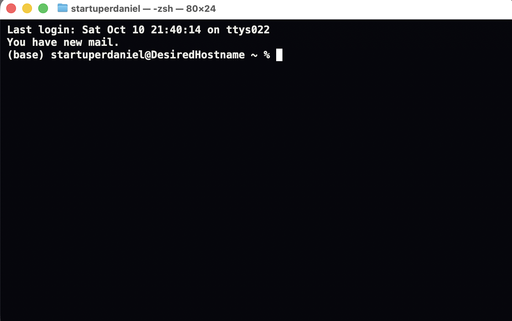

macOS · % 오른쪽 커서에 명령을 입력합니다.

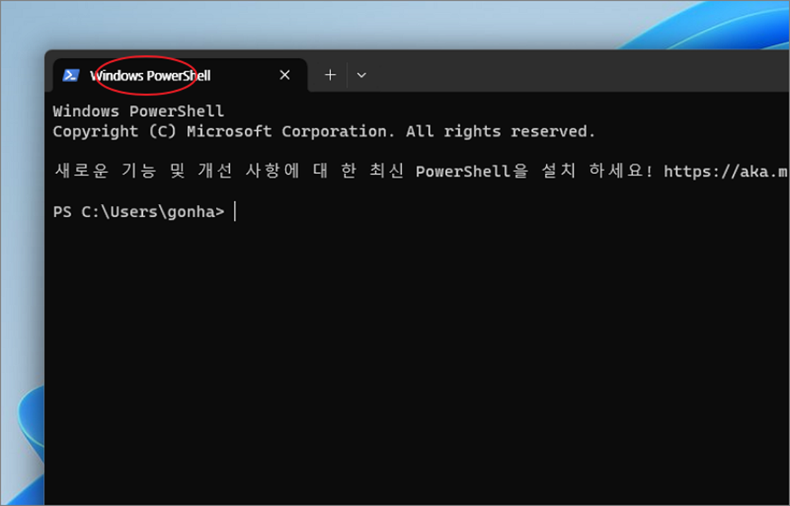

Windows · PS C:\…> 오른쪽 커서에 명령을 입력합니다.

| 화면에서 할 일 | 입력 예 |
| --- | --- |
| 프로그램을 켜기 · PowerShell/터미널 | claude |
| AI에게 일 부탁하기 · 열린 Claude Code 안 | 이 폴더의 파일 목록을 보여줘 |

지금은 두 화면의 차이만 봅니다. 기본 명령과 폴더 이동은 다음 터미널 단계에서 하나씩 해 봅니다.

### 왜 지금 배우나요? · 답변을 받아 도구와 반복 업무로

AI로 글을 받는 데서 시작해, 내 파일로 도구를 만들고 같은 일을 다시 실행하는 흐름으로 넓혀 갑니다. 이 수업도 그 순서를 따라갑니다.

**답변 받기**회의 메모를 요약해 달라고 부탁하기

**결과 만들기**회의록 파일과 작은 웹페이지 만들기

**다시 쓰기**다음 메모·Excel로 같은 절차 실행하기

**내 업무를 아는 사람이 무엇을 만들지 정합니다.** AI에게 계획·제작을 맡기고, 실제 결과를 확인하는 방법을 배우겠습니다.

**최근 연구·사례와 출처 보기**

### 최근 흐름 · 답변을 받는 AI에서 일을 맡기는 AI로

2026년 연구·사례와 2025년부터 이어진 스킬 확산을 골라 봅니다. 아래 앞의 세 항목은 공개 연구와 구현 사례이며 마지막 보고서는 2026년의 전망입니다. 모두가 같은 방식으로 일한다는 뜻은 아닙니다.

| 확인한 흐름 | 비개발자에게 중요한 것 | 우리 수업의 예 |
| --- | --- | --- |
| 업무 지식과 기획의 역할 · 2026-06-16 연구 | 관찰된 사용에서 사람의 기획·업무 전문성이 결과와 연결됨. [사용 연구](https://www.anthropic.com/research/claude-code-expertise) | 팀장이 무엇을 보고 판단할지 내가 정하기 |
| 절차를 파일로 남기는 스킬 · 2025-10-16, 표준 공개 2025-12-18 | 지시·자료·절차를 스킬로 묶어 필요한 업무에 사용. [Agent Skills 사례](https://www.anthropic.com/engineering/equipping-agents-for-the-real-world-with-agent-skills) | 내 회의록 기준을 SKILL.md로 저장해 다른 메모에 재사용 |
| 작업 환경과 별도 검수 · 2026-03-24 사례 | 하네스에 작업 기록·역할·검사 기준을 준비. 작성과 평가를 나눔. [하네스 사례](https://www.anthropic.com/engineering/harness-design-long-running-apps) | 제공 규칙·도구·3명 팀으로 숫자와 결과를 확인 |
| 한 번의 답변보다 작업 흐름 · 2026 전망 | 테스트·디버깅·문서까지 이어지는 흐름을 전망. [2026 트렌드 보고서](https://claude.com/resources/guides/2026-agentic-coding-trends-report) | 만들기 → 확인 → 다음 입력으로 다시 실행 → 파일 변경 자동화 |

오른쪽의 한빛화학·체크리스트 예는 수업에 맞춰 만든 적용 예입니다. 공식 자료의 고객 사례나 성공 수치로 소개하지 않습니다.

내 의도·기준AI 계획·실행실제 확인절차 저장·재사용

더 센 모델을 고르는 것만으로 해결되지는 않습니다. 무엇을 만들지·어떤 자료를 볼지·무엇을 확인할지를 정하는 연습으로 이어갑니다.

### 오전 3H 설명·시연 → 오후 5H 개인 실습

오전에는 터미널·의도·스펙·프롬프트·에이전트가 일하는 환경을 충분히 설명하고 강사가 시연합니다. 학생의 모델 요청과 도구 제작은 오후에 시작합니다. 단계별 시간표 대신 완성한 결과를 확인합니다.

자료는 가상의 한빛화학 화장품 영업부서입니다. 스펙과 설명은 MD, 실행 요청은 수정해서 복사할 TXT로 제공합니다. 미팅 메모와 제품·보고 기준도 준비돼 있습니다.

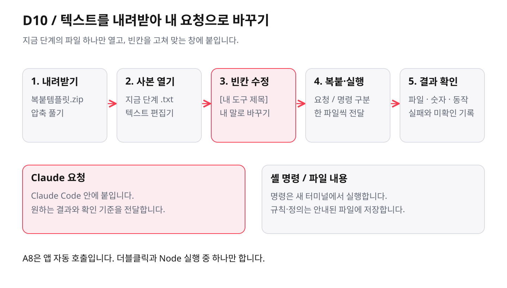

**D10 · 텍스트를 내려받아 내 요청으로 바꾸기**
내려받기 → 빈칸 수정 → 맞는 곳에 복붙 → 실제 결과 확인. · 직접 그린 설명 도식이며 실제 제품 화면이 아닙니다. 이미지를 눌러 확대할 수 있습니다.

**도식 내용을 글로 읽기**

- 복붙템플릿.zip을 내려받아 풀고 지금 단계의 .txt를 사본으로 엽니다.

- 대괄호 빈칸만 수정합니다. 설명은 사용순서 파일에, 실제 요청과 명령은 각 텍스트 파일에 있습니다.

- Claude_ 파일은 Claude Code 안에, 셸 명령은 새 터미널에 붙입니다. 파일내용은 지정된 .md 파일에 저장합니다.

- 실제 결과와 검사 기준을 확인합니다. A8은 앱이 자동으로 보내며 수동 요청 파일이 없습니다.

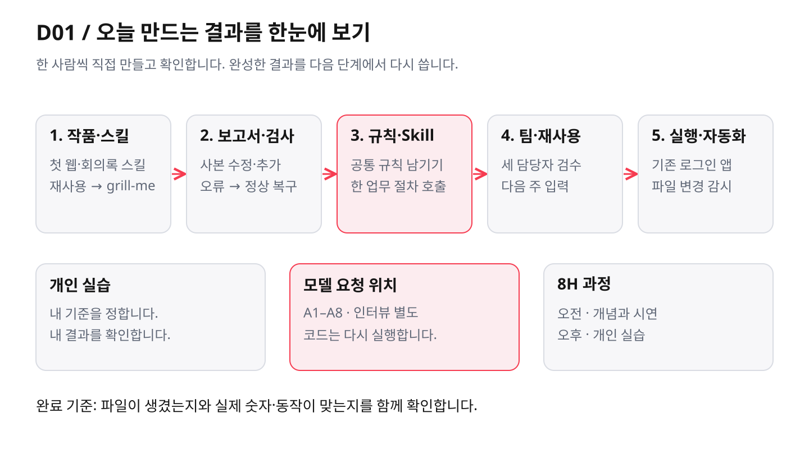

**D01 · 오늘 만드는 결과를 한눈에 보기**
결과를 만들고 → 직접 확인하고 → 같은 일을 다시 실행하는 개인 실습입니다. · 직접 그린 설명 도식이며 실제 제품 화면이 아닙니다. 이미지를 눌러 확대할 수 있습니다.

**도식 내용을 글로 읽기**

- 오전 설명·시연 뒤 오후에 체크리스트와 회의록 스킬을 만들고 Excel 보고서의 숫자와 오류를 확인합니다.

- CLAUDE.md와 Skill로 절차를 남긴 뒤 세 담당자에게 위임하고 새 입력에 재사용합니다.

- 같은 비용 업무를 로그인 실행 버튼과 파일 변경 감시로 실행합니다.

- 개인 실습이며 A1–A8와 스킬 인터뷰 요청을 구분합니다. 오전 3H는 설명·강사 시연, 오후 5H는 개인 실습입니다.

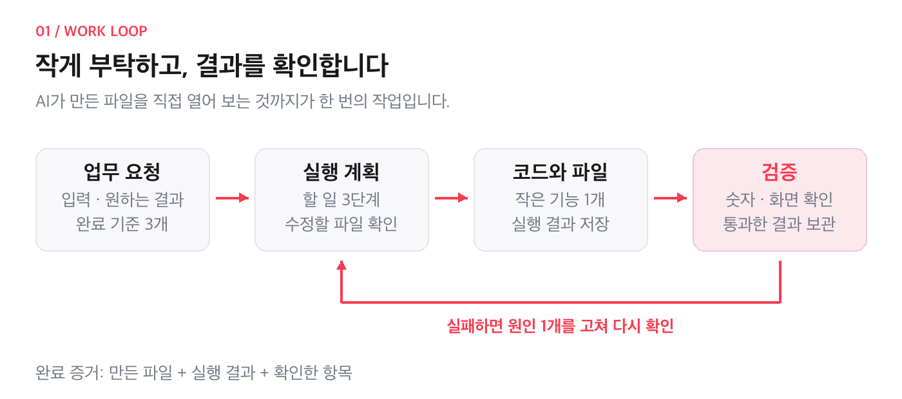

설명 도식 · 만들기와 반복 실행을 구분합니다. · 이미지를 누르면 크게 볼 수 있습니다.

### 07 첫 실습 전에 배우는 순서

- 파일·코드·브라우저·터미널: 무엇이 실행되고 어디에 결과가 남는지

- 바이브 코딩과 에이전틱 코딩: 말로 만들기와 계획·도구·검사까지 맡기기

- 의도와 기획: 누가 쓸지, 무엇을 넣을지, 무엇이면 완료인지

- 프롬프트·메타프롬프트·Spec Driven: 요청과 기준을 파일로 남기는 방법

- 최근 흐름과 규칙·스킬·하네스·팀: 다음에도 같은 방식으로 일할 환경

- 강사 시연을 본 뒤 오후에 claude → /model → 첫 응답 → 체크리스트 제작

[첫 실습 전 개념·최근 흐름 MD 내려받기](templates/00_첫실습전_개념과최근흐름.md) · 오전은 설명과 강사 시연입니다.

**전체 진행 순서 보기**

| 할 일 | 완료할 결과 |
| --- | --- |
| 01. 오늘 만들 결과와 진행 방식 | 필수 결과와 개인 실습 순서를 이해합니다. |
| 02. 터미널이 하는 일과 화면 준비 | 기본 명령과 작업 폴더 이동을 강사 시연으로 이해합니다. |
| 03. 바이브 코딩 · 의도·기획·프롬프트 | 의도를 기획으로 구체화하고 직접 요청·메타프롬프트·검증의 역할을 구분합니다. |
| 04. 에이전틱 코딩 · AI가 일하는 흐름 | AI의 작업 흐름과 사람이 결정·검토할 부분을 구분합니다. |
| 05. 시연 · 만들고 검증하고 다시 쓰기 | 요청·실행·오류·복구를 구분하고 오후 실습을 준비합니다. |
| 06. 내 실습 환경과 실제 응답 확인 | Claude를 켜고 /model에서 모델을 선택한 뒤 첫 응답을 확인합니다. |
| 07. 내 첫 체크리스트 만들기 | 첫 실제 도구를 만들고 직접 확인합니다. |
| 스킬을 직접 만들고 회의 메모에 적용하기 | 인터뷰한 기준의 회의록 스킬과 외부·내부 회의록을 남깁니다. |
| 08. /grill-me로 내 기능 정하고 구현 | 인터뷰한 기능을 구현하고 고객 추가·검색·상태 변경·브라우저 저장을 확인합니다. |
| 09. 내 도구 확인하고 사본 보관 | 혼자 확인한 동작과 복구 방법을 기록합니다. |
| 10. 비용 보고서의 입력과 완성 예시 | 원본과 완성 결과의 연결을 이해합니다. |
| 11. 내 Excel 사본 수정·추가 | 내 사본을 수정하고 숫자 변화를 확인합니다. |
| 12. 보고서와 공유 문안 만들기 | 사실·기준·비교·맥락으로 보고서 5종을 만들고 숫자를 대조합니다. |
| 13. 오류를 확인하고 정상 입력으로 복구 | 오류 중단·정상 결과 보존·복구를 직접 확인합니다. |
| 14. 내 데이터로 업무 자동화 스크립트 완성 | 내 비용 데이터와 기준으로 실행하는 scripts/my-workflow.cjs, 보고서, 복구 기록을 남깁니다. |
| 15. 내 업무 메모에 첫 결과 남기기 | 내가 줄일 업무와 첫 작업을 한 문단으로 정리합니다. |
| 16. 반복 설명을 CLAUDE.md에 남기기 | 공통 규칙과 업무 절차를 구분합니다. |
| 17. 보고서 절차를 Skill로 실행하기 | 반복 절차를 긴 프롬프트 대신 Skill로 호출합니다. |
| 18. 정규 실습 · 서브에이전트 3명 구축 | 3명 팀의 실제 호출과 각 역할의 결과·검사를 확인합니다. |
| 19. 같은 Skill로 다음 주 보고서 만들기 | 새 데이터로 같은 절차를 재사용합니다. |
| 20. 로그인된 Claude Code로 보고서 실행기 만들기 | 기존 로그인으로 Excel 분석 보고서를 만드는 로컬 실행 도구를 완성하고 확인합니다. |
| 21. 파일이 바뀌면 자동 보고서 갱신 | 자동 생성부터 변경 감지·건너뛰기·오류·종료까지 직접 경험합니다. |
| Gmail MCP 연결과 메일 초안 | Gmail에 메일 초안 한 개를 저장하고 직접 확인합니다. |
| 22. 실행 카드로 혼자 다시 실행 | 새 세션과 카드만으로 개인 재사용을 검증합니다. |
| 23. 내 작품 확인과 짧은 시연 | 개인 결과와 실제 검증 근거를 정리합니다. |
| 24. 제출하고 다음 사용 정하기 | 개인 결과를 제출하고 다음 실행을 정합니다. |

[실습자료 ZIP](../../실습자료.zip) · [복붙 텍스트 ZIP](../../복붙템플릿.zip) · [사전 준비](../../사전준비.md)

짧은 메모와 빈칸 요청은 화면에서 수정하고 복사합니다. 긴 설치 내용과 반복해서 쓸 전체 템플릿은 TXT로 내려받을 수 있습니다.

## 02. 터미널이 하는 일과 화면 준비

오전 · 설명과 강사 시연 · Module 1

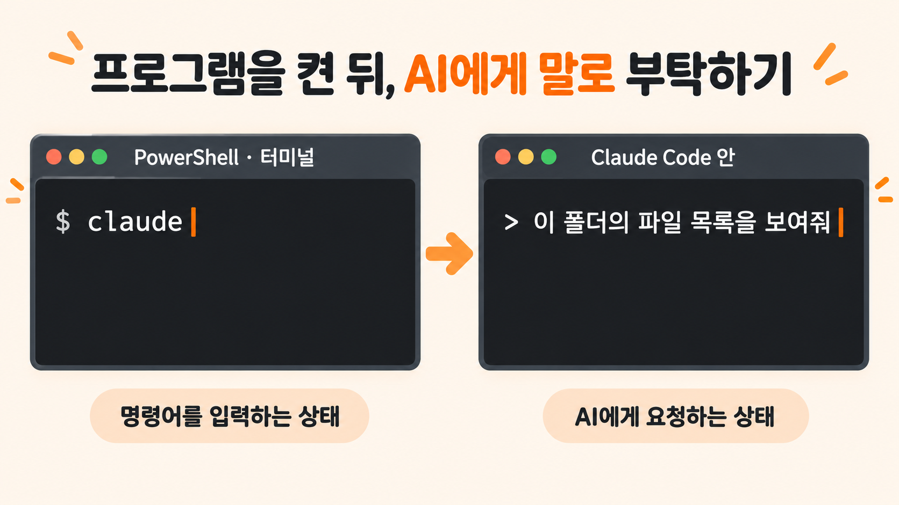

AI 생성 설명 그림 · 터미널 화면 설명 그림 · 실제 시작 화면 캡처는 초반 안내에 있습니다

오전에는 강사가 명령을 실행하고 설명합니다. 오후 시작에서 같은 순서로 직접 준비합니다.

### 터미널은 일을 실행하는 창입니다

Windows에서는 PowerShell, macOS에서는 터미널을 사용합니다. 이 창에서 Claude Code를 켜고 내 파일로 일을 맡깁니다. 파일은 파일 탐색기나 Finder에서, 결과 HTML은 브라우저에서 봅니다.

### 1. PowerShell 또는 터미널 켜기

| 내 컴퓨터 | 여는 방법 |
| --- | --- |
| Windows | 시작 메뉴에서 PowerShell 검색 → Windows PowerShell 열기 |
| macOS | Command + Space → 터미널 검색 → Enter |

내 운영체제의 화면을 봅니다. 계정 이름과 경로는 컴퓨터마다 다릅니다. 이미지를 누르면 크게 볼 수 있습니다. 커서에 명령 한 줄을 입력하고 Enter를 누르면 실행됩니다.

### 2. 기본 명령 · 강사 시연으로 먼저 보기

**터미널에는 “지금 있는 폴더”가 있습니다.** 파일 탐색기에서 폴더를 더블클릭하듯, 터미널에서는 cd로 폴더에 들어갑니다. 명령은 **지금 있는 폴더를 기준**으로 실행됩니다.

| 명령 | 쉬운 뜻 | 예시 |
| --- | --- | --- |
| pwd | 지금 어디에 있는지 보기 | 현재 폴더의 전체 경로가 나온다 |
| ls | 지금 폴더 안에 무엇이 있는지 보기 | 파일과 폴더 이름이 나온다 |
| mkdir | 새 폴더 만들기 | mkdir terminal-practice |
| cd | 다른 폴더로 이동하기 | cd terminal-practice |
| cd .. | 한 단계 위 폴더로 돌아가기 | ..은 바로 위 폴더를 뜻한다 |

아래 연습은 Windows PowerShell과 macOS 터미널에서 같은 명령을 씁니다. **한 줄씩 실행하고 결과를 봅니다.** 폴더 이름 terminal-practice는 “터미널 연습”이라는 뜻입니다.

**내 사용자 폴더에서 시작:** ~는 내 사용자 폴더입니다. 내 문서와 다운로드 폴더가 있는 곳에서 시작합니다.

[텍스트 내려받기 · 00a_사용자폴더로이동.txt](templates/복붙텍스트/셸명령/00a_사용자폴더로이동.txt)

P108 · 셸 · 기본 명령 연습 · 내 사용자 폴더에서 시작

```text
cd ~
```

**왜 이렇게 요청하나요?**

- **명령 한 줄**: 현재 위치 확인·폴더 이동·프로그램 시작 중 위 단계에서 안내한 행동을 합니다. Claude에게 보내는 요청과 입력창이 다릅니다.

**지금 위치 확인:** 내 사용자 폴더의 전체 경로가 보입니다.

[텍스트 내려받기 · 00_pwd_폴더확인.txt](templates/복붙텍스트/셸명령/00_pwd_폴더확인.txt)

P109 · 셸 · 기본 명령 연습 · 지금 위치 확인

```text
pwd
```

**왜 이렇게 요청하나요?**

- **명령 한 줄**: 현재 위치 확인·폴더 이동·프로그램 시작 중 위 단계에서 안내한 행동을 합니다. Claude에게 보내는 요청과 입력창이 다릅니다.

**연습 폴더 만들기:** 빈 폴더 하나를 만듭니다. 만들었다고 그 안으로 이동하지는 않습니다. 이미 있다는 메시지가 나오면 다음 단계로 갑니다.

[텍스트 내려받기 · 00b_연습폴더만들기.txt](templates/복붙텍스트/셸명령/00b_연습폴더만들기.txt)

P110 · 셸 · 기본 명령 연습 · 연습 폴더 만들기

```text
mkdir terminal-practice
```

**왜 이렇게 요청하나요?**

- **명령 한 줄**: 현재 위치 확인·폴더 이동·프로그램 시작 중 위 단계에서 안내한 행동을 합니다. Claude에게 보내는 요청과 입력창이 다릅니다.

**만든 폴더 찾기:** 목록에서 terminal-practice를 찾습니다. 다른 파일도 함께 보여도 괜찮습니다.

[텍스트 내려받기 · 00_ls_폴더확인.txt](templates/복붙텍스트/셸명령/00_ls_폴더확인.txt)

P111 · 셸 · 기본 명령 연습 · 만든 폴더 찾기

```text
ls
```

**왜 이렇게 요청하나요?**

- **명령 한 줄**: 현재 위치 확인·폴더 이동·프로그램 시작 중 위 단계에서 안내한 행동을 합니다. Claude에게 보내는 요청과 입력창이 다릅니다.

**연습 폴더에 들어가기:** 같은 pwd 명령을 다시 실행해 경로 끝에 terminal-practice가 붙었는지 봅니다. cd는 폴더를 만들지 않고 이동합니다.

[텍스트 내려받기 · 00c_연습폴더들어가기.txt](templates/복붙텍스트/셸명령/00c_연습폴더들어가기.txt)

P112 · 셸 · 기본 명령 연습 · 연습 폴더에 들어가기

```text
cd terminal-practice
```

**왜 이렇게 요청하나요?**

- **명령 한 줄**: 현재 위치 확인·폴더 이동·프로그램 시작 중 위 단계에서 안내한 행동을 합니다. Claude에게 보내는 요청과 입력창이 다릅니다.

**한 단계 위로 돌아가기:** pwd를 다시 실행하면 처음의 사용자 폴더로 돌아와 있습니다.

[텍스트 내려받기 · 00d_상위폴더로이동.txt](templates/복붙텍스트/셸명령/00d_상위폴더로이동.txt)

P113 · 셸 · 기본 명령 연습 · 한 단계 위로 돌아가기

```text
cd ..
```

**왜 이렇게 요청하나요?**

- **명령 한 줄**: 현재 위치 확인·폴더 이동·프로그램 시작 중 위 단계에서 안내한 행동을 합니다. Claude에게 보내는 요청과 입력창이 다릅니다.

사용자 폴더연습 폴더 만들기연습 폴더 들어가기위 폴더로 돌아오기

**직접 확인:** mkdir 뒤에는 위치가 그대로이고 cd 뒤에는 위치가 바뀌었나요? 여기까지 하면 폴더 만들기와 이동하기의 차이를 경험한 것입니다.

### 3. 바탕화면에 자료를 풀고 작업 폴더로 이동하기

- 실습자료.zip을 바탕화면에 압축을 풉니다. Windows는 ZIP을 오른쪽 클릭 → 모두 압축 풀기 → 대상 위치를 바탕화면으로 선택합니다. macOS는 ZIP을 바탕화면으로 옮기고 더블클릭합니다.

- 파일 탐색기 또는 Finder에서 압축이 풀린 claude-work-lab 폴더를 찾습니다. ZIP 안이 아닌 실제 폴더이며 안에 workbooks·templates·integrations가 있어야 합니다. 압축 해제 도구가 바깥 폴더를 하나 더 만들었다면 그 안의 claude-work-lab을 찾습니다.

- Windows: claude-work-lab 안에서 파일 탐색기 주소 표시줄을 클릭해 전체 경로를 복사합니다. macOS: Finder에서 claude-work-lab 폴더 자체를 선택하고 Command + Option + C로 경로를 복사합니다.

- 아래 텍스트를 내려받아 메모장이나 텍스트 편집기로 엽니다. 대괄호 부분만 복사한 경로로 바꾸고 큰따옴표는 남깁니다.

- 완성한 한 줄을 PowerShell 또는 터미널에 붙이고 Enter를 누릅니다.

[텍스트 내려받기 · 00_실습폴더로이동.txt](templates/복붙텍스트/셸명령/00_실습폴더로이동.txt)

P114 · 셸 · PowerShell 또는 macOS 터미널 · 실습 폴더로 이동

```text
cd "[claude-work-lab 폴더의 전체 경로]"
```

**왜 이렇게 요청하나요?**

- **명령 한 줄**: 현재 위치 확인·폴더 이동·프로그램 시작 중 위 단계에서 안내한 행동을 합니다. Claude에게 보내는 요청과 입력창이 다릅니다.

앞에서 쓴 pwd와 ls를 다시 실행합니다. 경로가 claude-work-lab이고 목록에 workbooks·templates·integrations가 보이면 이동한 것입니다. Windows에서 바탕화면 경로에 OneDrive가 포함돼도 그대로 복사합니다.

**여기까지 되면:** 실행 창의 현재 위치가 claude-work-lab입니다. 다음 단계에서는 claude로 시작하고 Claude 안에서 /model로 모델을 선택합니다.

### 4. 명령과 요청 구분하기

| 지금 상태 | 넣을 것 |
| --- | --- |
| Claude를 켜기 전의 PowerShell·터미널 | cd·node·claude 같은 실행 명령 |
| Claude Code를 켠 뒤 | 한국어 요청 또는 /grill-me 같은 호출 |

Claude가 실행 중인데 node 명령을 써야 하면 PowerShell이나 터미널 창을 하나 더 엽니다. **새 창에서도 위 cd 명령으로 같은 실습 폴더에 먼저 들어갑니다.** 그다음 node 명령을 실행합니다. /login은 Claude 안에 입력합니다.

폴더를 찾을 수 없다고 나오면 대괄호 예시를 실제 경로로 바꿨는지, 압축을 푼 폴더인지 확인합니다. 공백이 있는 경로도 큰따옴표 안에 넣습니다.

### 오후 준비에서 직접 해 보기

- 내 컴퓨터의 실행 창을 열고 실습 폴더로 이동합니다.

- 명령과 한국어 요청을 어느 상태에서 입력할지 구분합니다. 다음 단계에서 Claude를 직접 시작해 두 상태를 봅니다.

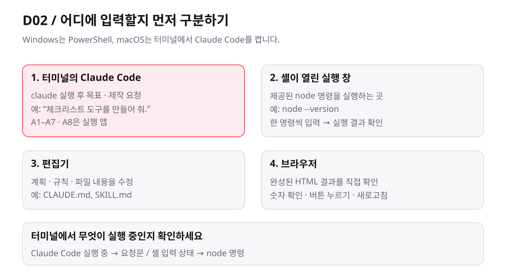

**D02 · 어디에 입력할지 먼저 구분하기**
Claude Code도 터미널 안에서 사용합니다. 요청과 셸 명령의 입력 위치를 확인합니다. · 직접 그린 설명 도식이며 실제 제품 화면이 아닙니다. 이미지를 눌러 확대할 수 있습니다.

**도식 내용을 글로 읽기**

- 터미널에서 claude를 실행한 뒤 Claude Code의 입력란에 목표와 제작 요청을 입력합니다. A8은 앱이 내부에서 보냅니다.

- node 명령은 셸이 열린 실행 창에서 실행합니다. Claude Code가 실행 중인 입력란과 구분합니다.

- 편집기에서는 파일의 규칙과 계획을 수정합니다. 브라우저에서는 실제 결과의 숫자와 동작을 확인합니다.

### 이후에 쓸 프로그램 실행 명령

| 명령 | 쉬운 뜻 |
| --- | --- |
| claude | Claude Code 시작 |
| node | 제공된 업무 프로그램 실행 |

폴더 이동은 앞에서 연습한 cd를 씁니다. 프로그램 실행 명령은 다음 준비 단계에서 제공합니다.

**내 메모**

내 실습 폴더 경로

메모는 [개인 실습 기록지](notes/내업무_실습기록.md) 사본에 적습니다.

입력할 창 구분하기

메모는 [개인 실습 기록지](notes/내업무_실습기록.md) 사본에 적습니다.

입력한 모든 칸을 항목 이름과 함께 복사합니다.

### 화면 연습 · 버튼을 눌러 두 입력 상태 익히기

웹 안의 연습 화면입니다. 실제 파일이나 프로그램을 실행하지 않습니다. **pwd → ls → claude**를 눌러 보고, 열린 Claude Code 안에서는 한국어 요청을 눌러 봅니다.

PowerShell · 화면 연습

```text

```

PS C:\Users\학생>

지금은 PowerShell/터미널에 명령을 입력하는 상태입니다.

## 03. 바이브 코딩 · 의도·기획·프롬프트

오전 · 설명과 강사 시연 · Module 1

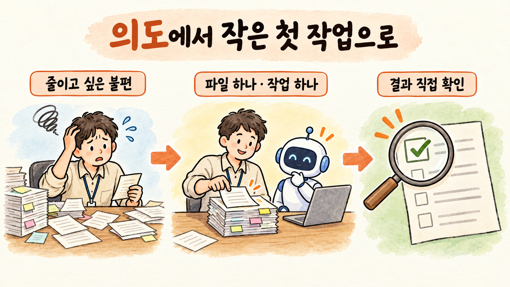

AI 생성 설명 그림 · 의도 → 작은 첫 작업 → 직접 확인

### AI·머신러닝·딥러닝·LLM · 이름부터 가볍게

| 용어 | 쉬운 뜻 | 익숙한 예 |
| --- | --- | --- |
| AI · 인공지능 | 사람이 하던 판단·예측·글쓰기 등을 컴퓨터로 수행하는 기술의 큰 이름 | 사진 분류, 상품 추천, 글 요약 |
| 머신러닝 · ML | 사람이 규칙을 하나씩 적는 대신, 데이터에서 패턴을 배우는 방법 | 과거 판매 기록에서 다음 달 판매량의 패턴 찾기 |
| 딥러닝 · DL | 머신러닝 중 여러 층의 신경망으로 복잡한 패턴을 배우는 방법 | 제품 사진에서 불량의 특징 찾기 |
| LLM · 대규모 언어 모델 | 딥러닝으로 많은 글을 학습해 글을 이해하고 생성하는 모델 | Claude 모델로 회의 메모 요약, 메일 문안·코드 작성 |

```text
AI
└─ 머신러닝 · 데이터에서 패턴 배우기
   └─ 딥러닝 · 여러 층의 신경망 사용
      └─ LLM · 언어를 다루는 모델
```

안쪽은 바깥쪽에 포함됩니다. Claude 모델은 언어를 다루고 Claude Code는 그 모델에 파일 읽기·수정·실행 도구를 연결한 작업 프로그램입니다. 오늘은 이미 학습된 모델에 자료를 주고 일을 맡겨 봅니다.

개념 참고: [IBM의 AI·ML·DL 설명](https://www.ibm.com/think/topics/ai-vs-machine-learning-vs-deep-learning-vs-neural-networks) · [LLM 설명](https://www.ibm.com/think/topics/large-language-models)

### 실습 전에 알아둘 것 · 파일이 화면과 도구가 되는 과정

지금 코드를 읽고 외울 필요는 없습니다. 내가 준 자료, AI가 만든 파일, 실행해서 확인한 결과를 구분하면 다음 시연을 따라갈 수 있습니다.

| 개념 | 쉽게 말하면 | 오늘 볼 예 |
| --- | --- | --- |
| 컨텍스트 | AI가 이번 일을 이해하는 데 참고하는 정보 | 미팅 메모·제품 자료·팀장에게 보고할 기준 |
| 토큰 | AI가 글을 처리할 때 나누는 조각. 요청과 답변, 읽은 자료에도 사용량이 듦 | 이번 메모와 필요한 기준만 주고 답은 짧게 받기 |
| 코드·프로그램 | 컴퓨터가 할 일을 적은 것이 코드, 그것을 실행하는 것이 프로그램 | Excel을 읽어 합계를 계산하는 절차 |
| 파일·폴더 | 파일은 자료나 결과 한 개, 폴더는 함께 둘 파일의 위치 | 회의 메모와 보고서를 서로 다른 위치에 보관 |
| HTML·브라우저 | HTML은 화면을 만드는 파일, 브라우저는 그 파일을 읽어 보여 주는 프로그램 | index.html을 열면 체크리스트 화면이 보임 |
| 터미널·Claude Code | 터미널에서 프로그램을 켜고 열린 Claude Code 안에 자연어로 일을 요청 | claude는 시작 명령, /model은 Claude 안의 설정 |
| 입력·출력·검사 | **무엇을 주고 무엇을 받을지** 정한 뒤 실제 결과를 기준과 대조 | 회의 메모 → 회의록 → 제안·결정·담당·기한 대조 |

바이브 코딩은 만들고 싶은 것을 일상 언어로 설명하고 AI가 만든 코드를 실행해 보며 다듬는 접근입니다. 오늘은 코드를 직접 쓰기보다 “무엇이 필요하고, 어떻게 확인할지”를 정합니다. 이 용어의 사용 범위는 사람마다 다릅니다.

### 에이전트 시대 · 의도를 기획으로 바꾸기

AI가 파일을 만들고 도구를 실행할 수 있게 되면, 구현을 맡기는 범위가 넓어집니다. 그래서 무엇을 위해 만들고 어떤 결과를 좋은 결과로 볼지 정하는 일이 중요해집니다. AI가 성실하게 실행해도 우리가 원한 문제와 다른 문제를 풀 수 있기 때문입니다.

**의도는 “누구의 어떤 문제를 풀어, 무엇이 달라지게 하고 싶은가”입니다.** “멋진 대시보드”는 만들 물건의 모양이고 “팀장이 총비용과 진행 건수를 확인해 후속 점검 여부를 판단하게 한다”는 그 물건을 만드는 이유입니다.

**오늘의 관점: 바이브 코딩에서 기획은 의도를 구현하고 확인할 수 있는 선택으로 바꾸는 일입니다.** 거창한 문서가 필요한 것은 아닙니다. 사용자·입력·필수 동작·결과 화면·완성 기준·작업 범위를 정하면 짧은 기획이 됩니다. 의도 한 문장이 곧 완성된 기획은 아니며 구체화와 확인을 거칩니다.

| 단계 | 비용 보고서에 적용하면 |
| --- | --- |
| 의도 · 왜 필요한가 | 팀장이 총비용과 진행 건수를 확인해 후속 점검 여부를 판단한다 |
| 기획 · 무엇을 정하나 | 교육용 Excel 한 개, 합계·부서별 금액·완료/진행 건수, 로컬 보고서 화면 |
| 요청 · AI에게 무엇을 전달하나 | 정한 기획과 입력 파일·기준·저장 위치를 전달한다 |
| 실행 · AI와 도구가 무엇을 하나 | 허용한 폴더에서 읽기·제작·명령 실행·검사를 한다 |
| 검증 · 의도가 충족됐나 | 원본과 합계 일치, 완료/진행 건수 대조, 후속 점검이 필요한지 판단할 수 있는지 사람이 본다 |

**의도 → 기획 → 프롬프트 → 에이전트 실행 → 검증**
원하는 문제를 풀지 못했다면 의도·기획·입력·구현 중 무엇이 어긋났는지 돌아봅니다.

### 같은 “만들어줘”여도 기획이 달라지면 결과가 달라집니다

첫 업무는 **자주 반복되고 필요한 자료가 있고 결과를 쓸 사람이 분명한 일**로 고릅니다. “팀 업무 전부 자동화”보다 “비용표 한 개로 이번 주 합계 확인”처럼 첫 결과를 작게 정하면 직접 확인하기 쉽습니다.

| 막연한 요청 | 의도를 담은 짧은 기획 | 직접 확인할 것 |
| --- | --- | --- |
| 할 일 앱 만들어줘 | 내가 남은 일을 놓치지 않도록 추가·완료·남은 개수 확인을 만든다. 새로고침 후에도 보존한다 | 추가한 일과 완료 표시가 남고 남은 개수가 정확한가 |
| 엑셀 대시보드 만들어줘 | 팀장이 비용 총액과 진행 건수를 확인한다. 원본을 보존하고 숫자의 출처와 검사 상태를 보여 준다 | 합계와 완료/진행 건수가 맞고 후속 점검 여부를 판단할 수 있는가 |
| 사진 메모 도구 만들어줘 | 사진을 다시 찾기 어렵다. 사진마다 장소와 한 줄 메모를 남기고 장소로 찾게 한다 | “교실 A”로 찾았을 때 해당 사진과 메모가 나오는가 |
| 회의 정리 자동화해줘 | 결정한 일의 담당자와 마감일을 놓친다. 회의 메모에서 할 일 표를 만들고 정하지 않은 칸은 미정으로 둔다 | 할 일·담당자·마감일이 원문과 맞고 없는 내용을 채우지 않았는가 |

사진 예시는 기획 비교용이며 회의록은 뒤의 스킬 실습에서 직접 만듭니다. 체크리스트와 비용 보고서로도 이어집니다.

### 기획도 AI와 함께 · 선택과 확인은 내가

- 내 의도를 한 문장으로 말합니다. 아직 모호하면 AI에게 질문과 후보를 부탁합니다.

- 메타프롬프트나 /grill-me로 입력·결과·완성 기준의 빈칸을 채웁니다.

- AI가 제안한 기능 중 이번에 만들 기능을 고르고 원본 보존·작업 폴더·외부 발송 여부를 정합니다.

- 기획 요약을 확인한 뒤 구현 요청을 전달하고 결과를 원래 의도와 대조합니다.

예쁜 화면이나 파일 생성은 중간 결과입니다. 필요한 사람이 필요한 판단이나 행동을 할 수 있는지도 봅니다. 숫자 오류는 계산과 입력을, 저장 실패는 구현을 점검합니다. 원하는 목적 자체가 달라졌다면 기획을 고칩니다. 문제가 생길 때마다 요청문을 길게 늘리는 것으로 해결하지 않습니다.

**학생 확인 질문:** 내 반복 업무에서 “무엇을 만들고 싶은지”와 “그래서 무엇이 달라지길 원하는지”를 각각 한 문장으로 구분해 봅니다. 오전에는 말로 정하고 오후 G1에서 구체화합니다.

### 채팅 답변이 실제 도구가 되는 순간

| 요청 | 받는 결과 | 내가 해 볼 일 |
| --- | --- | --- |
| 해야 할 일을 정리해줘 | 대화 안의 목록 | 읽고 옮기기 |
| 체크리스트를 파일로 만들어줘 | 클릭할 수 있는 HTML 파일 | 추가·완료·새로고침 |
| Excel 보고서를 매번 만들게 해줘 | 데이터 처리 도구와 실행 방법 | 다른 입력으로 다시 실행 |

### 프롬프트 엔지니어링 · 요청을 설계하고 고치기

프롬프트는 AI에게 주는 요청입니다. 프롬프트 엔지니어링은 원하는 결과가 나오도록 요청과 참고자료를 구성하고 실제 결과를 확인하며 고치는 일입니다. 오늘은 긴 문장을 외우기보다 빠진 정보를 채웁니다.

| 채울 정보 | 체크리스트 예시 |
| --- | --- |
| 누가 쓰나 | 할 일을 관리하는 나 |
| 무엇을 입력하나 | 할 일 문장 |
| 무엇이 나와야 하나 | 추가·완료 표시가 되는 HTML 파일 |
| 어떻게 확인하나 | 두 항목 추가 → 한 항목 완료 → 새로고침 후 보존 |

**모호한 요청:** “체크리스트 만들어줘.” 무엇을 입력하고 어디에 저장할지 AI가 추측하게 됩니다.

참고자료·필수 동작·저장 위치·검사 기준이 들어 있습니다. 더 필요한 모양이 있다면 예시 하나를 함께 줍니다. 생성된 파일을 직접 눌러 보고 안 되는 동작만 짚어 수정합니다. 반복 기준은 CLAUDE.md와 Skill에 남깁니다.

### 메타프롬프트 · AI에게 요청문을 만들게 하기

메타프롬프트는 AI가 다른 작업에 쓸 프롬프트를 작성하거나 개선하도록 시키는 요청입니다. 오늘은 필요한 정보를 질문으로 정리한 뒤, 구현 요청문을 만드는 방식으로 사용합니다. 질문하기는 메타프롬프트를 활용하는 한 방법입니다.

| 구분 | AI에게 맡기는 일 | 이번 단계의 결과 |
| --- | --- | --- |
| 직접 요청 | 정한 기준으로 체크리스트 제작 | 실제 HTML 파일 |
| 메타프롬프트 | 빠진 정보 질문 → 내 답 정리 → 구현 요청 작성 | 확인한 계획과 구현 프롬프트 |

[텍스트 내려받기 · 바이브_코딩_의도·기획·프롬프트_01_참고_P103.txt](templates/복붙텍스트/참고요청/바이브_코딩_의도·기획·프롬프트_01_참고_P103.txt)

P103 · 강사 시연 · Claude Code 안 · 메타프롬프트

```text
- 내 반복 업무를 자동화하고 싶어.
- 입력·원하는 결과·완성 기준에서 빠진 정보만 최대 3개, 한 번에 하나씩 질문해줘.
- 이미 알려준 내용은 다시 묻지 마.
- 내 답을 요약해 확인받은 뒤 Claude Code에 붙일 구현 프롬프트를 작성해줘.
- 아직 파일을 만들거나 명령을 실행하지 마.
```

**왜 이렇게 요청하나요?**

- **확인 방법**: 완료했다는 말보다 실제 확인한 결과와 확인하지 못한 것을 받습니다.

**막연한 아이디어 → 필요한 질문 → 내 답 → 요약 확인 → 구현 프롬프트**
사람이 내용을 확인한 뒤 별도 요청으로 구현합니다.

**대화 예시:** “매주 비용 보고서를 만들고 싶어” → AI가 “어떤 파일을 입력하나요?” 질문 → “Excel 한 개”라고 답 → 결과·검사 기준을 정리 → 내가 확인. 이 흐름은 설명용 예시이며 실제 모델 응답 기록이 아닙니다.

AI가 쓴 요청문도 빠진 내용이나 잘못된 가정이 있는지 확인합니다. 오후 /grill-me는 질문·계획 확인·구현 요청 정리를 다시 쓸 수 있게 묶은 Skill입니다. 오전에는 강사 시연으로 보고 학생은 오후 G1에서 실제 인터뷰합니다. 일반 메타프롬프트 예시에는 별도 스킬 설치가 필요하지 않습니다.

### Spec Driven · 만들기 약속을 파일로 남기기

스펙은 무엇을 만들고 어떻게 확인할지 적은 약속입니다. Spec Driven은 이 약속을 계획·구현·검사의 기준으로 쓰는 방식입니다. 긴 프롬프트 한 번으로 끝내기보다 약속과 실제 동작을 대조합니다.

**.md는 글을 적는 파일입니다.** 개념 설명과 이번 기능의 스펙을 구분합니다. 상세 설명은 아래 파일을 읽고 강사 시연은 작은 카운터 하나로 비교합니다.

[상세 개념 MD 내려받기](templates/spec-driven/01_스펙드리븐_쉽게이해하기.md)

[시연용 카운터 스펙 MD 내려받기](templates/spec-driven/02_카운터_스펙.md)

의도스펙계획·내 확인구현기준으로 검사

### 강사 시연 ① · 먼저 아주 짧게 부탁하기

[텍스트 내려받기 · 오전_01_그냥만들기.txt](templates/복붙텍스트/참고요청/오전_01_그냥만들기.txt)

P119 · 강사 시연 · Claude Code 안 · 작은 카운터

```text
- 클릭하면 숫자가 올라가는 아주 작은 웹페이지를 만들어줘.
- HTML 한 파일로 output/demo/plain-counter.html에 저장해줘.
```

**왜 이렇게 요청하나요?**

- **결과 지정**: 답변만 받지 않고 다시 열어 쓸 파일을 남기려는 요청입니다.


**처음 화면 · 0**


**한 번 클릭한 뒤 · 1**

숫자가 오르는지 눌러 봅니다. 시작 숫자와 새로고침 동작은 요청에 없었습니다. 결과가 잘 나와도 AI가 어떤 선택을 했는지 확인합니다.

### 강사 시연 ② · 규칙을 먼저 주고 만들 순서 확인하기

**카운터**는 버튼을 누르면 숫자가 올라가는 작은 도구입니다. **카운터 스펙**은 이 도구가 지켜야 할 규칙을 적은 문서입니다.

| 이번 규칙 | 직접 확인할 것 |
| --- | --- |
| 처음 숫자는 0 | 화면을 열어 0인지 보기 |
| 누를 때마다 1 증가 | 두 번 누르면 2인지 보기 |
| 새로고침하면 0 | 새로고침해 0인지 보기 |

개념 문서는 일하는 방법을 설명하고, 카운터 스펙은 이번에 만들 도구의 규칙을 정합니다. 아래 요청은 규칙 파일 하나만 줍니다. @는 Claude에게 “이 파일을 참고해”라고 알려 주는 표시입니다.

- 강사는 실습 폴더에서 새 Claude 대화를 시작합니다. 두 시연은 대화와 결과 파일을 나눕니다.

- Claude Code 안에서 @를 입력하고 templates/spec-driven의 파일을 선택합니다. Enter 또는 Tab으로 경로를 고르고 요청을 완성해 Enter로 보냅니다. 전체 요청 텍스트를 붙여 넣어도 됩니다.

- 아래 요청을 붙여 넣고 만들 순서만 받습니다. 세 규칙을 지키는 순서인지 확인합니다.

[텍스트 내려받기 · 오전_02_스펙읽고계획.txt](templates/복붙텍스트/참고요청/오전_02_스펙읽고계획.txt)

P102 · 강사 시연 · Claude Code 안 · 스펙 읽고 계획

```text
- @templates/spec-driven/02_카운터_스펙.md를 기준으로 숫자 버튼을 만들고 싶어.
- 먼저 만들 순서를 3줄로 알려줘.
- 아직 만들지 마.
```

**왜 이렇게 요청하나요?**

- **자료·파일 지정**: AI가 참고할 자료를 좁힙니다. 파일 이름은 내가 실제로 가진 파일과 맞춰야 합니다.

- **지킬 기준**: 바꿔도 되는 범위와 그대로 둘 것을 정해 불필요한 작업을 줄입니다.

@는 대화에 파일을 지정하는 표기입니다. 셸 명령이 아니며 파일을 자동으로 스킬로 설치하지 않습니다. 이번에는 로컬 파일만 참고합니다.

계획이 스펙과 맞는지 사람이 확인한 뒤 아래 요청을 보냅니다.

[텍스트 내려받기 · 오전_03_확인후구현.txt](templates/복붙텍스트/참고요청/오전_03_확인후구현.txt)

P120 · 강사 시연 · Claude Code 안 · 확인 후 구현

```text
- 확인한 순서대로 숫자 버튼을 만들어줘. @templates/spec-driven/02_카운터_스펙.md의 규칙대로 동작하는지 검사하고, 결과 파일과 미확인을 짧게 알려줘.
- 다른 파일은 보존해.
```

**왜 이렇게 요청하나요?**

- **자료·파일 지정**: AI가 참고할 자료를 좁힙니다. 파일 이름은 내가 실제로 가진 파일과 맞춰야 합니다.

- **지킬 기준**: 바꿔도 되는 범위와 그대로 둘 것을 정해 불필요한 작업을 줄입니다.

- **확인 방법**: 완료했다는 말보다 실제 확인한 결과와 확인하지 못한 것을 받습니다.

| 비교할 것 | 직접 요청 | 스펙 기반 요청 |
| --- | --- | --- |
| 시작 숫자·새로고침 | AI가 고른 동작을 확인 | 0으로 시작, 새로고침하면 0으로 명시 |
| 검사 기준 | 나온 화면을 보고 정리 | 0 → 두 번 클릭해 2 → 새로고침해 0 |
| 이번 비교의 의미 | 짧은 요청도 작은 도구를 만들 수 있다 | **추측할 내용을 줄이고 확인 기준을 남긴다** |

두 요청은 제공한 정보가 다릅니다. 스펙이 항상 더 좋은 결과나 오류 없는 코드를 보장하지 않습니다. 카운터는 오전 시연이며 오후에는 기존 체크리스트를 만듭니다.

[프롬프트 설계와 성공 기준](https://platform.claude.com/docs/en/build-with-claude/prompt-engineering/overview) · [명확한 요청과 예시 공식 안내](https://platform.claude.com/docs/en/build-with-claude/prompt-engineering/claude-prompting-best-practices)

빠른 시제품에는 잘 맞습니다. 회사 데이터와 실제 운영에 적용할 때는 데이터 접근 권한, 원본 보존, 결과 검사도 설계해야 합니다.

### 내 의도를 한 문장으로 적어 보기

- 어떤 입력을 받아 어떤 결과를 공유하는지 적습니다.

- 아래 메모에 내 업무를 짧게 적어 보세요. 무엇을 만들지는 내가 정하고 제작은 다음 단계에서 Claude에게 맡깁니다.

### 작은 기획 체험 · 내 말 세 문장

- 아래에 내 의도·넣을 정보·완료 기준을 짧게 적습니다.

- “멋진 앱”을 “내가 남은 일을 놓치지 않게 한다”처럼 바꿔 봅니다. 이 문장을 첫 작품과 다음 인터뷰에 그대로 씁니다.

- 구체적인 요청 시연에서 입력·결과·검사 기준을 찾아 표시합니다. 아래에 시연에서 나온 질문과 내 답을 하나 적어 봅니다.

### 메타프롬프트 · 부탁하는 말도 함께 만들기

처음부터 완벽한 요청을 쓸 필요는 없습니다. **“이런 일을 하고 싶은데, 어떻게 부탁하면 좋을까?”**라고 먼저 물어보는 것이 메타프롬프트입니다. AI가 질문하거나 요청 초안을 주면, 내가 원하는 입력·결과·확인 방법인지 읽고 고칩니다. 오후 첫 작품과 내 업무 정하기에서 직접 해 봅니다.

**내 메모**

**예시 보기 · 할 일 관리 / 고객 관리**

내 업무와 가까운 예시를 골라 빈 칸에 채우고, 내 말로 수정하세요. 이미 적은 내용은 유지합니다.

**할 일 관리**
- **내 의도**: 마감 전에 남은 일을 놓치지 않고 싶다

- **넣을 정보**: 할 일 이름

- **완료 기준**: 할 일 두 개 추가 → 하나 완료 → 새로고침해도 두 개와 완료 표시가 남는다

- **시연의 질문 하나와 내 답**: 질문: 누가 쓰나요?
내 답: 매일 업무 마감을 챙기는 나

**고객 관리**
- **내 의도**: 미팅한 고객과 다음 연락할 일을 잊지 않고 싶다

- **넣을 정보**: 회사명·담당자·상담 상태·메모

- **완료 기준**: 고객 한 명 추가 → 회사명으로 검색 → 상담 상태 변경 → 다시 열어도 기록이 남는다

- **시연의 질문 하나와 내 답**: 질문: 미팅 뒤 무엇을 다시 확인하나요?
내 답: 누구에게 언제 연락할지와 약속한 내용

내 의도 · 어떤 불편을 줄일까요?

메모는 [개인 실습 기록지](notes/내업무_실습기록.md) 사본에 적습니다.

넣을 정보 · 무엇을 입력할까요?

메모는 [개인 실습 기록지](notes/내업무_실습기록.md) 사본에 적습니다.

완료 기준 · 무엇을 해 보면 될까요?

메모는 [개인 실습 기록지](notes/내업무_실습기록.md) 사본에 적습니다.

시연의 질문 하나와 내 답

메모는 [개인 실습 기록지](notes/내업무_실습기록.md) 사본에 적습니다.

입력한 모든 칸을 항목 이름과 함께 복사합니다.

## 04. 에이전틱 코딩 · AI가 일하는 흐름

오전 · 설명과 강사 시연 · Module 1

### AI 시대 용어 · 영업팀 업무로 이해하기

회사에서 일을 맡기는 상황으로 연결해 봅니다. 아래 비유는 역할을 구분하기 위한 설명입니다.

| 용어 | 쉬운 뜻 | 한빛화학 영업팀의 예 |
| --- | --- | --- |
| 에이전트 | 목표를 받고 도구를 사용하며 다음 할 일을 고르는 AI | 메모 읽기 → 회의록 저장 → 원문과 대조 |
| CLAUDE.md | 이 프로젝트에서 계속 지킬 공통 규칙 | 원본 보존, 한국어 작성, 근거 없는 숫자 추가 금지 |
| 스킬 · Skill | 한 업무를 반복할 때 쓰는 절차와 기준 | 회의록을 결정·제안·할 일·미정으로 정리하는 SKILL.md |
| 서브에이전트 | 메인이 일을 나눠 맡기는 별도 AI 담당자 | 자료 확인·보고서 제작·검수 담당자 3명 |
| MCP | AI와 외부 도구를 연결하는 공통 방식 | 연결된 Gmail 도구로 보고 메일 초안 한 개 저장 |
| 하네스 | AI가 일할 자료·도구·규칙·역할·검사 방법을 갖춘 환경 | 메모·계산 도구·내 스킬·3명 팀·검사 기준을 함께 준비 |
| 워크플로우·자동화 | 워크플로우는 작업 순서, 자동화는 정한 조건에서 그 작업을 실행하는 것 | Excel 변경 → 계산 → 보고서 갱신 |

스킬은 **어떻게 일할지**, 서브에이전트는 **누구에게 맡길지**, MCP는 **어떤 외부 도구와 연결할지**를 정합니다. 하네스는 이 요소들이 함께 일할 환경입니다.

내 기준·회의 메모스킬·담당자회의록·내 확인Gmail MCP·초안

Gmail 초안 작성은 메일 발송과 다른 동작입니다. 연결된 도구가 지원하는 기능과 계정 권한 안에서 작업합니다. 로컬 파일을 읽거나 계산하는 데 모두 MCP가 필요한 것은 아닙니다.

공식 안내: [스킬](https://code.claude.com/docs/en/skills) · [서브에이전트](https://code.claude.com/docs/en/sub-agents) · [MCP](https://code.claude.com/docs/en/mcp)

에이전틱 코딩은 AI가 목표를 받아 파일을 읽고 계획을 세우고 도구를 실행한 뒤 결과를 확인하며 다음 행동을 고르는 작업 방식입니다. Claude Code는 터미널에서 이 흐름을 수행할 수 있습니다. 바이브 코딩은 사람이 요청하고 다듬는 접근, 에이전틱 코딩은 AI가 일을 진행하는 방식에 초점이 있습니다. 둘은 함께 사용할 수 있습니다.

### 채팅과 에이전트의 차이

| 구분 | 채팅 중심 | 도구를 쓰는 에이전트 |
| --- | --- | --- |
| 결과 | 답변이나 코드 제안 | 파일 수정·실행·검사 결과 |
| 실행 | 사람이 옮겨 실행 | 허용된 범위에서 AI가 도구 실행 |
| 오류 | 오류를 다시 전달 | 실행 결과를 읽고 수정 제안·재검사 |
| 사람 역할 | 질문하고 답변 평가 | **목표·범위·권한·완성 기준 결정** |

**목표 → 입력 읽기 → 계획 → 실행 → 검사 → 사람 확인**
검사 실패 → 원인 확인 → 수정 → 다시 검사 · 정해 둔 횟수에서 중단

컨텍스트는 AI의 작업 책상입니다. 이번 Excel, 원하는 보고서 예시, 비용 기준을 올려 둡니다. 필요한 자료가 빠져 있으면 그럴듯한 답변도 내 업무에 맞지 않을 수 있습니다. 자연스러운 문장과 정확한 결과는 별도로 확인합니다.

### AI에게 일을 맡기기 전에 · 내가 정할 세 가지

“보고서 만들어줘”만 말하면 AI는 어떤 자료를 읽고 무엇을 보여 줄지 추측해야 합니다. 비용 보고서 한 개를 맡긴다면 아래 세 가지를 먼저 정합니다.

| 먼저 정할 것 | 비용 보고서 예시 |
| --- | --- |
| 입력 | 어떤 Excel 사본을 읽을지 |
| 원하는 결과 | 총액과 진행 건수가 보이는 보고서 |
| 확인 방법 | 원본 숫자 대조·화면 열기·실패 기록 |

CLAUDE.md·Skill·서브에이전트는 오후에 같은 보고서를 발전시키며 하나씩 사용합니다. 지금 모두 외울 필요는 없습니다. MCP는 Module 3에서 Gmail 초안 한 개로 경험합니다.

### 시연을 따라 보기 · AI가 한 일 찾기

- 강사가 파일을 만드는 시연에서 읽은 자료·계획·실행 명령·검사 결과를 아래에 적습니다.

- AI의 “완료했어요”라는 말과 실제 파일·검사 결과를 비교합니다. 오후 내 첫 도구에서도 같은 순서를 찾아봅니다.

- 보고서 예시와 Excel을 함께 봅니다. AI에게 필요한 자료와 사람이 마지막에 확인할 숫자를 각각 하나 고릅니다.

오후에는 제공된 실행 도구와 담당자 정의로 계획 → 실행 → 검사 기록을 봅니다. 만드는 단계에는 AI가 일하고 완성된 계산 도구를 다시 돌리는 단계에는 정해진 프로그램이 일합니다.

### 실행 전에 · 모드로 어디까지 맡길지 정하기

모드는 **AI가 지금 계획만 세울지, 어떤 행동을 묻고 실행할지** 정하는 방식입니다. 터미널의 Claude Code 안에서 **Shift+Tab**으로 바꾸고 화면의 모드 표시를 확인합니다. 설치 버전·계정 설정에 따라 보이는 모드는 다를 수 있습니다.

| 모드 | 무엇을 하나요? | 오늘의 예 |
| --- | --- | --- |
| Plan · 계획 | 자료를 살펴보고 계획을 세웁니다. 일반 구현 파일을 수정하지 않습니다. | 카운터 규칙을 읽고 만들 순서 확인 |
| Manual · 기본(default) | 파일 편집·명령 실행 등에 필요한 권한을 물어봅니다. 이미 허용한 행동은 다시 묻지 않을 수 있습니다. | 처음 index.html을 만들 때 대상과 행동 확인 |
| acceptEdits · 편집 자동 허용 | 작업 폴더의 파일 편집과 일부 파일 관리 명령을 자동 허용합니다. 모든 실행을 허용하는 것은 아닙니다. | 익숙해진 뒤 HTML 문구를 반복 수정 |
| Auto · 자동 검토 | 지원되는 환경에서 행동을 자동 검토해 반복 확인을 줄입니다. 요청과 조직 정책의 제한은 적용됩니다. | 개념만 알아두기 · 수업은 Plan과 Manual로 시작 |
| bypassPermissions · 확인 생략 | 권한 확인을 크게 생략하는 모드입니다. 격리된 개발 환경용입니다. | 이번 수업에서 선택하지 않기 |

Plan · 계획 확인Manual · 실행으로 전환필요한 권한 판단결과 확인

Plan에서 계획을 확인했으면 Manual로 전환해 구현을 요청합니다. 허용 선택은 그 행동 한 번과 앞으로도 허용을 구분해 읽습니다. `/permissions`에서 저장된 허용·거절 규칙을 확인할 수 있습니다. [공식 모드 안내](https://code.claude.com/docs/en/permission-modes) · [권한 안내](https://code.claude.com/docs/en/permissions)

### 권한 요청 · 무엇을 허용할까요?

| 요청 | 확인하고 결정할 것 |
| --- | --- |
| index.html 생성·실습 폴더의 파일 읽기 | 지정한 폴더와 필요한 파일인지 확인 후 허용 |
| workbooks 원본 변경·다른 폴더 접근 | 요청 범위를 벗어나면 거절하고 사본·output으로 제한 |
| Gmail 초안 저장 | 교육용 수신자·초안 도구인지 확인 후 허용 |
| 삭제·메일 발송 | 이번 실습의 범위 밖이므로 거절 |

첫 제작에서 권한 창이 뜨면 대상 파일과 행동을 읽어 보고 결정합니다. 허용 기록이 이미 있으면 창이 다시 뜨지 않을 수 있습니다. 규칙 파일을 적는 것과 실행 권한을 주는 것은 다릅니다.

### CLAUDE.md · 매번 말하던 규칙을 파일로


CLAUDE.md · 반복해서 필요한 작업 기준을 적는 파일

신입에게 같은 안내를 매번 말하는 대신 메모로 남기는 것처럼, AI가 참고할 규칙을 적습니다. **내 모든 업무에 필요한 규칙**과 **이번 폴더에만 필요한 규칙**을 두 파일로 나눕니다.

| 규칙 파일 | 어디에 적용할까요? | 쉬운 예 |
| --- | --- | --- |
| 사용자 공통 · 글로벌~/.claude/CLAUDE.md | 이 PC의 내 계정에서 여러 프로젝트에 공통으로 | 한국어로 짧게 답하기, 확인 못 한 것은 미확인으로 쓰기 |
| 프로젝트용 · 로컬실습 폴더/CLAUDE.md | 이번 폴더의 작업에 | 한빛화학 보고서는 workbooks 원본을 보존하고 output에 저장하기 |

두 파일의 규칙을 함께 참고하므로 서로 반대되는 지시는 피합니다. 글로벌은 다른 사람의 계정까지 적용한다는 뜻이 아닙니다. 여기서 로컬은 프로젝트용이라는 뜻으로 씁니다. 오후에는 나에게 질문하게 해서 두 초안을 함께 만듭니다.

[CLAUDE.md 공식 안내](https://code.claude.com/docs/en/memory)

**내 메모**

시연에서 AI가 한 일

메모는 [개인 실습 기록지](notes/내업무_실습기록.md) 사본에 적습니다.

내가 마지막에 확인할 것 하나

메모는 [개인 실습 기록지](notes/내업무_실습기록.md) 사본에 적습니다.

입력한 모든 칸을 항목 이름과 함께 복사합니다.

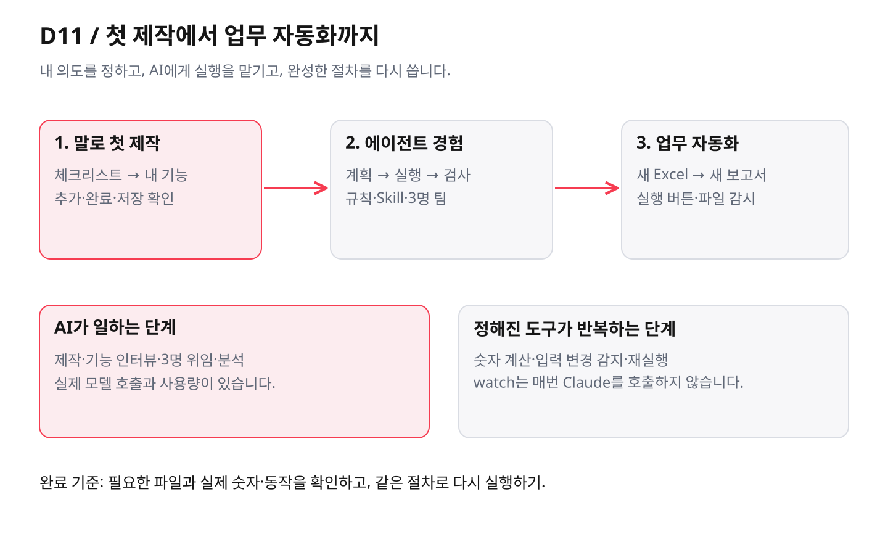

**D11 · 첫 제작에서 업무 자동화까지**
의도는 내가, 구현과 도구 실행은 AI와 함께, 최종 결과는 사람이 확인합니다. · 직접 그린 설명 도식이며 실제 제품 화면이 아닙니다. 이미지를 눌러 확대할 수 있습니다.

**도식 내용을 글로 읽기**

- 바이브 코딩에서는 일상 언어로 작은 도구를 만들고 직접 눌러 다듬습니다.

- 에이전틱 코딩에서는 의도와 범위를 정해 AI에게 계획·도구 실행·검사를 맡깁니다.

- 업무 자동화에서는 검사한 도구에 새 입력을 넣어 다시 실행하고 파일 변경을 감지합니다.

- 매번 판단이 필요한 AI 작업과 정해진 프로그램의 반복 실행은 다릅니다. watch는 매번 Claude를 호출하지 않습니다.

## 05. 시연 · 만들고 검증하고 다시 쓰기

오전 · 설명과 강사 시연 · Module 1

오전은 강사 화면을 보고 흐름을 이해합니다. 학생은 먼저 결과를 예측하고 실제 화면과 비교합니다. 오후에 같은 자료로 각자 제작합니다.

| 순서 | 강사 시연 | 학생 확인 질문 |
| --- | --- | --- |
| 첫 작품 | 체크리스트: 요청 → 실제 파일 → 추가·완료·새로고침 | 새로고침 뒤 무엇이 남아야 할까요? |
| 입력 변경 | 정상 Excel 보고서 → 수정후 파일 → 합계 변화 | 한 행이 늘면 건수와 총액이 어떻게 바뀔까요? |
| 오류와 복구 | 오류 입력 → 실패 기록 → **이전 보고서 보존** → 정상 복구 | 오래된 보고서를 이번 성공으로 볼 수 있을까요? |
| 오후 연결 | 3명 역할·변경 감지·로그인 앱의 준비된 흐름 예고 | 지금 결정하는 AI 작업과 정해진 자동 실행은 어디일까요? |

실제 로그에서 파일 읽기·실행 명령·검사 결과 한 묶음을 보여 줍니다. “지금 본 것은 계획, 도구 실행, 검사 중 어디인가요?”를 묻고 학생이 흐름을 짚어 봅니다.

Excel 숫자 계산은 제공 코드가 맡고 Claude는 해석 문안과 도구 제작을 돕습니다. 입력 변경 감지 프로그램이 매번 AI를 호출하는 것은 아닙니다. **AI가 만드는 단계와 정해진 프로그램이 실행되는 단계**를 구분합니다.

### 점심 전에 말로 확인하기

- 바이브 코딩과 에이전틱 코딩을 내 말로 각각 설명하기.

- “검사 통과”와 “사람이 사용해도 좋다고 판단”의 차이 말하기.

- 내 업무의 입력·결과·완성 기준 한 가지 정하기.

### 결과 예측하고 직접 확인

- 원본 보고서를 열어 총액을 찾습니다. Excel 금액을 바꾸면 어디가 바뀔지 먼저 고릅니다.

- 변경 시연의 새 보고서와 예측을 대조합니다. 잘못된 입력을 넣었을 때 이전 보고서가 남는지도 확인합니다.

**내 메모**

입력을 바꾸면 무엇이 달라질까요?

메모는 [개인 실습 기록지](notes/내업무_실습기록.md) 사본에 적습니다.

시연 뒤 확인한 결과

메모는 [개인 실습 기록지](notes/내업무_실습기록.md) 사본에 적습니다.

입력한 모든 칸을 항목 이름과 함께 복사합니다.

## 06. 내 실습 환경과 실제 응답 확인

오후 · 개인 실습 · Module 2

**오후 개인 실습 시작:** 바탕화면에 푼 자료로 기본 명령과 폴더 이동을 직접 해 봅니다. [앞의 준비 순서](../../실습핸드북.html#terminal)를 따라 같은 폴더에서 계정·응답을 확인합니다.

**설치부터 필요한 경우 펼치기**

### 설치가 아직 안 됐다면

Claude Code는 운영체제에 맞는 네이티브 설치 명령을 사용합니다. Node.js는 뒤에서 제공 계산 프로그램을 실행할 때 필요합니다. 아래 명령은 내 운영체제 하나만 골라 셸에 넣습니다.

[텍스트 내려받기 · P115_Claude설치.txt](templates/복붙텍스트/셸명령/P115_Claude설치.txt)

P115 · 셸 · Windows PowerShell · Claude Code 설치

```text
irm https://claude.ai/install.ps1 | iex
```

**왜 이렇게 요청하나요?**

- **설치 명령 한 줄**: Claude Code 프로그램을 설치합니다. 설명이나 불릿 기호 없이 PowerShell/터미널에 붙입니다.

[텍스트 내려받기 · P116_Claude설치.txt](templates/복붙텍스트/셸명령/P116_Claude설치.txt)

P116 · 셸 · macOS 터미널 · Claude Code 설치

```text
curl -fsSL https://claude.ai/install.sh | bash
```

**왜 이렇게 요청하나요?**

- **설치 명령 한 줄**: Claude Code 프로그램을 설치합니다. 설명이나 불릿 기호 없이 PowerShell/터미널에 붙입니다.

- 설치가 끝나면 셸 창을 새로 열고 같은 cd 텍스트로 실습 폴더에 들어갑니다.

- claude --version으로 설치를 확인합니다. Node.js LTS는 사전 준비 링크의 설치 프로그램으로 준비합니다.

- claude를 실행해 운영진 제공 계정으로 로그인합니다. 로그인 완료 후 아래 A1으로 실제 응답을 확인합니다.

[공식 설치 안내](https://code.claude.com/docs/en/setup)

설치와 제공 계정 로그인은 사전 준비에서 진행하고 오후 첫 실습에서 직접 완료 여부를 확인합니다. 이 단계에서는 Claude를 켜고 모델을 선택한 뒤 첫 응답을 확인합니다. 설치가 막히면 운영진이 준비한 환경으로 합류하고 미완료를 기록합니다.

**수업용 Claude 계정은 운영진이 제공합니다.**

안내받은 계정으로 터미널의 Claude Code에 로그인하고 실제 응답을 확인하세요.

### Claude 켜기 → 모델 고르기 → 첫 응답

**실습 폴더로 이동한** PowerShell 또는 macOS 터미널에서 아래 한 단어를 입력합니다.

```text
claude
```

Claude Code가 열리면 그 안에서 다음 명령을 입력합니다.

```text
/model
```

- 로그인이 필요하면 안내받은 수업용 계정으로 로그인합니다.

- /model 목록에서 강사가 안내하는 Sonnet 모델을 선택합니다. 방향키로 이동하고 Enter로 선택합니다.

- 아래 A1 요청으로 첫 응답을 확인합니다. /model은 **Claude 안의 설정 명령**이며 한국어 작업 요청과 구분합니다.

[모델 선택 공식 안내](https://code.claude.com/docs/en/model-config)

[텍스트 내려받기 · 01_Claude_A1_연결확인.txt](templates/복붙텍스트/01_Claude_A1_연결확인.txt)

P65 · Claude Code 대화 · A1 · 한 번만

```text
- 현재 작업 폴더 이름만 알려줘.
- 파일은 수정하지 마.
```

**왜 이렇게 요청하나요?**

- **이번 행동만 요청**: 지금 필요한 질문·수정·호출에 집중합니다. 원하는 결과가 다르면 실행 전에 내 말로 바꿉니다.

**성공 기준:** 실습 폴더와 실제 응답이 맞습니다.

**막히면:** 계정 로그인·모델 권한 문제는 사전 준비의 별도 확인 항목입니다.

[필요할 때 보는 명령어·모드 한 장](명령어_한장.md)

근거: [설치 공식 문서](https://code.claude.com/docs/en/setup) · [인증 공식 문서](https://code.claude.com/docs/en/authentication) · [모델 설정](https://code.claude.com/docs/en/model-config)

첫 제작 전에는 Shift+Tab으로 Manual(기본) 표시를 확인합니다. 계획만 볼 때는 Plan으로 바꿉니다.

## 07. 내 첫 체크리스트 만들기

오후 · 개인 실습 · Module 2

### 먼저 · 어떻게 부탁하면 좋을까?

아래 요청을 보내고 질문이 오면 답합니다. 제안된 제작 요청에서 **추가·완료·새로고침 후 보존**을 찾아 봅니다. 마음에 들면 내 도구 제목을 넣어 실행합니다.

[텍스트 내려받기 · 02e_Claude_첫도구_메타프롬프트.txt](templates/복붙텍스트/02e_Claude_첫도구_메타프롬프트.txt)

P131 · Claude Code 안 · 먼저 부탁하는 말 만들기

```text
- 할 일을 놓치지 않게 작은 체크리스트를 만들고 싶어.
- Claude에게 어떻게 부탁하면 좋을까? 아직 만들지는 마.
- @templates/checklist-spec.md의 기준을 지키고, 기존 파일을 보존해 index.html에 저장하는 요청이 필요해.
- 빠진 정보가 있으면 질문 하나만 해줘.
- 추가·완료 표시·새로고침 후 보존이 들어간 요청을 짧은 불릿으로 제안해줘.
```

**왜 이렇게 요청하나요?**

- **아직 만들지 마**: 지금은 실행할 요청을 준비하는 단계입니다. 답을 보고 범위를 고친 다음 제작을 맡깁니다.

- **질문 하나 + 짧은 불릿**: 빠진 정보만 채우고 내가 이해할 수 있는 요청을 받습니다.

**제작은 한 번만:** AI가 제안한 요청을 고쳐 보내거나, 아래 제공 요청을 사용합니다. 둘을 연달아 보내지 않습니다. 이미 파일을 만들었다면 바로 직접 확인 단계로 갑니다.

오전의 카운터 시연을 내 체크리스트에 적용합니다. templates/checklist-spec.md를 먼저 열어 입력·기능·확인 기준을 읽고 내 제목을 정합니다. 제공 요청을 고른 경우에만 아래 A2를 보냅니다.

**앞 단계에서 이어서:** 오후의 첫 개인 제작입니다. 완성 조건이 정해진 체크리스트를 먼저 만들어 보고 다음 단계에서 내 기능 한 개를 더합니다.

### 1. 작은 도구 요청 한 번

- templates/checklist-spec.md의 **완성 조건을 읽습니다**.

- 제공 요청을 고른 경우 A2를 한 번 보냅니다. 제안받은 요청을 이미 실행했다면 다시 보내지 않고 생성 파일을 확인합니다.

[텍스트 내려받기 · 02_Claude_A2_첫도구.txt](templates/복붙텍스트/02_Claude_A2_첫도구.txt)

P66 · Claude Code 대화 · A2 · 한 번만

```text
- @templates/checklist-spec.md를 내가 읽고 확인했어.
- 이 스펙으로 입력·동작·완료 기준을 맞춘 뒤 구현하고 검사하는 Spec Driven 방식으로 만들어줘.
- 제목은 [내 도구 제목], 결과는 index.html.
- 실제 검사 결과와 미확인을 4줄 이내로 알려줘.
```

**왜 이렇게 요청하나요?**

- **자료·파일 지정**: AI가 참고할 자료를 좁힙니다. 파일 이름은 내가 실제로 가진 파일과 맞춰야 합니다.

- **결과 지정**: 답변만 받지 않고 다시 열어 쓸 파일을 남기려는 요청입니다.

- **확인 방법**: 완료했다는 말보다 실제 확인한 결과와 확인하지 못한 것을 받습니다.

### 2. 열어서 세 동작 확인하기

- Finder 또는 파일 탐색기에서 실습 폴더의 index.html을 찾아 더블클릭합니다. Claude가 다른 경로에 저장했다면 알려 준 파일을 엽니다.

- **할 일 두 개 추가 → 하나 완료 → 새로고침**합니다. 두 항목과 완료 표시가 남아 있으면 성공입니다.

코드가 보이면 파일의 “다음으로 열기/연결 프로그램”에서 브라우저를 선택합니다. .md·JSON·TXT는 텍스트 편집기로 읽습니다.

동작이 안 되면 templates/막혔을때.md에 문제와 확인한 결과를 적어 수정 요청을 보냅니다.

- [ ] 실제 파일을 열었다.

- [ ] 추가·완료·새로고침 결과를 직접 확인했다.

### 만든 화면을 확인할 때 · AI 검사와 내 확인

AI에게 파일 존재와 기능 테스트를 맡기고 **실행한 검사와 실제 결과**를 읽습니다. 나는 브라우저에서 추가·완료·새로고침을 직접 해 봅니다. 검사 코드가 내가 정한 기준을 확인하는지도 봅니다. 보고서로 확장하면 숫자 대조는 도구에 맡기고 원인 추정과 업무 제안은 사람이 판단합니다.

## 스킬을 직접 만들고 회의 메모에 적용하기

오후 · 개인 실습 · Module 2

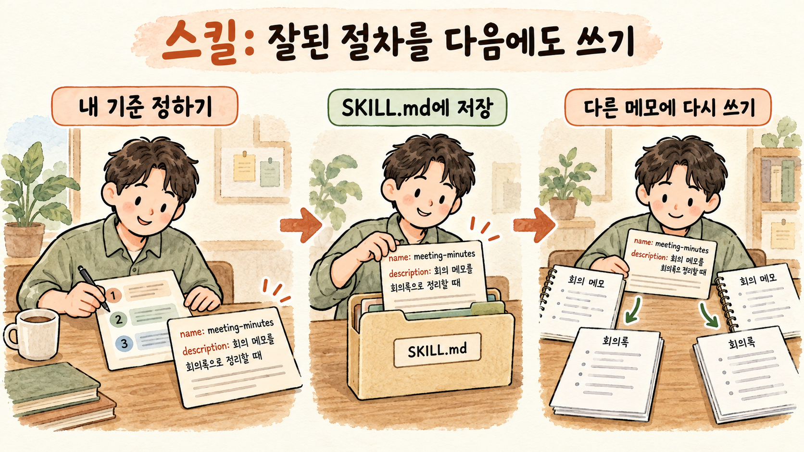

AI 생성 설명 그림 · 스킬 · 기준과 절차를 다음 자료에도 재사용

### 1. 왜 스킬로 저장할까요?

매번 “회의 내용을 어떤 순서로 정리할지” 설명하는 대신, 확인한 기준을 스킬에 저장하면 /meeting-minutes로 다시 부를 수 있습니다. 이번에는 스킬을 직접 만든 뒤 다른 메모에도 적용합니다.

| 부분 | 적을 내용 | 예시 |
| --- | --- | --- |
| name | 다음에 직접 부를 이름 | meeting-minutes → /meeting-minutes |
| description | 무슨 일을 언제 맡기는지 | 영업 미팅 메모를 결정·할 일·미정으로 정리할 때 |
| 본문 | 자료·순서·형식·확인 기준 | 원문 읽기 → 제안과 결정 구분 → 담당·마감 표 → 원문 대조 |

[스킬 빈칸 양식 MD](templates/skills/meeting-minutes/스킬_빈칸양식.md) · [작성법과 예시 MD](templates/skills/meeting-minutes/스킬_작성가이드.md) · [가상 한빛화학 자료 안내](input/hanbit-sales/README.md)

내 기준 인터뷰SKILL.md 읽기·수정외부 미팅 적용내부 회의 재사용

### 2. 인터뷰로 내 보고 기준 정하기

특별한 스킬 없이 일반 대화로 시작합니다. 질문에 한 번씩 답하고 요약을 확인합니다. 팀장에게 어떤 정보를 어떤 순서로 보여 줄지 내가 정합니다. 예를 들어 “팀장용, 결론 2줄 뒤 결정·제안·할 일 표, 없는 담당·기한은 미정”이라고 답할 수 있습니다.

[텍스트 내려받기 · 02b_Claude_회의록스킬인터뷰.txt](templates/복붙텍스트/02b_Claude_회의록스킬인터뷰.txt)

P121 · Claude Code 안 · 회의록 스킬 만들기 인터뷰

```text
- 회의 메모를 보고서로 정리하는 meeting-minutes 스킬을 만들고 싶어. @input/hanbit-sales/README.md와 @templates/skills/meeting-minutes/스킬_빈칸양식.md를 참고해줘.
- README에 안내된 참고자료 목록을 보고, 보고서에 들어갈 내용·읽을 사람·형식·꼭 지킬 기준 중 빠진 것만 최대 3개, 한 번에 하나씩 나를 인터뷰해줘.
- 내 답을 요약해 확인받은 뒤 .claude/skills/meeting-minutes/SKILL.md와 notes/회의록스킬_내기준.md에 저장해줘.
- 기존 파일은 덮어쓰지 마.
- name·description·본문에 내 기준을 반영해줘.
- disable-model-invocation은 true로 두고, 지정한 파일 경로 등 호출 뒤의 요청을 입력으로 사용하도록 적어줘.
- 없는 사실은 미정으로 남겨.
- 인터뷰 중에는 보고서를 만들지 마.
```

**왜 이렇게 요청하나요?**

- **자료·파일 지정**: AI가 참고할 자료를 좁힙니다. 파일 이름은 내가 실제로 가진 파일과 맞춰야 합니다.

- **결과 지정**: 답변만 받지 않고 다시 열어 쓸 파일을 남기려는 요청입니다.

- **지킬 기준**: 바꿔도 되는 범위와 그대로 둘 것을 정해 불필요한 작업을 줄입니다.

- **확인 방법**: 완료했다는 말보다 실제 확인한 결과와 확인하지 못한 것을 받습니다.

- 받는 사람, 꼭 들어갈 항목, 미정 정보 표기 등 질문에 답합니다. 기본 항목은 결정·제안·할 일·담당·마감·미정입니다.

- 요약을 읽고 고친 뒤 확인했다고 답합니다. 저장된 .claude/skills/meeting-minutes/SKILL.md를 메모장이나 텍스트 편집기로 엽니다.

- name·description·본문에서 내 답이 반영된 부분을 찾습니다. **본문의 내 기준 한 줄을 직접 바꿔** 저장합니다. 예를 들어 요약 2줄을 3줄로 바꾸거나 미정 항목을 별도 표로 보여 달라고 적습니다. name·파일 경로는 유지합니다.

- macOS에서 .claude가 안 보이면 Finder에서 Command+Shift+.로 숨김 파일을 표시합니다. SKILL.md는 일반 텍스트로 저장하고 이름 뒤에 .txt가 붙지 않았는지 확인합니다.

- 같은 폴더에서 Claude Code를 다시 시작하고 /를 입력해 meeting-minutes를 찾습니다.

### 3. 외부 미팅에 적용하고 내부 회의에 다시 쓰기

[텍스트 내려받기 · 02c_Claude_외부미팅정리.txt](templates/복붙텍스트/02c_Claude_외부미팅정리.txt)

P122 · Claude Code 안 · 내 스킬 첫 적용

```text
/meeting-minutes input/hanbit-sales/meetings/01_외부유통사미팅.txt를 내 기준으로 정리해줘.
- 결과는 output/meeting-minutes/외부미팅.md.
- 원문에 없는 결정·담당자·마감은 미정으로 남기고, 제안과 확정은 구분해줘.
```

**왜 이렇게 요청하나요?**

- **자료·파일 지정**: AI가 참고할 자료를 좁힙니다. 파일 이름은 내가 실제로 가진 파일과 맞춰야 합니다.

- **결과 지정**: 답변만 받지 않고 다시 열어 쓸 파일을 남기려는 요청입니다.

원문과 보고서를 나란히 봅니다. **제안을 확정 수주로 바꾸지 않았는지**, 없는 담당자·마감은 미정인지, 내가 정한 항목이 있는지 확인합니다. 기준이 틀렸다면 SKILL.md의 해당 문장을 고칩니다.

[텍스트 내려받기 · 02d_Claude_내부회의재사용.txt](templates/복붙텍스트/02d_Claude_내부회의재사용.txt)

P123 · Claude Code 안 · 같은 스킬 재사용

```text
/meeting-minutes input/hanbit-sales/meetings/03_내부주간영업회의.txt를 같은 기준으로 정리해줘.
- 결과는 output/meeting-minutes/내부회의.md.
- 원문에 없는 결정·담당자·마감은 미정으로 남겨줘.
```

**왜 이렇게 요청하나요?**

- **자료·파일 지정**: AI가 참고할 자료를 좁힙니다. 파일 이름은 내가 실제로 가진 파일과 맞춰야 합니다.

- **결과 지정**: 답변만 받지 않고 다시 열어 쓸 파일을 남기려는 요청입니다.

직접 바꾼 기준 한 줄이 두 회의록에 반영됐는지 원문과 결과를 대조합니다. 주제와 참석자가 바뀌어도 내 보고 형식이 유지되는지 봅니다. 입력 파일만 바꿔 같은 절차를 다시 쓴 경험입니다. 다른 미팅 메모는 수료 후 재사용 자료입니다.

### 스킬 카드 · 이름과 설명을 눌러 보기

```text
name: meeting-minutes
description: 회의 메모를 결정 사항과 할 일 표로 정리할 때
본문: 원문 읽기 → 결정·제안 구분 → 회의록 작성 → 원문 대조
```

name은 부를 이름, description은 언제 어떤 일을 맡기는지, 본문은 따라 할 절차입니다.

## 08. /grill-me로 내 기능 정하고 구현

오후 · 개인 실습 · Module 2

회의록 스킬을 직접 만들고 사용했습니다. 이번에는 질문하는 절차를 담은 grill-me를 제공 내용으로 설치해 첫 체크리스트의 추가 기능을 정합니다.

인터뷰에서 남길 정보·입력 방법·화면·추가 기능을 정합니다. 확인한 계획 파일을 읽고 구현을 맡깁니다. 아래 텍스트 파일을 사본으로 저장해 빈칸만 바꿉니다.

### 만든 스킬에서 grill-me로 이어가기

앞에서는 내 보고 기준으로 회의록 스킬을 만들었습니다. 이번에는 기능을 질문으로 구체화하는 grill-me 스킬을 가져다 씁니다. **name·description·본문을 읽고** 전체 내용을 Claude Code 안에 붙여 파일로 저장합니다.

| 부분 | 뜻 | 이번 예시 |
| --- | --- | --- |
| name | 직접 부를 이름 | grill-me → /grill-me |
| description | 하는 일과 사용할 상황 | 기능이 모호할 때 질문해 계획을 정리 |
| 본문 | 호출한 뒤 따를 순서와 기준 | 한 번에 한 질문 → 내 확인 → 계획 파일 저장 |

**이름과 설명 확인:** “help”와 “grill-me” 중 어떤 이름이 찾기 쉬운가요? “도와준다”와 “개인 도구의 기능을 질문으로 구체화한다” 중 어떤 설명이 맡길 일을 알려 주나요? 아래 설치 텍스트에서 name과 description을 찾아 표시해 보세요.

### 설치 체험 · Claude에게 파일 저장을 맡기기

- Claude Code가 열린 상태에서 스킬 설치 텍스트를 내려받아 엽니다.

- 파일 전체를 복사해서 Claude Code 안에 붙입니다. 설치 요청과 SKILL.md 내용이 한 파일에 들어 있습니다.

- 파일 탐색기 또는 Finder에서 .claude → skills → grill-me → SKILL.md를 열어 name·description을 확인합니다. 점으로 시작하는 .claude도 폴더 이름입니다.

- 같은 실습 폴더에서 Claude Code를 다시 시작합니다. /를 입력해 grill-me를 찾고 아래 인터뷰 요청을 보냅니다.

**스킬 설치 내용 펼치기 · 전체 복사**

[텍스트 내려받기 · 02a_Claude_스킬내용복붙설치.txt](templates/복붙텍스트/02a_Claude_스킬내용복붙설치.txt)

P88 · Claude Code 안 · 스킬 내용 붙여넣어 설치

```text
- 아래 SKILL.md 내용을 그대로 이 프로젝트의 .claude/skills/grill-me/SKILL.md에 저장해줘.
- 폴더가 없으면 만들어줘.
- 같은 내용의 파일이 있으면 그대로 두고, 다른 내용이면 덮어쓰지 말고 알려줘.
- name·description·본문을 바꾸거나 새로 작성하지 마.
- templates/skills/grill-me의 LICENSE와 SOURCE.md도 같은 스킬 폴더에 복사해줘.
- 설치만 하고 인터뷰는 아직 시작하지 마.
- 저장 경로와 name·description만 짧게 알려줘.

SKILL.md 내용:
---
name: grill-me
description: 만들고 싶은 개인 도구나 추가 기능을 짧게 인터뷰하고, 확인한 계획과 구현 요청을 정리한다. 무엇을 입력하고 어떤 결과를 볼지 아직 모호할 때 사용한다.
disable-model-invocation: true
---

# 내 도구를 정하는 짧은 인터뷰 · 교육용

Matt Pocock의 grill-me/grilling에서 질문으로 계획을 구체화하는 방식을 참고한 수업용 버전이다. 원본과 달리 다른 스킬 없이 실행하며, 8H 개인 실습 범위에서 인터뷰를 끝낸다.

사용자의 요청: $ARGUMENTS

## 질문과 종료

- 한국어로 쉬운 질문을 한 번에 하나씩 하고 답을 기다린다. 이미 알려 준 내용은 다시 묻지 않는다. 최대 3개 질문으로 필요한 내용을 정한다.
- 누가 언제 쓰는지, 남기고 싶은 정보와 입력 방법, 보고 싶은 결과와 추가 기능을 답에서 구체화한다. 장소 이름은 예시이며 특정 항목이나 앱으로 제한하지 않는다.
- 질문에는 추천 선택지와 자유롭게 답할 여지를 준다. 최종 선택은 사용자가 한다. 기능은 최대 3개, 화면은 1개로 줄이고 나머지는 다음 개선으로 남긴다.
- 이 실습은 HTML 한 파일, 외부 라이브러리·API·서버·로그인 없는 범위다. 범위를 넘는 요청은 구현 가능한 작은 대안을 함께 제안하고 선택을 기다린다.
- 사용 동작으로 확인할 기준을 정한다. 예: 두 건 입력 → 한 건 완료 → 새로고침 후 저장 확인. 실행하지 않은 검사는 미확인이다.
- 질문 뒤 확정한 내용과 남은 선택을 요약하고 사용자 확인을 기다린다. 3개 질문 뒤에도 중요한 선택이 남으면 추측하지 말고 그 선택을 표시한다. 사용자가 더 묻기를 원하면 추가 질문 횟수를 기록한다.

## 확인 후 남길 두 파일

사용자가 계획을 확인하면 다음 파일만 작성한다. 아직 앱을 구현하지 않는다. 같은 이름이 있으면 보존하고 새 파일명을 안내한다.

1. `notes/내도구_인터뷰.md`: 사용자 답, 확정 기능, 다음 개선, 직접 검사 기준. `templates/planning/01_내도구_빈칸템플릿.md`의 PRD 4칸·IA 3칸·사용 여정 3칸에 맞춰 확인한 계획을 정리한다. 모르는 내용은 미정으로 표시한다.
2. `notes/내도구_구현요청.txt`: 그 계획을 포함한 복사 가능한 구현 요청. 기존 파일 보존과 새 HTML 파일명 안내, 기능 최대 3개·화면 1개, 브라우저 localStorage 저장과 저장 실패 안내, 입력 텍스트를 HTML로 실행하지 않기, 실제 검사와 미확인 구분을 포함한다. 계획은 사용자가 확인했다는 표현을 쓴다.

끝에는 실제 파일명과 남은 선택만 짧게 안내한다. 사용자가 내용을 읽고 구현 요청을 따로 붙여 넣어야 구현을 시작한다.
```

**왜 이렇게 요청하나요?**

- **본문까지 전달**: 이름만 설치하는 것이 아니라 실제로 따라야 할 질문 순서와 기준까지 파일에 저장하기 위해서입니다.

- **기존 파일 보존**: 내가 이미 만든 스킬을 잘못 덮어쓰지 않도록 합니다.

이제 /grill-me가 내가 저장한 질문 순서를 사용하는지 직접 체험합니다. 설치는 파일 저장, 사용은 스킬 호출입니다. 지금부터 질문 하나에 답하고 확인한 계획으로 내 도구를 개선합니다.

**앞 단계에서 이어서:** 첫 HTML을 버리지 않고 내 도구의 개선판을 만듭니다. 인터뷰로 기능을 고르고 계획을 확인한 뒤 구현합니다.

오전에 정한 의도 한 문장을 먼저 말합니다. 무엇을 만들지와 그 도구로 무엇이 달라지길 원하는지를 함께 알려 주세요. /grill-me에서 이번에 만들 기능과 확인 기준을 정합니다.

### 인터뷰로 내 기능 정하기

**grill-me는 질문으로 막연한 아이디어를 구체화하는 스킬**입니다. 오늘은 첫 도구에 남길 정보나 추가 기능을 한 번 정해 봅니다. 교육용 버전은 최대 3개 질문 뒤 계획 확인을 받고 멈춥니다. 원본과 질문 방식·종료 조건이 다릅니다.

**name: grill-me**는 /grill-me로 부를 이름입니다. **description**은 “개인 도구나 추가 기능을 인터뷰하고, 확인한 계획과 구현 요청을 정리한다”는 사용 설명입니다. 이름만 보고 고르지 말고 무엇을 언제 하는지 읽으세요.

- **인터뷰** 아래 요청을 Claude Code 안에 붙여 넣습니다. 한 질문씩 답하세요. 이미 정한 내용은 바로 알려 줍니다.

[텍스트 내려받기 · 03_Claude_G1_기능인터뷰.txt](templates/복붙텍스트/03_Claude_G1_기능인터뷰.txt)

P89 · Claude Code 안 · G1 · 인터뷰 시작

```text
/grill-me 내 첫 도구를 개선하고 싶어.
- 추가할 정보나 기능: [남기고 싶은 정보 또는 추가 기능].
- 빠진 내용만 최대 3개, 한 번에 하나씩 질문해줘.
- 내 확인 뒤 계획과 구현 요청을 파일로 남겨줘.
- 아직 구현하지 마.
```

**왜 이렇게 요청하나요?**

- **확인 방법**: 완료했다는 말보다 실제 확인한 결과와 확인하지 못한 것을 받습니다.

예: 사진 메모에 장소뿐 아니라 날짜·상태를 남기기, 체크리스트에 담당자 넣기, 남은 일만 보기. “잘 모르겠어. 추천해줘”라고 답해도 됩니다. 제안 중 내게 필요한 것만 고릅니다. 답변 예시는 [사용 한 장](templates/skills/grill-me/사용방법.md)에 있습니다.

- **계획 확인** 요약을 읽고 빠진 정보나 기능을 고친 뒤 확인했다고 답합니다. 실제로 생성된 notes/내도구_인터뷰.md와 notes/내도구_구현요청.txt를 엽니다. 기능 3개 이하·입력 방법·결과 화면·직접 검사 기준을 확인합니다. **미정 항목이 남으면 구현 전에 결정**합니다.

- **구현** 아래 A3 요청으로 확인한 계획 파일을 읽게 합니다. 기존 첫 도구는 보존하고 새 HTML 파일을 만듭니다. 아래 직접 작성 폼과 중복으로 요청하지 않습니다.

- **직접 검사** 새 파일을 열어 내 검사 기준대로 눌러 봅니다. 성공·오류·미확인과 실제 파일명을 기록합니다.

**이번 단계에 남는 것:** 인터뷰 기록 1개 + 구현 요청 1개 + 내 기능이 들어간 새 HTML 파일 1개. 인터뷰는 AI 검사가 아니며 구현 뒤 사람의 직접 검사는 그대로 합니다.

설치·스킬 호출이 막히면 아래 직접 작성 방식으로 합류합니다. 인터뷰 미실행을 기록하고 A3 구현 요청은 한 번만 보냅니다. 설치가 막히면 제공 합류 방식으로 이어갑니다.

[Matt Pocock 원본](https://github.com/mattpocock/skills/tree/main/skills/productivity/grill-me) · [Claude Code Skill 공식 안내](https://code.claude.com/docs/en/skills)

[텍스트 내려받기 · 04_Claude_A3_확인한계획구현.txt](templates/복붙텍스트/04_Claude_A3_확인한계획구현.txt)

P106 · Claude Code 안 · A3 · 확인한 계획 적용

```text
- notes/내도구_구현요청.txt에 저장한 확인된 계획대로 작은 도구를 구현해줘.
- 실제 파일명이 다르면 내가 지정한 경로를 사용해.
- 기존 index.html은 보존하고 새 파일에 저장해줘.
- 계획의 기능과 직접 검사 기준을 유지하고, 실제 검사 결과와 미확인을 4줄 이내로 알려줘.
```

**왜 이렇게 요청하나요?**

- **자료·파일 지정**: AI가 참고할 자료를 좁힙니다. 파일 이름은 내가 실제로 가진 파일과 맞춰야 합니다.

- **결과 지정**: 답변만 받지 않고 다시 열어 쓸 파일을 남기려는 요청입니다.

- **지킬 기준**: 바꿔도 되는 범위와 그대로 둘 것을 정해 불필요한 작업을 줄입니다.

- **확인 방법**: 완료했다는 말보다 실제 확인한 결과와 확인하지 못한 것을 받습니다.

**인터뷰가 막히면 · 내 손으로 10칸 작성하기**

[직접 계획 텍스트 내려받기](templates/복붙텍스트/파일내용/내도구_직접계획.txt) · 빈칸을 채운 전체 내용만 Claude Code에 전달합니다.

**세 문장부터 적어 보세요.**

누가 쓰나요? 무엇을 넣나요? 무엇이 나오면 끝인가요? 답을 먼저 적고 아래 10칸에 나눠 넣습니다. PRD·IA·User Journey는 외울 용어가 아니라 내 계획을 정리하는 세 묶음입니다. 각 칸은 한 문장으로 시작하세요.

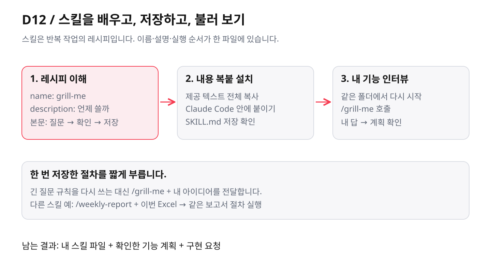

**D12 · 스킬을 배우고, 저장하고, 불러 보기**
설치 명령을 외우기보다 내가 저장한 절차를 직접 호출해 봅니다. · 직접 그린 설명 도식이며 실제 제품 화면이 아닙니다. 이미지를 눌러 확대할 수 있습니다.

**도식 내용을 글로 읽기**

- name은 부를 이름, description은 하는 일과 사용할 상황입니다. 본문에는 실행 순서를 적습니다.

- 제공 텍스트에는 설치 요청과 SKILL.md 내용이 함께 들어 있습니다. 전체를 Claude Code 안에 붙입니다.

- Claude가 .claude/skills/grill-me/SKILL.md에 저장한 뒤 같은 폴더에서 다시 시작합니다.

- /grill-me로 인터뷰하고 확인한 계획을 구현 요청에 사용합니다.

### 1. 내 도구를 10칸으로 계획

- 예시를 읽고 PRD 4칸·IA 3칸·여정 3칸을 직접 적습니다.

- 현재 파일에서 바꿀 업무 기준을 한 가지 고르세요.

- 내가 다시 읽고 기능이 3개 이하인지, 직접 확인할 방법이 있는지 봅니다.

| 개념 | 쉬운 뜻 | 내 체크리스트에서 |
| --- | --- | --- |
| PRD | 만들기 약속 | 누구의 불편·기능 3개·확인 방법 |
| IA | 서랍 지도 | 소개·입력·결과에 들어갈 정보 |
| User Journey | 사용 이야기 | 마감 전 걱정→입력·체크→남은 일 확인 |

인터뷰가 막히면 [직접 계획 텍스트](templates/복붙텍스트/파일내용/내도구_직접계획.txt)를 채웁니다. 두 경로 중 하나만 실행합니다.

### 2. 내 최종 계획 한 번 전달

- 내 계획안 만들기 → 요약 검토 → 계획 복사 순서로 누릅니다.

- 복사한 계획을 A3로 Claude에 한 번 붙여 넣습니다.

- 기존 첫 파일은 보존하고 알려 준 실제 새 파일을 엽니다.

**성공 기준:** 내가 적은 기능과 확인 조건이 실제 파일에 반영됐습니다.

### 3. 계획의 확인 기준으로 검사

- 두 항목 추가·한 항목 완료·새로고침 또는 내 기준을 검사합니다.

- 결과와 실제 파일명을 기록합니다. 추가 문구 수정 요청은 필수가 아닙니다.

인터뷰 경로: 생성된 계획 파일 + 04번 A3 요청. 인터뷰가 막힌 경우: 직접 작성 텍스트의 빈칸을 채워 전체를 전달합니다. 둘 중 하나만 사용합니다. 기존 계획을 다시 작성하게 하지 않습니다.

숨긴 폴더가 안 보이면 Windows 파일 탐색기의 숨긴 항목 표시를 켭니다. macOS Finder에서는 Command + Shift + .을 누릅니다.

### 직접 만들기 · 상담 고객을 기억하는 작은 앱

이제 화면을 하나 더 만듭니다. 상담하던 고객을 어디 적었는지 찾는 대신, **고객 추가·검색·상태 변경**을 한 화면에서 해 봅니다. 기록은 서버 DB가 아니라 **내 브라우저**에 남습니다.

샘플 5명한 명 추가검색·상태 변경닫았다 열기

| 준비 | 직접 할 것 | 남는 결과 |
| --- | --- | --- |
| 가상고객_5명.csv | 한빛테스트상사 한 명 추가 | 고객 6명 |
| 고객관리_스펙.md | 회사명 검색·상담 상태 변경 | 선택한 고객의 후속연락 표시 |
| 같은 브라우저·같은 주소 | 새로고침·닫았다 다시 열기 | 기록 보존 확인 |

[고객관리 요구사항 MD](templates/customer-app/01_고객관리_스펙.md) · [가상 고객 CSV](input/customer-app/가상고객_5명.csv)

[미리 만든 예시 · 기능 먼저 보기](../../assets/28-고객관리예시.html) — 강사는 고객 추가·검색·다시 열기를 짧게 보여 줍니다. 실습에서는 아래 요청으로 내 앱을 만듭니다.

### 1. 만들고 열기

[텍스트 내려받기 · 04b_Claude_고객관리앱.txt](templates/복붙텍스트/04b_Claude_고객관리앱.txt)

P125 · Claude Code 안 · 고객관리 앱 만들기

```text
- @templates/customer-app/01_고객관리_스펙.md로 작은 고객관리 웹앱을 만들어줘.
- 시작 자료: @input/customer-app/가상고객_5명.csv. 실제 개인정보는 넣지 마.
- 기능: 고객 추가·회사명 검색·상담 상태 변경. 결과는 output/customer-app/index.html.
- 같은 브라우저의 localStorage에 저장하고, 첫 실행에만 샘플을 넣어줘. 입력은 글자로 표시하고 저장 실패는 안내해줘.
- 기존 파일은 보존해줘. 제공 로컬 웹 도구로 같은 주소에서 열어줘. 외부 서버·DB·API는 쓰지 마.
- 실제 검사 결과와 브라우저 주소를 알려줘. 브라우저를 닫고 다시 여는 확인은 내가 할게.
```

**왜 이렇게 요청하나요?**

- **자료·파일 지정**: AI가 참고할 자료를 좁힙니다. 파일 이름은 내가 실제로 가진 파일과 맞춰야 합니다.

- **결과 지정**: 답변만 받지 않고 다시 열어 쓸 파일을 남기려는 요청입니다.

- **지킬 기준**: 바꿔도 되는 범위와 그대로 둘 것을 정해 불필요한 작업을 줄입니다.

- **확인 방법**: 완료했다는 말보다 실제 확인한 결과와 확인하지 못한 것을 받습니다.

### 2. 내가 눌러 보기

- Claude가 알려 준 실제 로컬 주소를 엽니다. 처음 고객 5명을 봅니다.

- 한빛테스트상사·홍예진·수분 세럼·신규로 한 명을 추가합니다. 전체 6명인지 봅니다.

- 한빛을 검색해 한 명을 찾고 상태를 후속연락으로 바꿉니다. 검색을 비우면 다시 6명입니다.

- 새로고침 → 브라우저 닫기 → 같은 주소로 다시 열기 순서로 확인합니다. 6명과 상태가 남아 있어야 합니다.

- 빈 회사명은 막히는지 봅니다. 실제 개인정보는 넣지 않습니다.

### 3. 작은 개선 한 가지

[텍스트 내려받기 · 04c_Claude_고객메모추가.txt](templates/복붙텍스트/04c_Claude_고객메모추가.txt)

P126 · Claude Code 안 · 고객 메모 칸 하나 추가

```text
- 고객관리 앱에 메모 입력칸 하나를 추가해줘.
- 기존 고객과 상태를 지우지 마. 메모도 같은 브라우저에 저장해줘.
- 기존 고객의 메모가 비어 있어도 오류 없이 보여줘.
- 달라진 기능과 실제 검사 결과만 짧게 알려줘.
```

**왜 이렇게 요청하나요?**

- **결과 지정**: 답변만 받지 않고 다시 열어 쓸 파일을 남기려는 요청입니다.

- **확인 방법**: 완료했다는 말보다 실제 확인한 결과와 확인하지 못한 것을 받습니다.

기존 고객과 상담 상태가 그대로인지 확인한 뒤 메모를 적고 새로고침합니다. **추가 기능을 만들 때 기존 데이터를 지키는 경험**입니다.

- [ ] 추가·검색·상태 변경을 직접 눌렀다.

- [ ] 닫았다 열어 고객과 상태 보존을 확인했다.

- [ ] 메모 칸을 추가해도 이전 고객 기록이 남았다.

## 09. 내 도구 확인하고 사본 보관

오후 · 개인 실습 · Module 2

### 1. 혼자 다시 열기

- 파일을 닫고 같은 파일을 다시 엽니다.

- 내 확인 기준만 보고 동작을 확인합니다.

- 실습 기록에 **성공·오류·미확인**을 적습니다.

### 2. 안전하게 복구

- **작동한 파일 사본**을 보관합니다.

- 작은 편집을 되돌릴 때는 /rewind의 범위를 확인합니다. 외부 셀·일부 쉘 변경은 별도 복구합니다.

**열어서 확인:** [공식 복구 범위](https://code.claude.com/docs/en/checkpointing)

**성공 기준:** 내 결과와 복구할 사본이 남았습니다.

작동한 파일과 확인 기록을 보존합니다.

이 단계에서는 복구할 사본을 미리 보관합니다. /rewind로 되돌릴 수 있는 범위는 공식 안내를 확인하고 지원 범위 밖의 변경은 보관한 사본으로 복구합니다.

## 10. 비용 보고서의 입력과 완성 예시

오후 · 개인 실습 · Module 2

이제 같은 업무 자료를 끝까지 발전시킵니다. 회의록에서는 없는 사실을 만들지 않는 기준을 배웠고 비용 보고서에서는 계산·검사·오류 복구·반복 실행을 경험합니다.

가상의 한빛화학 영업부서에서 미팅을 정리한 뒤 주간 비용도 확인합니다. 제공 비용 Excel은 계산을 배우는 별도 교육용 표입니다. 회의의 제안 금액과 Excel의 **비용 금액을 합쳐 매출로 해석하지 않습니다**.

**앞 단계에서 이어서:** 첫 작품은 보관했습니다. 이제 공통 업무인 비용 보고서로 넘어갑니다. 여기부터 규칙·Skill·팀·실행기는 같은 비용 데이터를 다룹니다.

### 입력 하나와 결과 숫자만 봅니다

AI가 열 이름만 보고 뜻을 짐작하게 두지 않습니다. **한 행이 무엇인지, 숫자의 단위가 무엇인지, 상태가 무엇을 뜻하는지** 먼저 맞춥니다.

| 항목 | 이번 비용 보고서에서 확인할 뜻 |
| --- | --- |
| 전표번호 | 비용 한 건을 구분하는 번호. 서로 다른 건에 같은 번호를 쓰지 않는다 |
| 금액 | 수량×단가로 계산한 원 단위 비용. 3000은 3,000원이다 |
| 처리상태 | 완료·진행으로 나누어 세는 값. 완료라고 해서 결제까지 끝났다고 짐작하지 않는다 |

- workbooks/주간비용_실습.xlsx를 열고 비용내역 탭으로 갑니다.

- 전표번호·수량·단가·금액 열을 찾고 한 행의 수량×단가를 확인합니다.

- 아래 완성 예시에서 원본40건·2,333,300원을 봅니다. 다음 단계에서 사본 한 곳을 바꿉니다.

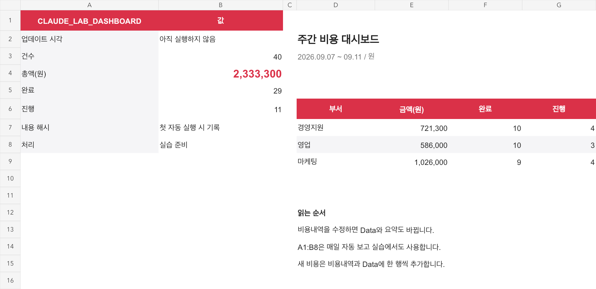

제공 Excel에서 렌더한 초기 Dashboard · Google 실계정 화면이 아닙니다.

**Excel 탭과 데이터 구조 더 보기**

오늘은 가상 회사의 주간 비용 마감입니다. 사람이 Excel 사본의 값을 바꾸고 제공 도구가 새 입력을 읽어 비용 보고서를 생성합니다.

| 탭 | 이번 실습에서 |
| --- | --- |
| Dashboard | 원본 요약을 보기. 새 보고서는 output의 실제 파일에서 확인 |
| 비용내역 | 14개 열 중 전표번호·부서·품목·수량·단가·금액·처리상태를 사용 |
| Data | 원본의 연결표. 로컬 계산은 비용내역을 직접 읽음 |
| 실습안내 | 원본 파일 안내. 현재 실행 순서는 이 핸드북을 따름 |

[원본 Excel 열기](workbooks/주간비용_실습.xlsx). **원본 파일을 복사하고 사본에서 수정**합니다. Dashboard에는 파일에 저장된 이전 계산값이 보일 수 있습니다. 새 입력의 결과는 도구를 실행한 뒤 output의 HTML에서 확인합니다.

### 1. 오늘 다룰 숫자 확인

- 비용내역 탭의 헤더와 원본 40건을 봅니다.

- 수량×단가가 금액인지 확인합니다.

- 초기 보고서 예시와 원본 총액을 대조합니다.

**열어서 확인:** [원본 보고서 예시](templates/report-example.html)

**성공 기준:** 원본 40건·2,333,300원. 원본은 보존합니다.

### 내 업무를 한 문단으로 · 첫 작업은 하나만

잘 쓴 기획서가 필요하지 않습니다. **누가 쓰는지 · 넣을 자료 · 원하는 결과 · 처음 해 볼 작은 작업 · 확인 방법**이 드러나게 평소 말로 적습니다. 한 번에 부서 전체를 자동화하기보다 메모 한 개나 Excel 한 파일부터 고릅니다.

**줄글 예시 보기 · 미팅 메모 / 비용 보고**

저는 한빛화학 영업팀에서 고객 미팅 뒤 메모를 정리합니다. 메모 한 개를 넣으면 팀장에게 보여 줄 결정 사항과 다음 할 일 표가 나오면 좋겠습니다. 이번에는 메모 한 개만 정리하고, 담당자와 날짜가 없으면 미정으로 남기겠습니다. 원문과 표를 비교해 빠진 일이나 지어낸 내용이 없는지 확인하겠습니다.

저는 매주 Excel 비용표를 받아 팀장에게 보고합니다. 이번에는 파일 한 개의 건수와 총액만 보고서로 만들고 싶습니다. 메일 발송이나 일정 자동화는 나중에 붙이겠습니다. 원본에서 두 건을 골라 계산과 합계를 비교하겠습니다.

**내 메모**

내 업무 · 줄글로 적어도 됩니다

메모는 [개인 실습 기록지](notes/내업무_실습기록.md) 사본에 적습니다.

입력한 모든 칸을 항목 이름과 함께 복사합니다.

쓴 문단을 전체 복사해 아래 빈칸에 넣습니다. AI가 고른 첫 작업이 너무 크면 **“파일 한 개의 요약만 먼저 하자”**처럼 줄입니다.

[텍스트 내려받기 · 04a_Claude_내업무_메타프롬프트.txt](templates/복붙텍스트/04a_Claude_내업무_메타프롬프트.txt)

P132 · Claude Code 안 · 내 업무를 작은 요청으로 바꾸기

```text
- 내가 줄이고 싶은 업무: [내 업무를 한 문단으로 적기]
- 이 중 처음 해 볼 작은 작업 하나를 골라줘. 아직 만들지는 마.
- 꼭 필요한 정보가 없으면 질문 하나만 해줘.
- 내가 확인하면 입력·결과·확인 방법이 담긴 짧은 실행 요청을 제안해줘.
```

**왜 이렇게 요청하나요?**

- **아직 만들지 마**: 지금은 실행할 요청을 준비하는 단계입니다. 답을 보고 범위를 고친 다음 제작을 맡깁니다.

- **질문 하나 + 짧은 불릿**: 빠진 정보만 채우고 내가 이해할 수 있는 요청을 받습니다.

앞의 첫 도구에서도 같은 순서였습니다. **내 말 → 질문·요청 초안 → 내 확인 → 제작**. 다음 비용 실습은 준비된 예시로 연습하고, 내 업무 스크립트 단계에서는 그중 비용표 정리에 해당하는 작은 작업을 적용합니다. 다른 종류의 업무는 이 메모를 수료 후 첫 작업 계획으로 남깁니다.

## 11. 내 Excel 사본 수정·추가

오후 · 개인 실습 · Module 2

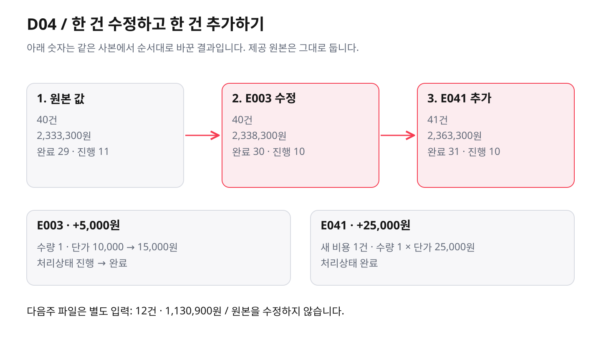

**D04 · 한 건 수정하고 한 건 추가하기**
총액의 변화와 건수의 변화를 함께 확인합니다. · 직접 그린 설명 도식이며 실제 제품 화면이 아닙니다. 이미지를 눌러 확대할 수 있습니다.

**도식 내용을 글로 읽기**

- 원본은 40건, 2,333,300원입니다.

- E003의 단가를 10,000원에서 15,000원으로 바꾸고 진행을 완료로 바꾸면 40건, 2,338,300원입니다. **총액이 5,000원 늘어납니다**.

- E041을 수량 1, 단가 25,000원으로 추가하면 41건, 2,363,300원입니다. 총액이 다시 25,000원 늘어납니다.

- 다음주 파일 12건, 1,130,900원은 별도의 새 입력입니다.

### 1. 내 사본의 값 한 곳 수정

- 원본을 복사해 workbooks/내주간비용.xlsx로 저장합니다.

- E003의 단가 10000→15000, 처리상태 진행→완료로 바꾸고 저장합니다.

[텍스트 내려받기 · 내_Excel_사본_수정·추가_01_Claude_P67.txt](templates/복붙텍스트/실행요청/내_Excel_사본_수정·추가_01_Claude_P67.txt)

P67 · Claude Code 안 · 제공 도구로 보고서 실행

```text
- 입력: workbooks/내주간비용.xlsx
- 결과 폴더: output/my-costs
- @integrations/local-report/실행안내.md의 제공된 주간 비용 보고 도구를 실행해줘. 계산 코드는 새로 만들거나 바꾸지 마.
- 원본과 다른 결과는 보존하고, 입력 오류가 나면 기존 정상 보고서를 유지해줘.
- 실제 건수·총액·검사 결과와 보고서 여는 방법만 짧게 알려줘.
```

**왜 이렇게 요청하나요?**

- **자료·파일 지정**: AI가 참고할 자료를 좁힙니다. 파일 이름은 내가 실제로 가진 파일과 맞춰야 합니다.

- **결과 지정**: 답변만 받지 않고 다시 열어 쓸 파일을 남기려는 요청입니다.

- **지킬 기준**: 바꿔도 되는 범위와 그대로 둘 것을 정해 불필요한 작업을 줄입니다.

- **확인 방법**: 완료했다는 말보다 실제 확인한 결과와 확인하지 못한 것을 받습니다.

**성공 기준:** 40건·2,338,300원으로 5,000원 증가합니다.

**막히면:** 편집 앱이 없으면 제공 수정후 파일로 합류하고 직접 편집 여부를 기록합니다.

### 2. 새 비용 한 건 추가

- E041 / 부서 마케팅 / 품목 행사 안내 카드 / 수량 1 / 단가 25000 / 상태 완료를 새 상세행에 적습니다.

- 금액은 같은 행의 수량×단가 수식으로 넣고 저장합니다.

- 아래 요청으로 수정한 사본을 다시 처리합니다.

[텍스트 내려받기 · 내_Excel_사본_수정·추가_02_Claude_P68.txt](templates/복붙텍스트/실행요청/내_Excel_사본_수정·추가_02_Claude_P68.txt)

P68 · Claude Code 안 · 제공 도구로 보고서 실행

```text
- 입력: 수정한 workbooks/내주간비용.xlsx
- 결과 폴더: output/my-costs
- @integrations/local-report/실행안내.md의 제공된 주간 비용 보고 도구를 실행해줘. 계산 코드는 새로 만들거나 바꾸지 마.
- 원본과 다른 결과는 보존하고, 입력 오류가 나면 기존 정상 보고서를 유지해줘.
- 내가 바꾼 금액이 보고서에 반영됐는지 확인해줘.
- 실제 건수·총액·검사 결과와 보고서 여는 방법만 짧게 알려줘.
```

**왜 이렇게 요청하나요?**

- **자료·파일 지정**: AI가 참고할 자료를 좁힙니다. 파일 이름은 내가 실제로 가진 파일과 맞춰야 합니다.

- **결과 지정**: 답변만 받지 않고 다시 열어 쓸 파일을 남기려는 요청입니다.

- **지킬 기준**: 바꿔도 되는 범위와 그대로 둘 것을 정해 불필요한 작업을 줄입니다.

- **확인 방법**: 완료했다는 말보다 실제 확인한 결과와 확인하지 못한 것을 받습니다.

**성공 기준:** 41건·2,363,300원. **원본 40건은 그대로**입니다.

합류 입력: [수정후41건 파일](workbooks/주간비용_수정후.xlsx). 이후 공통 실습은 이 정답 입력을 사용하므로 경로를 맞춥니다.

## 12. 보고서와 공유 문안 만들기

오후 · 개인 실습 · Module 2

**앞 단계에서 이어서:** 방금 내 사본으로 숫자의 변화를 확인했습니다. 팀 실습까지 모두 같은 수치를 비교하도록 제공 수정후41건으로 공통 보고서를 만듭니다.

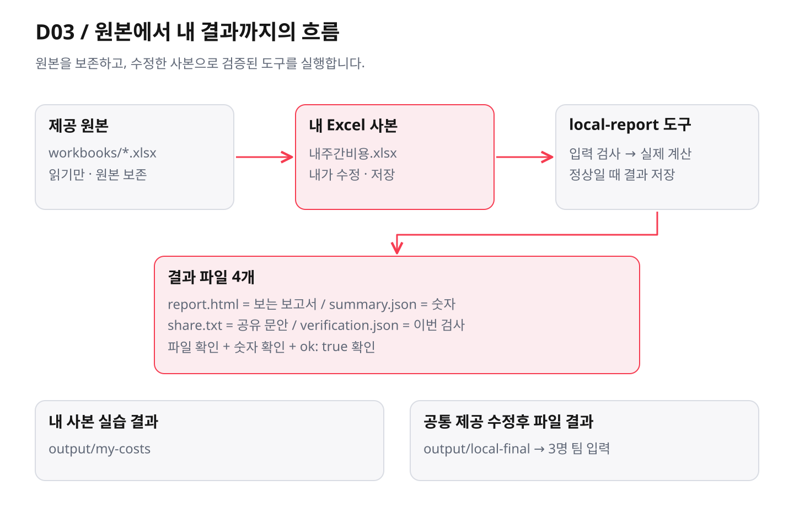

**D03 · 원본에서 내 결과까지의 흐름**
내 사본 결과 폴더와 3명 팀이 읽을 공통 결과 폴더를 구분합니다. · 직접 그린 설명 도식이며 실제 제품 화면이 아닙니다. 이미지를 눌러 확대할 수 있습니다.

**도식 내용을 글로 읽기**

- workbooks 폴더의 제공 원본은 보존하고 내주간비용.xlsx 사본만 수정합니다.

- 검증된 local-report 도구를 실행하면 report.html, summary.json, share.txt, verification.json이 만들어집니다.

- **내 사본 결과는 output/my-costs**입니다. 공통 제공 수정후 파일 결과는 output/local-final이며 3명 팀이 읽습니다. 같은 숫자를 보고서와 팀에서 사용합니다.

### 1. 공통 보고서 생성

- 아래 요청으로 실행을 맡깁니다. AI에게 보고서 코드를 다시 만들라고 요청하지 않습니다.

[텍스트 내려받기 · 보고서와_공유_문안_만들기_01_Claude_P69.txt](templates/복붙텍스트/실행요청/보고서와_공유_문안_만들기_01_Claude_P69.txt)

P69 · Claude Code 안 · 제공 도구로 보고서 실행

```text
- 입력: workbooks/주간비용_수정후.xlsx
- 결과 폴더: output/local-final
- @integrations/local-report/실행안내.md의 제공된 주간 비용 보고 도구를 실행해줘. 계산 코드는 새로 만들거나 바꾸지 마.
- 원본과 다른 결과는 보존하고, 입력 오류가 나면 기존 정상 보고서를 유지해줘.
- 실제 건수·총액·검사 결과와 보고서 여는 방법만 짧게 알려줘.
```

**왜 이렇게 요청하나요?**

- **자료·파일 지정**: AI가 참고할 자료를 좁힙니다. 파일 이름은 내가 실제로 가진 파일과 맞춰야 합니다.

- **결과 지정**: 답변만 받지 않고 다시 열어 쓸 파일을 남기려는 요청입니다.

- **지킬 기준**: 바꿔도 되는 범위와 그대로 둘 것을 정해 불필요한 작업을 줄입니다.

- **확인 방법**: 완료했다는 말보다 실제 확인한 결과와 확인하지 못한 것을 받습니다.

**열어서 확인:** output/local-final/report.html · share.txt

**성공 기준:** 41건·2,363,300원. 경영지원 721,300·영업 586,000·마케팅 1,056,000원입니다.

### 2. 품질과 공유 문안 확인

- verification.json의 ok:true·품질 검사·원본 보존을 확인합니다.

- share.txt의 출처·생성 시각·건수·총액을 읽습니다.

- templates/마감브리핑_양식.md 사본에 핵심 숫자를 적습니다.

**열어서 확인:** summary.json · verification.json · 내 브리핑 양식

**막히면:** ok:false이면 **이전 HTML을 새 입력 성공으로 읽지 않습니다**. 오류 안내로 이동합니다.

공유 문안은 보내기 전의 초안입니다. 받는 사람과 요청할 행동을 내 상황에 맞게 한 줄씩 바꾸고 건수·총액·출처는 생성된 결과와 다시 대조하세요. 바꾼 사본은 따로 보관합니다.

### 직접 만들기 · 같은 자료로 결과물 5종

숫자만 정리한 보고서에서 한 걸음 더 갑니다. **팀장·팀원·메일을 받는 사람**에게 필요한 형태로 같은 자료를 바꿉니다. 먼저 앞 단계의 수정후 41건 보고서가 정상인지 확인합니다.

| 입력 4개 | 역할 | 넣는 이유 |
| --- | --- | --- |
| 이번주비용.csv | 사실 | 무슨 비용이 얼마나 있었는가 |
| 보고기준.md | 기준 | 누가 어떤 형식으로 읽는가 |
| 지난주보고서.md | 비교 | 지난주와 무엇이 달라졌는가 |
| 이번주메모.md | 맥락 | 팀장은 무엇을 먼저 보고 싶어 하는가 |

사실·기준·비교·맥락같은 집계수신자별 결과 5개

자료는 [준비자료 한 장](input/weekly-report/README.md)에 모았습니다. YAML을 새로 배우는 대신 기준은 쉬운 MD로 제공합니다. Google Docs·Slack 연결 없이 로컬 파일로 먼저 완성합니다.

### 1. 준비자료 읽고 만들기

- input/weekly-report의 네 자료를 읽습니다. 사실·기준·비교·맥락에서 한 가지씩 찾습니다.

- 메모의 “진행 중 비용을 먼저”가 보고서에 어떻게 보여야 할지 생각합니다.

- 아래 요청을 한 번 보낸 뒤 결과 폴더에서 파일 5개를 찾습니다.

[텍스트 내려받기 · 04d_Claude_보고서 5종.txt](templates/복붙텍스트/04d_Claude_보고서 5종.txt)

P127 · Claude Code 안 · 수신자별 보고서 5종

```text
- @input/weekly-report/README.md의 자료 4개로 수신자별 결과물 5개를 만들어줘.
- 결과: output/audience-report/weekly-report.md · weekly-report.html · team-summary.md · email-draft.md · chart-data.csv.
- 이번 주 CSV는 output/local-final의 검증된 집계와 대조해줘. 같지 않으면 중단해줘.
- 보고 기준·지난주 수치·이번 주 메모를 반영하고, 숫자 계산은 제공 도구로 확인해줘.
- 원인은 확정하지 말고 근거와 가설을 구분해줘. 기존 결과는 보존하고 메일은 발송하지 마.
- 파일 5개 경로·건수·총액·전주 차이·미확인만 짧게 알려줘.
```

**왜 이렇게 요청하나요?**

- **자료·파일 지정**: AI가 참고할 자료를 좁힙니다. 파일 이름은 내가 실제로 가진 파일과 맞춰야 합니다.

- **결과 지정**: 답변만 받지 않고 다시 열어 쓸 파일을 남기려는 요청입니다.

- **지킬 기준**: 바꿔도 되는 범위와 그대로 둘 것을 정해 불필요한 작업을 줄입니다.

- **확인 방법**: 완료했다는 말보다 실제 확인한 결과와 확인하지 못한 것을 받습니다.

| 파일 | 누가 쓰나요? | 내가 확인할 것 |
| --- | --- | --- |
| weekly-report.md | 팀장 | 한 줄 결론·전주 차이·다음 행동 |
| weekly-report.html | 팀 전체 | KPI 카드·부서별 금액 |
| team-summary.md | 팀원 | 6줄 안에 핵심과 확인할 일 |
| email-draft.md | 보고를 받는 사람 | 제목·본문·미발송 |
| chart-data.csv | 차트를 다시 만들 사람 | 부서별 합계=총액 |

### 2. 다섯 결과의 숫자 대조

- 모든 결과에서 41건·2,363,300원을 대조합니다. 차트 CSV의 부서별 합계도 같은 총액이어야 합니다.

- 지난주 40건·2,333,300원과 비교해 1건·30,000원 증가인지 봅니다.

- 검토 한도2,400,000원과의 차이36,700원을 봅니다. 한도 이내라는 것과 업무 승인은 다른 판단입니다.

- 메모에 없는 원인·담당자·기한이 생겼다면 추정 또는 미정으로 표시됐는지 확인합니다.

### 3. 한 부분만 고치기

[텍스트 내려받기 · 04e_Claude_보고서부분수정.txt](templates/복붙텍스트/04e_Claude_보고서부분수정.txt)

P128 · Claude Code 안 · 보고서의 다음 행동만 수정

```text
- output/audience-report/weekly-report.md의 다음 행동 부분만 고쳐줘.
- 팀장이 읽도록 담당자·할 일·확인할 날짜의 표로 정리해줘.
- 메모에 없는 담당자·날짜는 미정으로 표시해줘.
- 숫자와 다른 파일은 바꾸지 마. 바뀐 부분만 보여줘.
```

**왜 이렇게 요청하나요?**

- **결과 지정**: 답변만 받지 않고 다시 열어 쓸 파일을 남기려는 요청입니다.

- **지킬 기준**: 바꿔도 되는 범위와 그대로 둘 것을 정해 불필요한 작업을 줄입니다.

- **확인 방법**: 완료했다는 말보다 실제 확인한 결과와 확인하지 못한 것을 받습니다.

수정 전후를 나란히 봅니다. **형식은 달라지고 총액은 그대로**여야 합니다. 이후 내 업무 자료는 기존 Excel 실행기 단계에서 넣습니다. 이 CSV 네 자료 실습과 입력을 섞지 않습니다.

- [ ] 네 자료의 역할을 찾아 설명했다.

- [ ] 결과 5개와 전주 차이·총액을 직접 대조했다.

- [ ] 한 부분을 수정해도 숫자와 다른 결과가 유지됐다.

## 13. 오류를 확인하고 정상 입력으로 복구

오후 · 개인 실습 · Module 2

**앞 단계에서 이어서:** 정상 보고서를 만들었으니 틀린 입력일 때 멈추고 마지막 정상 결과를 지키는지도 확인합니다. 정상 복구 후 다음 단계로 갑니다.

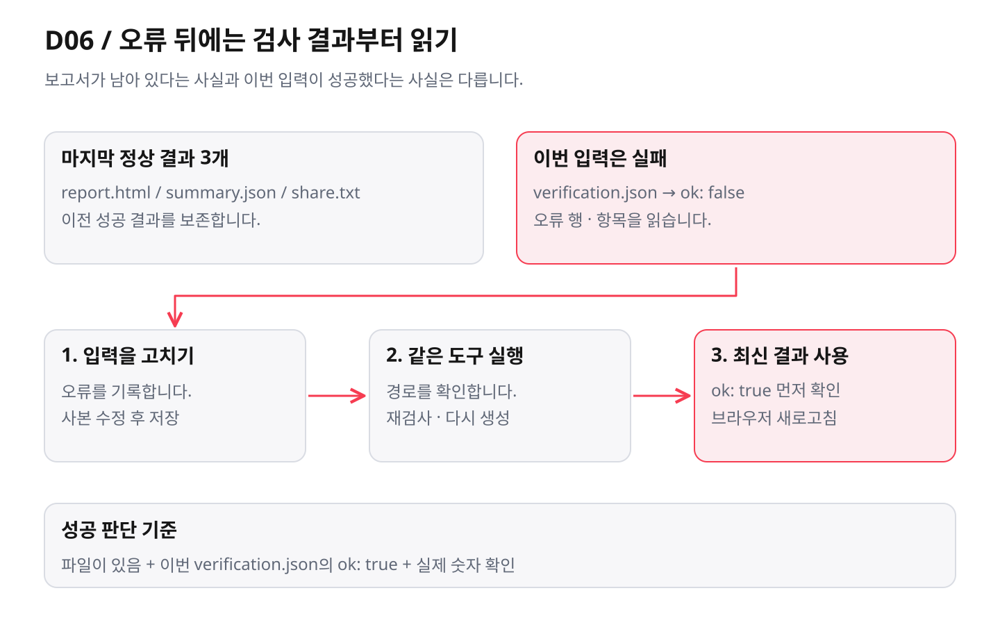

**D06 · 오류 뒤에는 검사 결과부터 읽기**
이번 verification.json과 마지막 정상 결과의 생성 시점을 함께 확인합니다. · 직접 그린 설명 도식이며 실제 제품 화면이 아닙니다. 이미지를 눌러 확대할 수 있습니다.

**도식 내용을 글로 읽기**

- 입력이 실패하면 마지막 정상 report.html, summary.json, share.txt 세 파일은 보존됩니다.

- 이번 verification.json의 ok: false와 오류 내용을 읽고 입력을 수정합니다.

- 같은 도구를 다시 실행합니다. ok: true를 확인한 뒤 최신 결과를 사용합니다. 파일 존재만으로 새 성공을 판단하지 않습니다.

### 1. 같은 입력 다시 실행

- 아래 요청으로 수정후 파일을 한 번 더 처리하고 건수·합계를 비교합니다.

[텍스트 내려받기 · 오류를_확인하고_정상_입력으로_복구_01_Claude_P75.txt](templates/복붙텍스트/실행요청/오류를_확인하고_정상_입력으로_복구_01_Claude_P75.txt)

P75 · Claude Code 안 · 제공 도구로 보고서 실행

```text
- 입력: workbooks/주간비용_수정후.xlsx
- 결과 폴더: output/local-final
- @integrations/local-report/실행안내.md의 제공된 주간 비용 보고 도구를 실행해줘. 계산 코드는 새로 만들거나 바꾸지 마.
- 원본과 다른 결과는 보존하고, 입력 오류가 나면 기존 정상 보고서를 유지해줘.
- 오류 실습 전 정상 결과를 확인해줘.
- 실제 건수·총액·검사 결과와 보고서 여는 방법만 짧게 알려줘.
```

**왜 이렇게 요청하나요?**

- **입력 파일**: 어느 Excel을 읽을지 정해 다른 파일을 분석하지 않게 합니다.

- **결과 폴더**: 보고서를 어디서 찾을지 정합니다.

- **@실행안내 + 계산 코드 유지**: 이미 준비한 도구를 쓰게 합니다. 매번 계산 프로그램을 새로 만들 필요가 없습니다.

- **원본·정상 결과 보존**: 잘못된 입력 때문에 이전 보고서까지 잃지 않도록 합니다.

- **오류 실습 전 정상 확인**: 잘못된 입력을 넣기 전의 결과와 나중 결과를 비교하려는 요청입니다.

- **건수·총액·검사·여는 방법**: 긴 설명 대신 내가 바로 확인할 정보만 받습니다.

**성공 기준:** 숫자는 같고 생성 시각은 달라질 수 있습니다.

### 2. 틀린 입력이면 멈추는지 보기

- 오류 입력을 마지막 정상 결과 폴더에 실행합니다.

- verification.json에서 중복 전표·빈 단가를 찾아봅니다.

- 정상 HTML·summary·share가 보존됐는지 봅니다.

[텍스트 내려받기 · 오류를_확인하고_정상_입력으로_복구_02_Claude_P76.txt](templates/복붙텍스트/실행요청/오류를_확인하고_정상_입력으로_복구_02_Claude_P76.txt)

P76 · Claude Code 안 · 제공 도구로 보고서 실행

```text
- 입력: workbooks/주간비용_오류.xlsx
- 결과 폴더: output/local-final
- @integrations/local-report/실행안내.md의 제공된 주간 비용 보고 도구를 실행해줘. 계산 코드는 새로 만들거나 바꾸지 마.
- 원본과 다른 결과는 보존하고, 입력 오류가 나면 기존 정상 보고서를 유지해줘.
- 잘못된 값을 고치지 말고, 오류 위치와 이유를 알려줘. 이전 정상 결과가 남아 있는지 확인해줘.
- 실제 건수·총액·검사 결과와 보고서 여는 방법만 짧게 알려줘.
```

**왜 이렇게 요청하나요?**

- **자료·파일 지정**: AI가 참고할 자료를 좁힙니다. 파일 이름은 내가 실제로 가진 파일과 맞춰야 합니다.

- **결과 지정**: 답변만 받지 않고 다시 열어 쓸 파일을 남기려는 요청입니다.

- **지킬 기준**: 바꿔도 되는 범위와 그대로 둘 것을 정해 불필요한 작업을 줄입니다.

- **확인 방법**: 완료했다는 말보다 실제 확인한 결과와 확인하지 못한 것을 받습니다.

**성공 기준:** 이 오류 입력에서는 **중단되는 것이 정상**입니다. verification.json은 ok:false이고 마지막 정상 보고서·요약·공유 문안 3파일은 보존됩니다.

**시간이 남으면 · 필수 열이 없는 입력도 확인**

### 3. 열이 없을 때도 확인

- 필수 단가 열이 없는 파일을 실행합니다.

- 누락을 0으로 채우지 않고 중단하는지 살펴봅니다.

[텍스트 내려받기 · 오류를_확인하고_정상_입력으로_복구_03_Claude_P77.txt](templates/복붙텍스트/실행요청/오류를_확인하고_정상_입력으로_복구_03_Claude_P77.txt)

P77 · Claude Code 안 · 제공 도구로 보고서 실행

```text
- 입력: workbooks/주간비용_열누락.xlsx
- 결과 폴더: output/missing-column
- @integrations/local-report/실행안내.md의 제공된 주간 비용 보고 도구를 실행해줘. 계산 코드는 새로 만들거나 바꾸지 마.
- 원본과 다른 결과는 보존하고, 입력 오류가 나면 기존 정상 보고서를 유지해줘.
- 빠진 필수 열이 무엇인지 알려줘. 임의로 열이나 값을 추가하지 마.
- 실제 건수·총액·검사 결과와 보고서 여는 방법만 짧게 알려줘.
```

**왜 이렇게 요청하나요?**

- **자료·파일 지정**: AI가 참고할 자료를 좁힙니다. 파일 이름은 내가 실제로 가진 파일과 맞춰야 합니다.

- **결과 지정**: 답변만 받지 않고 다시 열어 쓸 파일을 남기려는 요청입니다.

- **지킬 기준**: 바꿔도 되는 범위와 그대로 둘 것을 정해 불필요한 작업을 줄입니다.

- **확인 방법**: 완료했다는 말보다 실제 확인한 결과와 확인하지 못한 것을 받습니다.

**성공 기준:** 필수 헤더 오류로 중단합니다.

### 4. 정상 보고서로 복구

- 오류 원인과 정상 파일 보존 여부를 개인 기록에 먼저 적습니다.

- 같은 local-final에 정상 수정후 입력을 실행합니다. 복구 전에 local-final/verification.json의 실패 내용을 개인 기록에 남깁니다. 선택 열 누락 실습도 했다면 missing-column의 실패 파일을 함께 보관합니다.

[텍스트 내려받기 · 오류를_확인하고_정상_입력으로_복구_04_Claude_P78.txt](templates/복붙텍스트/실행요청/오류를_확인하고_정상_입력으로_복구_04_Claude_P78.txt)

P78 · Claude Code 안 · 제공 도구로 보고서 실행

```text
- 입력: workbooks/주간비용_수정후.xlsx
- 결과 폴더: output/local-final
- @integrations/local-report/실행안내.md의 제공된 주간 비용 보고 도구를 실행해줘. 계산 코드는 새로 만들거나 바꾸지 마.
- 원본과 다른 결과는 보존하고, 입력 오류가 나면 기존 정상 보고서를 유지해줘.
- 정상 입력으로 복구하고 이전과 건수·총액이 같은지 확인해줘.
- 실제 건수·총액·검사 결과와 보고서 여는 방법만 짧게 알려줘.
```

**왜 이렇게 요청하나요?**

- **자료·파일 지정**: AI가 참고할 자료를 좁힙니다. 파일 이름은 내가 실제로 가진 파일과 맞춰야 합니다.

- **결과 지정**: 답변만 받지 않고 다시 열어 쓸 파일을 남기려는 요청입니다.

- **지킬 기준**: 바꿔도 되는 범위와 그대로 둘 것을 정해 불필요한 작업을 줄입니다.

- **확인 방법**: 완료했다는 말보다 실제 확인한 결과와 확인하지 못한 것을 받습니다.

**열어서 확인:** output/local-final/verification.json

**성공 기준:** ok:true와 41건·2,363,300원. **최신 실행이 성공으로 바뀌었습니다**.

## 14. 내 데이터로 업무 자동화 스크립트 완성

오후 · 개인 실습 · Module 2

### 1. 반복 업무를 네 칸으로 정하기

| 정할 것 | 이번 비용 보고서 예시 |
| --- | --- |
| 입력 | 내 비용 내역의 교육용 사본 |
| 처리 | 필수 항목 검사 → 비용 합계 → 기준 금액 이상 목록 |
| 결과 | 보고서 HTML·공유 초안·검사 기록 |
| 완료 기준 | 내가 세어 둔 건수·합계와 일치, 원본 보존 |

제공 계산 코드를 매번 다시 만들지 않습니다. 내 입력·출력 위치와 기준을 정한 실행 스크립트를 Claude와 완성합니다.

### 2. 내 데이터 사본 준비

- 원본은 보관합니다. 주간비용_실습.xlsx를 복사해 workbooks/내업무비용.xlsx로 저장합니다.

- 사본의 비용내역 탭에서 1행 제목은 남기고 기존 데이터 행 전체를 지웁니다. Dashboard의 이전 값은 이번 정답으로 쓰지 않습니다.

- 내 비용 자료에서 공유 가능한 2~5건을 아래 일곱 열에 옮깁니다. 전표번호는 서로 달라야 하고 금액은 수량×단가로 적습니다.

- 숫자는 쉼표·원 글자 없이 숫자 셀로 입력합니다. 수량은 양의 정수, 단가·금액은 0 이상의 정수, 처리상태는 완료 또는 진행으로 적고 저장합니다.

- **예상 건수와 금액 합계를 직접 적어** 둡니다. 다른 업무 자료는 억지로 비용 열에 맞추지 않고 이 비용 자동화는 교육용 예시 데이터로 경험합니다.

제공 Excel에는 다른 열도 있습니다. 아래 표의 열 순서대로 통째로 붙이지 않고 Excel에서 같은 이름의 열을 찾아 값을 넣습니다. 다른 열은 비워도 됩니다.

| 전표번호 | 부서 | 품목 | 수량 | 단가 | 금액 | 처리상태 |
| --- | --- | --- | --- | --- | --- | --- |
| ME001 | 운영 | 노트 | 2 | 3000 | 6000 | 완료 |
| ME002 | 운영 | 파일철 | 1 | 4000 | 4000 | 진행 |

내 자료가 없으면 위 두 건을 입력합니다. 이 경우의 정답은 2건·10,000원입니다. 내 자료를 썼다면 내 예상값이 정답이며 공통 보고서의 41건을 적용하지 않습니다. 제공 계산 도구는 비용내역 탭의 일곱 열을 읽는 .xlsx용입니다. CSV·다른 탭·다른 열 이름은 이 도구에서 자동 변환되지 않습니다.

### 3. 내 설정으로 실행기 만들기

[텍스트 내려받기 · 04a_Claude_내업무실행기.txt](templates/복붙텍스트/04a_Claude_내업무실행기.txt)

P117 · Claude Code 안 · 내 업무 실행기 완성

```text
- templates/내업무_실행기명세.txt와 templates/내업무_실행기시작코드.txt를 읽고 scripts/my-workflow.cjs를 만들어줘.
- 입력은 workbooks/내업무비용.xlsx, 출력은 output/my-work, 기준 금액은 [정수 금액]원.
- 기존 계산 코드는 수정하지 말고 제공 시작 코드의 설정만 반영해.
- 먼저 입력의 비용내역 탭과 필수 열을 검사하고, 맞지 않으면 중단해.
- 파일은 실제 실행한 뒤 원본 보존·건수·총액·검사 상태를 4줄 이내로 알려줘.
```

**왜 이렇게 요청하나요?**

- **자료·파일 지정**: AI가 참고할 자료를 좁힙니다. 파일 이름은 내가 실제로 가진 파일과 맞춰야 합니다.

- **결과 지정**: 답변만 받지 않고 다시 열어 쓸 파일을 남기려는 요청입니다.

- **지킬 기준**: 바꿔도 되는 범위와 그대로 둘 것을 정해 불필요한 작업을 줄입니다.

- **확인 방법**: 완료했다는 말보다 실제 확인한 결과와 확인하지 못한 것을 받습니다.

- 기준 금액 빈칸을 정수로 바꾸고 요청을 한 번 보냅니다. 입력 검사에서 막히면 탭·열·오류 행부터 확인합니다.

- scripts/my-workflow.cjs를 텍스트 편집기로 열어 내 입력 경로·출력 경로·기준 금액을 찾습니다. 제공 계산 프로그램은 그대로입니다.

- 아래 요청을 Claude Code 안에 붙여 같은 업무를 다시 실행합니다.

[텍스트 내려받기 · 04a_내업무실행.txt](templates/복붙텍스트/참고요청/04a_내업무실행.txt)

P118 · Claude Code 안 · 내 업무 다시 실행

```text
- scripts/my-workflow.cjs의 내 업무 스크립트를 다시 실행해줘.
- 원본은 보존하고, 현재 입력의 건수·총액과 검사 결과를 알려줘.
- 실패하면 이전 정상 결과를 유지하고 원인 한 가지만 알려줘.
```

**왜 이렇게 요청하나요?**

- **지킬 기준**: 바꿔도 되는 범위와 그대로 둘 것을 정해 불필요한 작업을 줄입니다.

- **확인 방법**: 완료했다는 말보다 실제 확인한 결과와 확인하지 못한 것을 받습니다.

output/my-work/report.html과 verification.json을 엽니다. ok:true, 내 건수·합계·기준 금액을 대조합니다. 공통 팀 실습은 output/local-final을 그대로 사용합니다.

### 4. 실수하고 사본으로 되돌려 보기

- 지금 작동한 내업무비용.xlsx를 같은 폴더에 내업무비용_정상백업.xlsx로 복사합니다.

- 실행용 사본 내업무비용.xlsx에서 단가 한 칸만 비우고 저장한 뒤 같은 스크립트를 실행합니다.

- verification.json에서 오류 행·항목을 읽습니다. 이전 정상 report.html·summary.json·share.txt가 보존됐는지 확인합니다.

- 오류 기록을 개인 메모에 남깁니다. 정상 백업을 복사해 **실행용 사본의 같은 이름** 내업무비용.xlsx로 복구합니다. 백업 자체는 남깁니다.

- 같은 Claude 요청으로 재실행해 ok:true와 내 원래 건수·합계가 돌아오는지 확인합니다.

버전 관리는 작동한 상태와 변경 내용을 남겨 이전으로 돌아갈 수 있게 하는 일입니다. 오늘은 정상 사본과 오류 기록으로 체험합니다. Git은 코드의 변경 이력을 남기는 도구이며 후속 학습에서 연결할 수 있습니다. /rewind는 모든 셸 변경·Excel 수정·외부 서비스 작업을 되돌리는 백업이 아닙니다.

### 5. 내 기준 바꾸기

아래는 공통 파일의 기준만 바꿔 보는 요청입니다. 요청의 기준 금액만 바꾸면 총액은 그대로이고 확인할 목록만 바뀝니다. 내 실행기의 기준을 바꿨을 때도 같은 관계를 확인합니다.

[텍스트 내려받기 · 내_데이터로_업무_자동화_스크립트_완성_01_Claude_P79.txt](templates/복붙텍스트/실행요청/내_데이터로_업무_자동화_스크립트_완성_01_Claude_P79.txt)

P79 · Claude Code 안 · 제공 도구로 보고서 실행

```text
- 입력: workbooks/주간비용_수정후.xlsx
- 결과 폴더: output/my-rule
- @integrations/local-report/실행안내.md의 제공된 주간 비용 보고 도구를 실행해줘. 계산 코드는 새로 만들거나 바꾸지 마.
- 원본과 다른 결과는 보존하고, 입력 오류가 나면 기존 정상 보고서를 유지해줘.
- 기준 금액: 50,000원. 이 금액 이상인 비용을 표시해줘.
- 실제 건수·총액·검사 결과와 보고서 여는 방법만 짧게 알려줘.
```

**왜 이렇게 요청하나요?**

- **자료·파일 지정**: AI가 참고할 자료를 좁힙니다. 파일 이름은 내가 실제로 가진 파일과 맞춰야 합니다.

- **결과 지정**: 답변만 받지 않고 다시 열어 쓸 파일을 남기려는 요청입니다.

- **지킬 기준**: 바꿔도 되는 범위와 그대로 둘 것을 정해 불필요한 작업을 줄입니다.

- **확인 방법**: 완료했다는 말보다 실제 확인한 결과와 확인하지 못한 것을 받습니다.

- [ ] 내 업무 스크립트 파일이 생성됐다.

- [ ] 내 입력의 건수·합계·기준을 확인했다.

- [ ] 같은 입력 파일을 백업에서 복구하고 재검사했다.

## 15. 내 업무 메모에 첫 결과 남기기

오후 · 개인 실습 · Module 2

앞에서 적은 내 업무 문단을 다시 봅니다. **어떤 자료를 넣었고, 무엇이 나왔으며, 직접 해 보니 무엇이 달랐는지** 한두 문장만 덧붙입니다. 명령어와 긴 실행 기록을 외워 적지 않습니다.

- 이번에 줄인 일이 처음 적은 불편과 연결되는지 확인합니다.

- 내 비용 보고서는 output/my-work에서 다시 열어 봅니다. 다음에 할 일을 하나만 고릅니다. 예: “다른 미팅 메모 한 개로 다시 써 보기”.

- 아직 안 되는 것은 한 문장으로 남깁니다. 예: “날짜가 없는 할 일은 내가 확인해야 한다”.

- [ ] 내 업무·첫 작업·결과·확인 방법을 내 말로 적었다.

[줄글 예시 다시 보기](notes/자동화_사용카드.md) · 긴 문서를 새로 쓰지 않아도 됩니다. 앞의 메모 입력칸에서 고치고 전체 복사합니다. 마지막 혼자 재실행 단계에서는 실제로 다시 써 보고 보완합니다.

## 16. 반복 설명을 CLAUDE.md에 남기기

오후 · 개인 실습 · Module 3

이제 같은 비용 계산 절차를 재사용할 환경을 만듭니다. 내 2~5건 보고서는 output/my-work에 보관하고 스킬·팀·실행기·감시는 검증된 공통 예제로 경험합니다. 마지막 재실행과 Gmail 초안은 내 결과로 돌아옵니다.

**여기부터 사용하는 입력과 출력 확인**

| 단계 | 입력 | 결과 |
| --- | --- | --- |
| 내 업무 스크립트 | 내업무비용.xlsx · 내 2~5건 | output/my-work |
| 보고서 스킬 | 주간비용_수정후.xlsx | output/skill-run |
| 3명 팀 | 수정·추가한 공통 41건 | output/local-final |
| 로그인 실행기 | 주간비용_다음주.xlsx · 12건 | 실행기의 이번 결과 |
| 변경 감시 | 공통 원본 40건 → 다음 주 12건 | 자동 갱신 결과·로그 |
| 마지막 재실행·Gmail | 내 실행 카드·output/my-work/share.txt | 내 보고서 재실행·메일 초안 |

### 하네스 · AI가 일할 작업 환경 갖추기

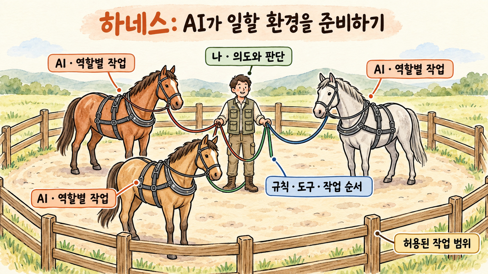

AI 생성 비유 그림 · 말=AI, 사람=나, 고삐=규칙·도구·작업 순서, 울타리=허용 범위

말이 힘이 세도 어디로 갈지와 어떤 길을 쓸지는 정해야 합니다. **하네스는 AI가 일할 환경을 준비하는 것**입니다. CLAUDE.md 두 개는 그 환경에서 규칙을 맡는 부분입니다. 도구·스킬·담당자·검사도 함께 갖춥니다. 그림의 울타리는 비유이며, 실제 접근 범위는 권한 설정으로 제한합니다.

하네스는 AI에게 목표만 주는 데서 한 걸음 더 나아가 일할 자료·도구·규칙·담당자·확인 방법을 준비하는 것입니다. 새 프로그램 이름이 아니라 작업 환경을 갖추는 방법입니다. 비용 보고서라면 Excel과 계산 도구, 원본 보존 규칙, 보고서 스킬, 담당자 3명, 합계 검사 기준이 한 환경에 들어갑니다.

| 준비할 것 | 이 과정에서 설정할 것 |
| --- | --- |
| 자료와 도구 | workbooks의 Excel, 제공 계산 도구 |
| 공통 규칙 | CLAUDE.md에 내 역할과 원본 보존 |
| 반복 절차 | weekly-report의 내 기준 금액 |
| 담당자 | 데이터 확인·화면 제작·검수 3명 |
| 완료 확인 | 숫자 검사와 직접 연 화면 |

자료·도구CLAUDE.mdSkill담당자 3명결과 확인

지금 공통 규칙을 설정하고 → 다음에 스킬 기준을 바꾸고 호출하고 → 팀 단계에서 담당자 파일과 호출 규칙을 설치합니다. 각각 확인한 뒤 같은 입력으로 팀을 실행하면 내 하네스가 완성됩니다.

**앞 단계에서 이어서:** 반복해서 지킬 원본 보존·출력 형식·검사 기준을 공통 규칙으로 남깁니다.

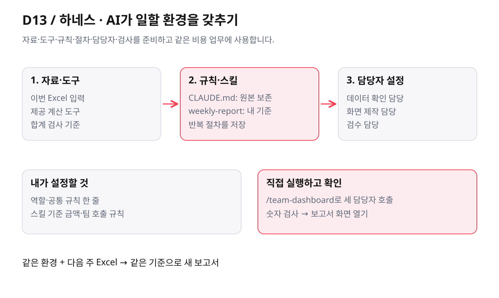

**D13 · 하네스 · AI가 일할 환경을 갖추기**
규칙 → 스킬 → 담당자 설정을 차례로 끝내고 내 작은 팀을 실행합니다. · 직접 그린 설명 도식이며 실제 제품 화면이 아닙니다. 이미지를 눌러 확대할 수 있습니다.

**도식 내용을 글로 읽기**

- 하네스는 AI가 일할 환경을 갖추는 방법입니다. 새로운 프로그램 이름을 뜻하지 않습니다.

- Excel과 계산 도구를 준비하고 CLAUDE.md에 공통 규칙을 적습니다.

- 보고서 스킬의 내 기준을 설정하고 제공 담당자 3명과 팀 스킬을 설치합니다.

- 메인 Claude가 데이터 확인, 화면 제작, 검수를 위임합니다. 결과 숫자와 화면은 직접 확인합니다.

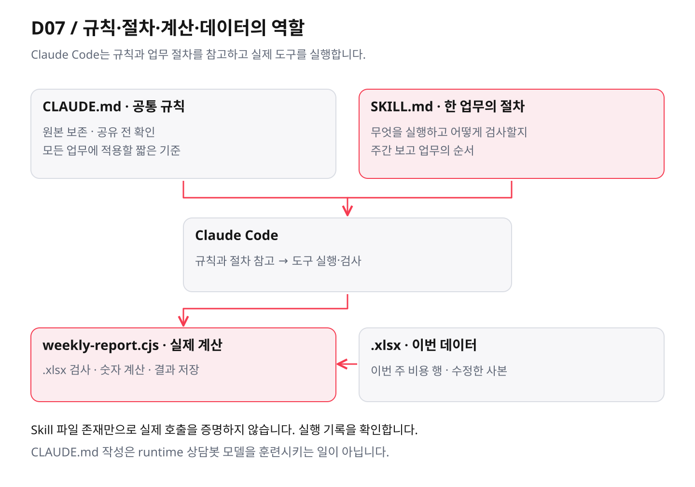

**D07 · 규칙·절차·계산·데이터의 역할**
공통 규칙과 업무 절차를 남기고 실제 실행·검사 기록으로 확인합니다. · 직접 그린 설명 도식이며 실제 제품 화면이 아닙니다. 이미지를 눌러 확대할 수 있습니다.

**도식 내용을 글로 읽기**

- CLAUDE.md는 공통 규칙이고 SKILL.md는 한 업무의 실행과 검사 절차입니다.

- weekly-report.cjs가 실제 계산을 수행하고 .xlsx는 이번 입력 데이터입니다.

- Claude Code가 규칙과 Skill을 참고해 도구를 실행하더라도 Skill 파일이 있는 것만으로 실제 Skill 호출을 증명하지는 않습니다.

- CLAUDE.md를 작성하는 것은 runtime 상담봇 모델을 훈련시키는 일이 아닙니다.

### 1. 내가 규칙을 쓰기 전에 · AI에게 인터뷰 부탁하기

| 규칙 파일 | 어디에 적용할까요? | 쉬운 예 |
| --- | --- | --- |
| 사용자 공통 · 글로벌~/.claude/CLAUDE.md | 이 PC의 내 계정에서 여러 프로젝트에 공통으로 | 한국어로 짧게 답하기, 확인 못 한 것은 미확인으로 쓰기 |
| 프로젝트용 · 로컬실습 폴더/CLAUDE.md | 이번 폴더의 작업에 | 한빛화학 보고서는 workbooks 원본을 보존하고 output에 저장하기 |

`~`는 내 사용자 폴더를 뜻합니다. 경로를 직접 외워 입력하지 않아도 Claude가 이 PC에 맞게 찾아줍니다. 이번 주 합계처럼 자주 바뀌는 숫자는 규칙 대신 입력 자료에 둡니다.

[텍스트 내려받기 · 05d_Claude_공통과프로젝트규칙_인터뷰.txt](templates/복붙텍스트/05d_Claude_공통과프로젝트규칙_인터뷰.txt)

P133 · Claude Code 안 · 인터뷰로 두 규칙 파일 설정하기

```text
- 매번 같은 설명을 하지 않도록 CLAUDE.md를 설정하고 싶어.
- 내 업무와 선호를 최대 3개, 한 번에 하나씩 질문해줘. 이미 말한 것은 다시 묻지 마.
- 답을 사용자 공통 규칙과 이번 프로젝트 규칙으로 나눠 두 초안을 보여줘. 아직 저장하지 마.
- 내가 확인하면 사용자용 ~/.claude/CLAUDE.md와 이 폴더의 CLAUDE.md에 적용해줘.
- 기존 파일이 있으면 먼저 읽고, 바꿀 부분과 충돌하는 규칙을 알려줘. 기존 내용을 백업하고 필요한 부분만 합쳐줘.
- 이 프로젝트의 원본 보존·제공 도구·팀 호출 규칙은 유지해줘. 권한 설정은 바꾸지 마.
```

**왜 이렇게 요청하나요?**

- **질문부터 받기**: 내가 규칙 문장을 잘 쓰지 못해도 업무와 선호를 답하면 됩니다.

- **공통과 프로젝트 분리**: 모든 작업에서 필요한 규칙과 이 폴더에서만 필요한 규칙이 섞이지 않게 합니다.

- **초안 확인 후 합치기**: 다른 프로젝트에서 쓰던 기존 규칙까지 바꾸지 않도록 합니다.

- 질문 하나에 평소 말로 답합니다. 예: “영업팀이고, 결정 사항과 다음 연락할 일을 먼저 보고 싶어”.

- 두 초안을 읽습니다. 한국어·짧은 답변은 공통, 원본 보존·보고서 폴더는 프로젝트 쪽에 있는지 봅니다.

- 기존 규칙과 충돌이 없으면 “좋아, 그 내용으로 적용해줘”라고 답합니다. 바꿀 것이 있으면 한 줄로 고칩니다.

- `/memory`로 적용된 규칙 파일을 확인합니다. 다음 단계에서 같은 폴더의 Claude를 다시 켜고 새 작업에도 규칙이 반영되는지 봅니다.

**규칙 파일 예시 보기 · 그대로 외울 필요 없습니다**

[텍스트 내려받기 · CLAUDE_규칙.txt](templates/복붙텍스트/파일내용/CLAUDE_규칙.txt)

P80 · 파일 내용 · CLAUDE.md · 편집기에 저장

```text
# CLAUDE.md
## 내 역할과 업무
- [내 역할과 반복 업무]. Excel 원본과 비용 요약을 확인한다.
## 결과 형식
- 한국어로 건수·총액·출처·생성 시각·검사 상태를 먼저 표시한다.
## 반복 업무
- 보고서 작업은 .claude/skills/weekly-report/SKILL.md의 절차를 따른다.
## 작업 기준
- workbooks 원본은 수정하지 않고 output에 결과를 저장한다.
- 입력 오류는 중단하고 이전 정상 결과와 최신 실패를 구분한다.
- 해외 USD 참고액은 원화 비용 합계에 더하지 않는다.
- 확인하지 않은 호출·검사·발송을 성공이라고 쓰지 않는다.

```

**왜 이렇게 요청하나요?**

- **예시 파일**: 반복 규칙이 어떤 모양인지 읽어 보는 예시입니다. 내 규칙은 위 인터뷰로 정합니다.

| 파일 | 넣을 것 |
| --- | --- |
| CLAUDE.md | **여러 업무에 공통인 역할·형식·작업 기준** |
| SKILL.md | 주간 보고서의 실제 실행·검사 절차 |
| 이번 .xlsx 입력과 보고 맥락 파일 | 이번 입력과 상황. 회사 비밀·키는 넣지 않기 |

CLAUDE.md는 모델이 읽는 작업 지침이며 **OS 접근 권한을 강제하는 장치가 아닙니다**. 실제 실행 권한은 권한 설정에서 확인합니다. 긴 자기소개 대신 반복해서 필요한 기준을 적습니다.


AI 생성 비유 일러스트 · 하네스는 AI가 일할 책상과 규칙을 준비하는 일입니다. · 이미지를 누르면 크게 볼 수 있습니다.

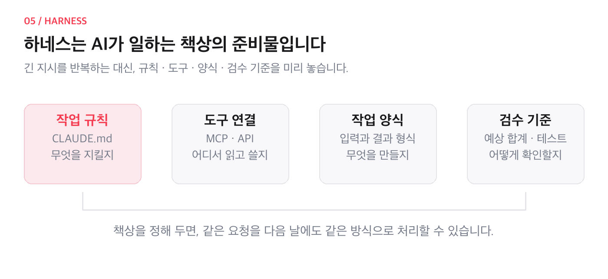

설명 도식 · 규칙·도구·역할·검사를 함께 갖춥니다. · 이미지를 누르면 크게 볼 수 있습니다.

근거: [CLAUDE.md 공식 문서](https://code.claude.com/docs/en/memory) · [권한 공식 문서](https://code.claude.com/docs/en/permissions)

### 규칙을 써 보기 · 우리 자료로 고객 답변 초안

이번에는 비용 대신 상담 자료를 씁니다. Claude Code에 회사 FAQ와 제품표를 주고, **아는 질문·모르는 질문·비교 질문**에 답하게 합니다. 별도 챗봇 서비스나 API를 만들지 않습니다. 내가 검토할 답변 초안을 만듭니다.

- input/customer-reply의 FAQ·질문·직접확인 자료를 읽습니다. 질문2번은 왜 바로 약속하면 안 되는지 생각합니다.

- 프로젝트 CLAUDE.md에 “상담 답변은 자료의 근거를 적고, 없는 정보는 확인 필요로 남긴다”를 추가해 달라고 Claude에게 부탁합니다.

- 아래 요청으로 답변 초안 3개를 받은 뒤 제공 직접확인 표와 비교합니다.

[텍스트 내려받기 · 05c_Claude_FAQ답변초안.txt](templates/복붙텍스트/05c_Claude_FAQ답변초안.txt)

P129 · Claude Code 안 · 회사 FAQ로 답변 초안 3개

```text
- @input/customer-reply/01_상담FAQ.md와 @input/hanbit-sales/references/02_제품기준표.md로 답변 초안 3개를 만들어줘.
- 질문은 @input/customer-reply/02_고객질문_3개.txt에 있어.
- 답변마다 근거 파일과 항목을 적고, 없는 정보는 확인 필요로 남겨줘.
- 가격·수량 단위를 그대로 쓰고, 할인·재고·납기를 약속하지 마.
- 결과는 output/customer-reply/답변초안.md. 기존 결과는 보존하고 고객에게 전송하지 마.
- 세 답변의 실제 근거 확인 결과만 짧게 알려줘.
```

**왜 이렇게 요청하나요?**

- **자료·파일 지정**: AI가 참고할 자료를 좁힙니다. 파일 이름은 내가 실제로 가진 파일과 맞춰야 합니다.

- **결과 지정**: 답변만 받지 않고 다시 열어 쓸 파일을 남기려는 요청입니다.

- **지킬 기준**: 바꿔도 되는 범위와 그대로 둘 것을 정해 불필요한 작업을 줄입니다.

- **확인 방법**: 완료했다는 말보다 실제 확인한 결과와 확인하지 못한 것을 받습니다.

| 질문 유형 | 직접 볼 답변 |
| --- | --- |
| 자료에 있음 | 600개×6,000원=3,600,000원, 부가세 제외 |
| 자료에 없음 | 내일 배송·할인을 약속하지 않고 확인 필요 |
| 비교 | 500개 기준 세럼3,000,000원·크림4,000,000원, 부가세 제외 |

답변이 친절해도 **없는 배송일을 약속하면 실패**입니다. 근거 파일과 숫자를 대조하고 나서 활용합니다. 고객에게 자동 전송하지 않습니다.

- [ ] 세 답변의 근거와 숫자를 직접 확인했다.

- [ ] 자료에 없는 약속이 없는지 확인했다.

## 17. 보고서 절차를 Skill로 실행하기

오후 · 개인 실습 · Module 3

### 두 번째 스킬 · 숫자 보고서의 기준 고치기

회의록 스킬은 내 인터뷰 답으로 만들었습니다. 이번 weekly-report는 제공 계산 도구를 쓰는 보고서 스킬입니다. name·description·본문을 읽고 내 상황과 원본 보존 기준을 보강합니다. 계산 명령과 경로는 유지합니다.

[텍스트 내려받기 · 05b_Claude_보고서스킬기준수정.txt](templates/복붙텍스트/05b_Claude_보고서스킬기준수정.txt)

P124 · Claude Code 안 · 제공 보고서 스킬 다듬기

```text
- .claude/skills/weekly-report/SKILL.md를 읽고 name과 계산·경로·검사 명령은 유지해줘.
- description에 한빛화학 영업부서의 주간 비용 보고용이라는 상황을 반영하고, 원본에 없는 숫자나 결제 완료를 추정하지 않는 기준을 한 줄 보강해줘.
- 다른 내용이 충돌하면 수정하지 말고 알려줘.
- 바뀐 두 부분만 보여줘.
```

**왜 이렇게 요청하나요?**

- **확인 방법**: 완료했다는 말보다 실제 확인한 결과와 확인하지 못한 것을 받습니다.

앞서 grill-me로 질문 절차를 저장하고 불러 봤습니다. 이번에는 비용 보고서를 만드는 절차를 바꾸고 호출합니다. **스킬의 본문 한 곳만 바꾸면** 다음 호출에도 같은 기준을 사용할 수 있습니다.

**앞 단계에서 이어서:** 공통 규칙을 정했으니 보고서 한 번을 만드는 실행·검사 절차를 Skill로 묶습니다. name과 description을 읽고 실제로 호출합니다.

### 이름과 설명부터 읽기

**name**은 호출할 이름입니다. weekly-report라면 /weekly-report로 부릅니다. **description**에는 하는 일과 사용할 때를 적습니다. 언제 쓰지 않는지도 적으면 업무가 섞이는 일을 줄일 수 있습니다. 아래는 설명 예시이며 새 파일로 복사할 필요는 없습니다.

```text
---
name: weekly-report
description: 주간 비용 Excel을 읽어 보고서와 공유 초안을 만든다. 비용 마감이나 다음 주 재실행에 사용한다. 환율 조회와 이메일 발송에는 사용하지 않는다.
disable-model-invocation: true
---
```

예시를 읽은 뒤 제공된 실제 SKILL.md의 name·description을 찾아보세요. 이 과정은 직접 호출해 확인하므로 disable-model-invocation: true를 사용합니다.

### 1. 절차 한 곳 수정

- .claude/skills/weekly-report/SKILL.md를 엽니다.

- 기본 기준 금액을 M2에서 고른 내 숫자로 바꿉니다.

- 같은 폴더에서 Claude를 새로 열어 A4를 한 번 보냅니다.

[텍스트 내려받기 · 05_Claude_A4_스킬실행.txt](templates/복붙텍스트/05_Claude_A4_스킬실행.txt)

P81 · Claude Code 대화 · A4 · 한 번만

```text
/weekly-report workbooks/주간비용_수정후.xlsx → output/skill-run.
- 내가 Skill에 적은 기본 금액을 사용해줘.
```

**왜 이렇게 요청하나요?**

- **자료·파일 지정**: AI가 참고할 자료를 좁힙니다. 파일 이름은 내가 실제로 가진 파일과 맞춰야 합니다.

- **결과 지정**: 답변만 받지 않고 다시 열어 쓸 파일을 남기려는 요청입니다.

**열어서 확인:** output/skill-run/report.html · notes/weekly-report-result.md

**성공 기준:** **실제 Skill 호출·도구 실행·내 기준·결과**가 맞습니다.

**막히면:** 파일 존재만으로 호출 성공이라 하지 않습니다. 프로젝트 루트·파일 경로를 확인하고 새 세션을 엽니다.

근거: [업무 Skill 공식 문서](https://code.claude.com/docs/en/skills)

## 18. 정규 실습 · 서브에이전트 3명 구축

오후 · 개인 실습 · Module 3


AI 생성 설명 그림 · 팀 · 확인 담당 → 작성 담당 → 검수 담당

### 내 팀 하나 고르기

비용 보고 팀은 아래 기본 경로를 사용합니다.

### 팀장 놀이 · 한 업무를 세 명에게 나누기

서브에이전트는 **한 일을 나눠 맡기는 AI 담당자**입니다. 스킬은 그 일을 반복할 절차이고, MCP는 외부 도구 연결입니다. “정규직과 프리랜서”보다는 **담당자 · 업무 절차서 · 연결 도구**로 구분하면 쉽습니다. 팀을 만든다고 항상 더 빠르거나 정확해지는 것은 아닙니다. 오늘은 자료 확인과 작성, 검수를 나눠 보는 데 집중합니다.

| 고를 팀 하나 | 확인 담당 → 작성 담당 → 검수 담당 | 오늘 남길 결과 |
| --- | --- | --- |
| 비용 보고 팀 · 강사 예시 | 숫자 확인 → 보고서 화면 제작 → 숫자·누락 검수 | 기존 비용 대시보드 하나 |
| 회의 정리 팀 | 원문 사실 확인 → 결정·할 일 표 작성 → 없는 담당자·날짜 검수 | 미팅 메모 한 개의 회의록 |
| 고객 후속관리 팀 | 고객표 확인 → 다음 연락 목록 작성 → 없는 약속·기한 검수 | 가상 고객 5명의 다음 행동 표 |

**강사 예시:** “팀장이 비용 현황을 빨리 보게 하고 싶어. 첫 담당자는 숫자를 확인하고, 둘째는 화면을 만들고, 셋째는 원본과 비교해 줘.” 내가 먼저 업무와 결과를 정하고 AI에게 역할을 맡깁니다.

**내 메모**

내 팀이 해결할 작은 일

메모는 [개인 실습 기록지](notes/내업무_실습기록.md) 사본에 적습니다.

세 명에게 맡길 역할

메모는 [개인 실습 기록지](notes/내업무_실습기록.md) 사본에 적습니다.

입력한 모든 칸을 항목 이름과 함께 복사합니다.

**팀은 하나만 만듭니다.** 비용 보고 팀을 고르면 아래 기본 경로, 회의·고객 팀을 고르면 펼친 경로를 따릅니다. 두 경로를 모두 실행하지 않습니다. 세 이름이 실제 위임 기록에 나타났는지 보고, 결과를 원문과 직접 비교합니다.

**회의 정리 / 고객 후속관리 팀으로 실습하기**

위에서 내 역할을 먼저 정한 뒤 제공 역할 카드와 비교합니다. 준비된 자료와 정의를 써서 팀을 설정하고, 같은 폴더에서 Claude를 다시 켠 뒤 호출합니다. 아래 두 요청은 비용 팀의 설정·호출을 대신합니다.

[텍스트 내려받기 · 06b_Claude_고른팀_설정.txt](templates/복붙텍스트/06b_Claude_고른팀_설정.txt)

P134 · Claude Code 안 · 고른 팀의 세 담당자 설정

```text
- 내가 고른 팀: [회의정리 또는 고객후속관리]
- @templates/team-options/사용안내.md를 읽고 그 팀의 제공 파일로 담당자 3명과 팀 스킬을 설정해줘.
- 새 정의를 만들지 말고, 기존 파일은 보존해줘. 내용이 다르면 덮어쓰기 전에 물어봐.
- 세 담당자의 name·description·맡은 결과를 짧게 보여줘. 지금은 실행하지 마.
```

**왜 이렇게 요청하나요?**

- **자료·파일 지정**: AI가 참고할 자료를 좁힙니다. 파일 이름은 내가 실제로 가진 파일과 맞춰야 합니다.

- **지킬 기준**: 바꿔도 되는 범위와 그대로 둘 것을 정해 불필요한 작업을 줄입니다.

설정 뒤 같은 폴더에서 Claude를 다시 켭니다. `/agents`에서 선택한 팀의 세 이름을 확인한 뒤 다음 요청을 보냅니다.

[텍스트 내려받기 · 06c_Claude_고른팀_실행.txt](templates/복붙텍스트/06c_Claude_고른팀_실행.txt)

P135 · Claude Code 안 · 고른 팀 한 번 실행

```text
/meeting-team
- 내가 고른 팀: [회의정리 또는 고객후속관리]
- @templates/team-options/사용안내.md에서 그 팀의 절차를 읽고 팀 스킬로 실행해줘.
- 자료 확인 → 초안 작성 → 검수 순서로 세 서브에이전트를 실제 호출해줘.
- 지정한 자료만 사용하고, 없는 담당자·날짜·약속은 만들지 마. 원본과 이전 결과는 보존해줘.
- 결과 파일을 열 방법과 세 담당자의 실제 호출·검수 결과만 짧게 알려줘.
```

**왜 이렇게 요청하나요?**

- **자료·파일 지정**: AI가 참고할 자료를 좁힙니다. 파일 이름은 내가 실제로 가진 파일과 맞춰야 합니다.

- **지킬 기준**: 바꿔도 되는 범위와 그대로 둘 것을 정해 불필요한 작업을 줄입니다.

- **확인 방법**: 완료했다는 말보다 실제 확인한 결과와 확인하지 못한 것을 받습니다.

**호출 이름:** 회의 정리는 첫 줄 `/meeting-team`, 고객 후속관리는 첫 줄을 `/followup-team`으로 바꿉니다. 위 팀 선택 버튼을 누르면 두 요청의 팀 이름과 호출 이름이 함께 바뀝니다.

회의 정리: output/meeting-team/회의록.md · 고객 후속관리: output/followup-team/다음연락.md. 검수.md와 notes의 호출 기록을 봅니다. **원문에 없는 날짜·약속을 만들었으면 수정이 필요**합니다. 역할 정의만 있고 실제 위임이 없으면 아직 팀으로 실행한 것이 아닙니다. 이 경로에서는 비용 팀의 화면 기준 변경 요청도 건너뜁니다.

**앞 단계에서 이어서:** 한 업무의 절차와 검사 방법을 익혔습니다. 같은 수정후41건 보고서를 데이터 확인·화면 제작·검수 세 역할에 나눠 맡깁니다.

정규 과정이며 개인 실습입니다. 사람은 각자 실습합니다. 내 메인 Claude가 데이터 확인·화면 제작·검수 담당 세 명을 순서대로 호출합니다. 별도 세션이 대화하는 Agent Teams와는 다른 서브에이전트 실습입니다.

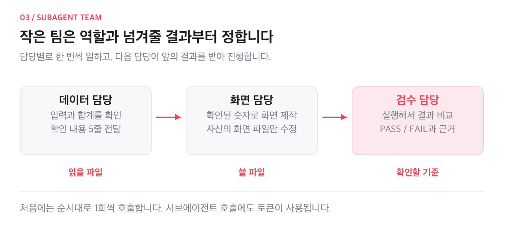

설명 도식 · 서로 의존하는 작업은 순서대로 진행합니다. · 이미지를 누르면 크게 볼 수 있습니다.

| 이름 | 하는 일 | 남길 근거 |
| --- | --- | --- |
| data-auditor | 입력·집계·원본 확인 | 숫자와 검사 결과 |
| dashboard-builder | 확인한 숫자로 HTML 제작 | 실제 출력 경로 |
| qa-reviewer | 집계와 HTML을 독립 대조 | 검사 명령·PASS/FAIL·미확인 |

### 비용 보고 팀 경로 · 1. 내 하네스 설정

역할을 이해한 뒤 Claude Code 안에 아래 설정 요청을 붙입니다. 앞 단계의 output/local-final/summary.json과 verification.json이 필요합니다. 오류 실습 뒤에는 정상 입력으로 복구한 뒤 팀을 호출합니다.

[텍스트 내려받기 · 05a_Claude_하네스설정.txt](templates/복붙텍스트/05a_Claude_하네스설정.txt)

P90 · Claude Code 안 · 하네스 설정

```text
- 내 비용 보고서 작업 환경을 설정해줘.
- 새 정의를 생성하지 말고 templates/team-starter/.claude의 제공 파일을 그대로 복사해줘.
- .claude/agents에는 data-auditor.md, dashboard-builder.md, qa-reviewer.md를, .claude/skills/team-dashboard에는 SKILL.md를 둬.
- 기존 파일은 같은 내용이면 유지하고 다르면 덮어쓰지 말고 알려줘.
- 담당자 name·description·model: inherit는 유지해줘.
- CLAUDE.md의 기존 규칙은 보존하고 다음 한 줄이 없으면 추가해줘: "팀 보고서를 요청하면 /team-dashboard 절차로 데이터 확인 → 화면 제작 → 검수 담당자를 호출한다."
- 설정만 하고 팀 실행은 아직 하지 마.
- 설치한 4개 파일과 규칙 한 줄을 확인해 6줄 이내로 알려줘.
```

**왜 이렇게 요청하나요?**

- **제공 정의 사용**: 담당자 세 명을 매번 새로 설계하지 않고 준비한 역할을 설정합니다.

- **name·description 유지**: 호출 이름과 맡기는 일을 팀 절차가 찾을 수 있게 합니다.

Claude가 제공 정의를 복사하면 .claude/agents/data-auditor.md, dashboard-builder.md, qa-reviewer.md 세 정의 파일을 만듭니다. 각각 열어 name·description·model: inherit를 확인합니다. name은 호출 이름, description은 맡길 상황과 일을 설명합니다. 제공 호출 절차가 이 이름을 사용하므로 이름은 유지합니다. 같은 폴더에서 Claude를 다시 시작하고 /agents에서 세 이름, /team-dashboard를 확인합니다. 다른 정의가 있으면 덮어쓰지 않고 중단합니다. [준비·역할 한 장](templates/team-starter/README.md)을 봅니다.

### 2. 내 작은 팀 호출

[텍스트 내려받기 · 06_Claude_A5_3명팀.txt](templates/복붙텍스트/06_Claude_A5_3명팀.txt)

P91 · Claude Code 안 · A5 · 팀 한 번

```text
/team-dashboard
```

**왜 이렇게 요청하나요?**

- **짧은 호출**: 앞에서 연결하거나 설정한 도구·팀 절차를 불러옵니다. 이름만 입력해도 준비된 절차를 찾을 수 있습니다.

실제 위임 기록에 세 이름이 각각 나타나는지 봅니다. **데이터 확인 → 제작 → 검수** 순서입니다. 같은 HTML을 동시에 수정하지 않습니다. 검수 실패 수정은 한 번까지만 하고 남은 문제를 기록합니다.

### 3. 보고서를 열고 확인하기

- Claude가 알려 준 output/team-dashboard.html을 브라우저로 엽니다.

- 41건·2,363,300원인지 봅니다. 부서별 금액은 경영지원721,300원·영업586,000원·마케팅1,056,000원입니다.

- notes/team-result.md에서 세 담당자의 실제 호출과 검수 결과를 봅니다. 자동 검사는 검수 담당자가 실행합니다.

- 숫자가 맞아도 화면은 직접 눌러 봅니다. 메인이 혼자 만들었다면 3명 호출은 미확인입니다.

- [ ] 정의 파일 3개와 name·description을 확인하고 실제 위임 기록을 확인했다.

- [ ] 데이터 검수와 HTML 결과를 직접 확인했다.

### 설정한 작업 환경 확인

- CLAUDE.md의 원본 보존 규칙과 추가된 팀 호출 규칙 한 줄을 읽습니다.

- 스킬의 기준 금액과 담당자 3명의 역할을 짚어 봅니다.

- A5 팀 실행 뒤 같은 입력의 숫자와 검수 결과를 봅니다. 다음 주에는 같은 환경을 다시 사용합니다.

- [ ] 내 규칙·스킬·담당자 3명·확인 기준을 찾아 설명할 수 있다.

선택한 팀의 담당자 정의 3개는 미리 제공합니다. 내가 맡길 일을 적고 제공 역할과 비교합니다. 수업 중 정의 파일을 새로 생성하게 하지 않습니다. 한 번의 팀 실행에서 확인·제작·검수를 경험하고 다음 주 재사용은 단일 Skill로 진행합니다.

### 기준 한 줄 바꾸고 팀 결과 비교하기

첫 팀 보고서를 확인한 뒤 같은 자료로 **진행 중 비용을 먼저** 보이게 바꿉니다. 담당자 정의를 다시 만들거나 역할을 늘리지 않습니다. 팀을 다시 호출하므로 추가 사용량이 듭니다.

[텍스트 내려받기 · 06a_Claude_팀기준변경.txt](templates/복붙텍스트/06a_Claude_팀기준변경.txt)

P130 · Claude Code 안 · 같은 팀으로 기준 변경

```text
/team-dashboard 같은 41건으로 보고서 화면을 한 번만 개선해줘.
- 숫자·계산·담당자 정의는 유지해줘. 기준은 한 줄: 진행 중 비용을 먼저 보여줘.
- 결과: output/team-followup.html. 기록: notes/team-followup.md. 이전 결과는 보존해줘.
- 제공 절차대로 데이터 확인·화면 제작·검수 담당자를 호출해줘.
- 처음 화면과 달라진 배치, 그대로인 총액·건수, 실제 검수 결과만 알려줘.
```

**왜 이렇게 요청하나요?**

- **자료·파일 지정**: AI가 참고할 자료를 좁힙니다. 파일 이름은 내가 실제로 가진 파일과 맞춰야 합니다.

- **결과 지정**: 답변만 받지 않고 다시 열어 쓸 파일을 남기려는 요청입니다.

- **지킬 기준**: 바꿔도 되는 범위와 그대로 둘 것을 정해 불필요한 작업을 줄입니다.

- **확인 방법**: 완료했다는 말보다 실제 확인한 결과와 확인하지 못한 것을 받습니다.

- 처음 team-dashboard.html과 새 team-followup.html을 나란히 엽니다.

- 진행 중 비용의 위치가 달라졌는지 봅니다. 총액2,363,300원·41건은 같아야 합니다.

- 새 기록에서 데이터 확인→제작→검수의 실제 결과를 봅니다. 숫자가 달라졌다면 개선 완료로 세지 않습니다.

## 19. 같은 Skill로 다음 주 보고서 만들기

오후 · 개인 실습 · Module 3

**앞 단계에서 이어서:** 팀 결과는 보관합니다. 이제 **새 입력인 다음 주12건**으로 바꿔 앞에서 만든 내 weekly-report Skill을 다시 사용합니다. 팀을 다시 호출할 필요는 없습니다.

### 1. 다음 주 표를 먼저 읽기

- 다음주 파일을 열어 행수와 일부 수량×단가를 직접 계산합니다.

- 값과 열 순서가 바뀌었는지 봅니다.

### 2. 같은 Skill 다시 사용

- A6를 한 번 보내 **기존 도구를 재사용**합니다.

- 실행 명령·원본 품질·총액을 내 예상과 강사 정답에 대조합니다.

[텍스트 내려받기 · 07_Claude_A6_다음주.txt](templates/복붙텍스트/07_Claude_A6_다음주.txt)

P82 · Claude Code 대화 · A6 · 한 번만

```text
/weekly-report workbooks/주간비용_다음주.xlsx → output/next-week.
- 내 기본 기준을 유지하고 같은 도구로 검사해줘.
```

**왜 이렇게 요청하나요?**

- **자료·파일 지정**: AI가 참고할 자료를 좁힙니다. 파일 이름은 내가 실제로 가진 파일과 맞춰야 합니다.

- **결과 지정**: 답변만 받지 않고 다시 열어 쓸 파일을 남기려는 요청입니다.

- **확인 방법**: 완료했다는 말보다 실제 확인한 결과와 확인하지 못한 것을 받습니다.

**열어서 확인:** output/next-week/report.html · summary.json · verification.json

**성공 기준:** 열 이름으로 처리하고 새로운 입력에 맞는 결과를 만듭니다.

## 20. 로그인된 Claude Code로 보고서 실행기 만들기

오후 · 개인 실습 · Module 3

**앞 단계에서 이어서:** 다음 주 보고서가 확인됐습니다. 같은12건 사본으로 로그인된 Claude Code를 호출하는 실행 버튼을 만듭니다. 제공 코드와 명세를 사용하며 새 웹 서비스를 처음부터 설계하지 않습니다.

Excel 파일을 넣고 실행하면 로그인된 Claude Code가 분석 문안을 만들고 로컬 도구가 보고서 화면을 저장합니다. 이 실습은 **CLI의 기존 로그인을 사용**합니다. API 키를 발급하거나 인증 파일을 앱에 복사하지 않습니다.

**엑셀 넣기 → 실행 → 로그인된 Claude가 분석 → 보고서 확인**

내 PC에서 실행하지만 Claude 분석에는 인터넷과 계정 사용량이 필요합니다. 무료·오프라인 프로그램이 아닙니다. 이 실행 버튼에는 준비된 실습 폴더·Node·Claude Code가 필요합니다. .exe만 다른 PC로 보내 쓸 수 있는 독립 앱은 아닙니다.

### 1. Claude Code가 켜져 있는지 보기

- 앞에서 쓰던 Claude Code 대화로 돌아옵니다. 다시 시작할 때는 실습 폴더에서 claude를 입력합니다.

- 로그인 요청이 나오면 제공 계정으로 로그인합니다. /login은 Claude Code 안에 입력합니다.

- 다음 주12건·1,130,900원 사본은 아래 제작 요청으로 준비합니다. 인증 파일을 열거나 복사할 필요는 없습니다.

### 2. 제공 명세로 실행기 만들기

[텍스트 내려받기 · 08_Claude_A7_실행기제작.txt](templates/복붙텍스트/08_Claude_A7_실행기제작.txt)

P95 · Claude Code 안 · A7 · 제공 명세로 실행기 만들기

```text
- 엑셀을 넣고 실행하면 분석 보고서가 나오는 로컬 프로그램을 만들어줘.
- API 키 없이 이 PC에 로그인된 Claude Code를 써줘.
- integrations/auth-report/task-spec.md와 제공 소스로 준비해줘. 계산·분석 코드를 새로 쓰지 마.
- inbox-auth 폴더를 만들고 workbooks/주간비용_다음주.xlsx를 주간비용.xlsx 이름으로 복사해줘. 기존 입력이 있으면 보존하고 나에게 확인해줘.
- Windows: 제공 소스로 ExcelReport.exe를 만들어줘. macOS: ExcelReport.command를 만들어줘.
- 실제 분석은 내가 실행기를 열어서 할게. 지금은 분석을 실행하지 마.
- 생성된 실행 파일과 준비한 입력 경로를 짧게 알려줘.
```

**왜 이렇게 요청하나요?**

- **자료·파일 지정**: AI가 참고할 자료를 좁힙니다. 파일 이름은 내가 실제로 가진 파일과 맞춰야 합니다.

- **지킬 기준**: 바꿔도 되는 범위와 그대로 둘 것을 정해 불필요한 작업을 줄입니다.

- **확인 방법**: 완료했다는 말보다 실제 확인한 결과와 확인하지 못한 것을 받습니다.

실습 폴더에 Windows는 ExcelReport.exe, macOS는 ExcelReport.command가 실제로 생겼는지 봅니다. 파일이 없다면 아래 오류 도움 요청으로 화면에 나온 오류를 전달합니다. 학생이 별도 빌드 명령을 입력하지 않습니다.

### 3. 실행 파일을 눌러 보고서 만들기

- Windows는 ExcelReport.exe, macOS는 ExcelReport.command를 더블클릭합니다.

- 열린 창에서 이번 분석의 완료 또는 오류를 확인합니다. 같은 입력은 한 번만 분석합니다.

- 이때 앱이 로그인된 Claude Code를 호출합니다. 대화에 분석 요청을 다시 보내지 않습니다. 실행 파일이 열리지 않으면 미완료로 남깁니다.

### 4. 실제 보고서 검사

성공하면 이번 output/auth-report/실행별폴더의 report.html·analysis.md·summary.json·run-state.json을 엽니다. 실패하면 보고서 파일이 없을 수 있습니다. run-state.json의 failedStage와 error.code, local/verification.json이 생성됐는지 확인하고 분석 실패를 기록합니다. 건수·총액·출처는 계산 결과와 대조하고 원인·제안은 사람이 판단합니다. “**로컬 계산 통과 / Claude 분석 성공 / exe 실행**”을 별도로 기록합니다. 다시 실행하면 새 폴더가 생겨 이전 보고서를 보존합니다.

- [ ] 이번 실행의 Claude 분석 성공 또는 실패를 구분했다.

- [ ] 보고서 숫자와 AI 제안을 직접 확인했다.

- [ ] Windows exe 또는 대체 실행 여부를 기록했다.

[CLI 자동 실행 공식 안내](https://code.claude.com/docs/en/headless) · [로그인 공식 안내](https://code.claude.com/docs/en/authentication)

**실전 사례 · xlreport를 짧게 실행해 보기**

제공된 실행 로그에서는 sales_fake.xlsx를 분석하고 docs/excel-report-날짜.md를 저장했습니다. 아래는 **Bun과 이미 만든 xlreport 프로젝트가 있는 macOS 환경**의 복습입니다. 정규 실행기 실습과 둘 다 할 필요는 없습니다.

### 만들고 싶은 화면은 이렇게 요청합니다

[텍스트 내려받기 · 로그인된_Claude_Code로_보고서_실행기_만들기_01_참고_P98.txt](templates/복붙텍스트/참고요청/로그인된_Claude_Code로_보고서_실행기_만들기_01_참고_P98.txt)

P98 · 참고 요청 · 화면을 추가할 때만

```text
- 엑셀 파일이 있는 폴더를 선택하고 “보고서 만들기”를 누르면 분석 보고서가 나오는 로컬 앱을 만들고 싶어.
- API 키 없이 로그인된 Claude Code를 사용해줘.
- 진행 상태와 오류를 화면에 보여주고, 결과는 선택한 폴더의 docs에 저장해줘.
```

**왜 이렇게 요청하나요?**

- **결과 지정**: 답변만 받지 않고 다시 열어 쓸 파일을 남기려는 요청입니다.

### 실행은 세 단계

xlreport 프로젝트 폴더에서 Claude Code를 켭니다. 아래 요청은 Claude Code 안에 하나씩 붙입니다.

[텍스트 내려받기 · 로그인된_Claude_Code로_보고서_실행기_만들기_02_Claude_P99.txt](templates/복붙텍스트/실행요청/로그인된_Claude_Code로_보고서_실행기_만들기_02_Claude_P99.txt)

P99 · Claude Code 안 · xlreport 준비

```text
- 이 xlreport 프로젝트의 제공 의존성을 설치해줘.
- package.json과 sample/sales_fake.xlsx가 있는지 먼저 확인해줘.
- 다른 프로젝트 파일은 바꾸지 마. 준비 결과만 알려줘.
```

**왜 이렇게 요청하나요?**

- **지킬 기준**: 바꿔도 되는 범위와 그대로 둘 것을 정해 불필요한 작업을 줄입니다.

- **확인 방법**: 완료했다는 말보다 실제 확인한 결과와 확인하지 못한 것을 받습니다.

로그인 요청이 나오면 제공 계정으로 로그인합니다. /login은 Claude Code 안에 입력합니다.

[텍스트 내려받기 · 로그인된_Claude_Code로_보고서_실행기_만들기_03_Claude_P100.txt](templates/복붙텍스트/실행요청/로그인된_Claude_Code로_보고서_실행기_만들기_03_Claude_P100.txt)

P100 · Claude Code 안 · xlreport 분석

```text
- xlreport의 제공 도구로 sample 폴더의 Excel을 분석해줘.
- 로그인된 Claude Code를 사용하고 새 계산 도구는 만들지 마.
- 이번 보고서 경로와 실제 성공·실패를 알려줘. 같은 입력을 중복 분석하지 마.
```

**왜 이렇게 요청하나요?**

- **지킬 기준**: 바꿔도 되는 범위와 그대로 둘 것을 정해 불필요한 작업을 줄입니다.

Report written: 뒤의 실제 파일을 엽니다. 분석 요청으로 보고서를 받았다면 같은 파일을 화면에서 또 분석하지 않습니다.

[텍스트 내려받기 · 로그인된_Claude_Code로_보고서_실행기_만들기_04_Claude_P101.txt](templates/복붙텍스트/실행요청/로그인된_Claude_Code로_보고서_실행기_만들기_04_Claude_P101.txt)

P101 · Claude Code 안 · xlreport 화면 열기

```text
- xlreport의 제공 화면을 열어줘. 입력은 sample 폴더야.
- 화면을 여는 것만 하고 분석은 시작하지 마.
- 브라우저 주소와 종료 방법을 알려줘.
```

**왜 이렇게 요청하나요?**

- **이번 행동만 요청**: 지금 필요한 질문·수정·호출에 집중합니다. 원하는 결과가 다르면 실행 전에 내 말로 바꿉니다.

화면에서 sample 폴더와 sales_fake.xlsx가 보이는지 확인합니다. 화면으로 처음 분석하는 경우에만 “보고서 만들기”를 누릅니다. 종료는 셸에서 Ctrl+C입니다.

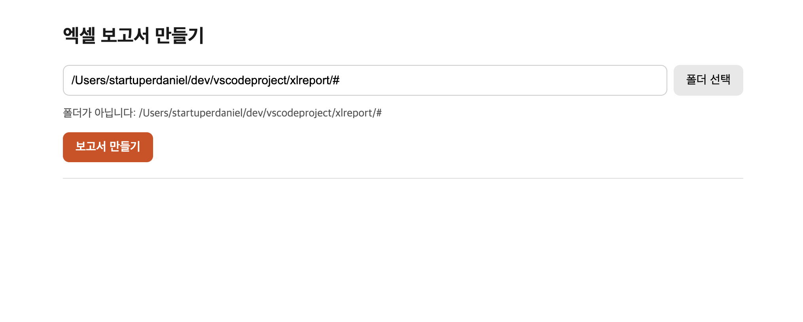

실제 제공 화면 · 경로 끝의 # 때문에 폴더를 찾지 못했습니다. 폴더 선택 버튼으로 Excel이 있는 폴더를 다시 고릅니다. 이 화면은 분석 성공 화면이 아닙니다.

| 막힌 이유 | 다음 행동 |
| --- | --- |
| 명령 끝에 # 설명을 함께 복사 | 명령 줄만 복사 |
| 이미 xlreport인데 cd xlreport를 또 실행 | 현재 폴더에서 다음 명령 실행 |
| 엑셀 없는 폴더를 선택 | sales_fake.xlsx가 있는 sample 선택 |
| 셸에 /login 입력 | 셸에서는 claude auth login 사용 |

[짧은 실행 카드](templates/xlreport-실행카드.md) · bun link와 언어·모델 옵션은 이 복습에 필요하지 않습니다.

## 21. 파일이 바뀌면 자동 보고서 갱신

오후 · 개인 실습 · Module 3

이번에는 보고서 만드는 절차를 켜 두고 **파일만 바꿔 봅니다.** Claude가 제공 감시 도구를 별도 실행 창에서 시작한 뒤에는 새 파일을 넣을 때마다 AI에게 다시 요청하지 않습니다.


**D09 · Claude가 켜고 파일만 바꿔 보기**
교체 → 로그 기다리기 → 실제 결과 확인 순서를 지킵니다. · 직접 그린 설명 도식이며 실제 제품 화면이 아닙니다. 이미지를 눌러 확대할 수 있습니다.

**도식 내용을 글로 읽기**

- Claude 안에 시작 요청을 붙입니다. 별도 실행 창에서 로그를 보고, 탐색기에서 입력 사본을 교체합니다.

- 기본 원본 40건에서 시작한 뒤 탐색기에서 다음 주 파일을 넣고 실행 창의 generated와 12건을 확인합니다. 브라우저를 수동 새로고침한 뒤 skipped를 봅니다.

- 오류 실습은 watch를 따로 재시작합니다. 오류 파일 사본을 넣고 error 로그를 기다린 뒤 다음 주 정상 파일로 바꿉니다.

- 복구 generated와 ok: true를 확인한 뒤 Ctrl+C 또는 횟수 종료로 마칩니다. 파일 교체 사이에 해당 로그를 기다립니다.


**D08 · watch가 반복 확인하는 순서**
실패한 입력은 성공으로 기억하지 않습니다. 변경 감지는 파일 바이트 비교입니다. · 직접 그린 설명 도식이며 실제 제품 화면이 아닙니다. 이미지를 눌러 확대할 수 있습니다.

**도식 내용을 글로 읽기**

- 첫 입력이거나 파일 바이트가 바뀌면 입력을 검사합니다. 마지막 성공 입력과 같으면 skipped로 건너뜁니다.

- 정상 입력은 보고서를 생성하고 성공 파일 지문을 저장합니다. 오류 입력은 정상 세 파일을 보존하고 성공 지문을 저장하지 않으며 다음 검사에서 재시도합니다.

- 5초 간격 최대 12회이며 계산 시간이 추가될 수 있습니다. 60초 이후 새 검사는 시작하지 않고 진행 중인 검사는 마칩니다. Ctrl+C로도 중단합니다.

- 노트북과 터미널이 켜져 있어야 합니다. 셀 값이 아닌 파일 바이트를 비교하므로 글꼴 변경도 파일 변경이면 감지합니다.

### 1. 자연어로 자동화 켜기

[텍스트 내려받기 · 파일이_바뀌면_자동_보고서_갱신_01_Claude_P84.txt](templates/복붙텍스트/실행요청/파일이_바뀌면_자동_보고서_갱신_01_Claude_P84.txt)

P84 · Claude Code 안 · 파일 변경 자동화 시작

```text
- integrations/automation/실행안내.md를 읽고 제공 감시 도구를 켜줘.
- 시작 입력: workbooks/주간비용_실습.xlsx의 사본을 inbox/주간비용.xlsx에 준비해줘. 기존 입력이 있으면 그대로 두고 감시만 다시 켜줘.
- 결과 폴더: output/auto. 기준 금액: 50,000원.
- 별도 실행 창을 열어줘. 이 대화는 입력을 받을 수 있게 유지해줘.
- 같은 입력은 건너뛰고, 오류가 나면 이전 정상 보고서를 유지해줘. 최대 12회 확인 후 종료해줘.
- 내가 파일을 바꿀 위치·결과 여는 위치·종료 방법을 알려줘. 실제로 켜지지 않으면 미확인이라고 해줘.
```

**왜 이렇게 요청하나요?**

- **자료·파일 지정**: AI가 참고할 자료를 좁힙니다. 파일 이름은 내가 실제로 가진 파일과 맞춰야 합니다.

- **결과 지정**: 답변만 받지 않고 다시 열어 쓸 파일을 남기려는 요청입니다.

- **확인 방법**: 완료했다는 말보다 실제 확인한 결과와 확인하지 못한 것을 받습니다.

### 2. 파일만 바꿔 보기

- 파일 탐색기 또는 Finder에서 inbox 폴더를 엽니다. 주간비용.xlsx가 있는지 봅니다.

- workbooks/주간비용_다음주.xlsx를 복사합니다. inbox의 실습 사본 주간비용.xlsx를 이 파일로 교체하고 이름을 주간비용.xlsx로 맞춥니다. workbooks 원본은 보존합니다.

- 실행 창의 generated를 기다린 뒤 output/auto/report.html을 다시 엽니다. 12건·1,130,900원으로 바뀌었는지 봅니다.

- 같은 파일을 다시 넣어 봅니다. 실행 창에서 skipped가 나오는지 확인합니다.

- 이번에는 주간비용_오류.xlsx 사본으로 바꿉니다. 실행 창의 error를 기다린 뒤 직전 정상 보고서가 남아 있는지 봅니다.

- 다음 주 정상 파일로 다시 교체합니다. generated를 기다린 뒤 보고서를 열어 복구를 확인합니다. 실행 창에서 Ctrl+C를 눌러 감시를 끝냅니다.

감시가 먼저 끝났다면 위 시작 요청을 다시 붙입니다. 기존 입력은 그대로 두고 다시 켭니다. 파일을 교체할 때마다 generated 또는 error를 기다린 다음 결과를 확인합니다.

- [ ] 파일 교체만으로 보고서가 갱신됐다.

- [ ] 같은 입력 건너뛰기·오류 시 보존·복구를 확인했다.

- [ ] 별도 실행 창에서 감시를 종료했다.

## Gmail MCP 연결과 메일 초안

오후 · 개인 실습 · Module 3

MCP는 Claude가 외부 서비스의 도구를 사용할 수 있게 연결하는 방식입니다. 이 과정에서는 이미 만든 **공유 문안을 Gmail 초안 한 개로 저장**하는 데만 사용합니다.

### 앞에서 만든 보고서를 메일 초안으로 이어 붙이기

Module 3의 정규 연결 실습입니다. 연결 → 도구 확인 → 내 공유 문안으로 초안 저장 → Gmail에서 확인 순서로 진행합니다. 새 보고서나 긴 메일 문안을 다시 생성하지 않습니다.

Claude가 Gmail의 초안 저장 도구를 쓰도록 연결합니다. 운영진이 초안 저장을 지원하는 Gmail 커넥터를 사전에 확인합니다. Claude 계정과 별도로 교육용 Gmail 계정의 로그인·권한이 필요합니다.

### 1. Gmail 연결

claude.ai의 Customize → Connectors에서 Gmail을 연결하고 교육용 Google 계정으로 인증합니다. 조직 계정은 운영진의 커넥터 허용이 필요할 수 있습니다. 토큰·인증 파일을 복사하지 않습니다.

### 2. 터미널에서 도구 확인

[텍스트 내려받기 · Gmail_MCP_연결과_메일_초안_01_Claude_P104.txt](templates/복붙텍스트/실행요청/Gmail_MCP_연결과_메일_초안_01_Claude_P104.txt)

P104 · Claude Code 안 · 연결 확인

```text
/mcp
```

**왜 이렇게 요청하나요?**

- **짧은 호출**: 앞에서 연결하거나 설정한 도구·팀 절차를 불러옵니다. 이름만 입력해도 준비된 절차를 찾을 수 있습니다.

Gmail 연결과 초안 저장 도구(create_draft 등)가 사용 가능한지 확인합니다. 연결만 있고 쓰기 도구가 없으면 여기서 멈추고 초안 저장 미확인으로 기록합니다.

### 3. 초안 한 개 저장 요청

[텍스트 내려받기 · 09_Claude_Gmail초안.txt](templates/복붙텍스트/09_Claude_Gmail초안.txt)

P105 · Claude Code 안 · 메일 초안

```text
- [검사한 공유 문안 경로]를 바탕으로 Gmail MCP에 메일 초안 1개를 저장해줘.
- 수신자: [교육용 Gmail 주소].
- 제목: [실습] 주간 비용 보고.
- 본문은 6줄 이내, 숫자는 원문 그대로.
- 발송하지 마.
- 초안 저장 도구가 없으면 저장하지 못했다고 알려줘.
- 저장되면 초안 ID를 알려줘.
```

**왜 이렇게 요청하나요?**

- **결과 지정**: 답변만 받지 않고 다시 열어 쓸 파일을 남기려는 요청입니다.

- **확인 방법**: 완료했다는 말보다 실제 확인한 결과와 확인하지 못한 것을 받습니다.

경로는 output/my-work/share.txt, 수신자는 내 교육용 Gmail 주소로 바꿉니다. 내 업무 실행기가 미완료라면 검사한 output/local-final/share.txt를 사용하고 기록에 적습니다. 다시 실행하기 전에 기존 초안을 확인해 중복을 피합니다.

### 4. Gmail에서 직접 확인

Gmail의 **임시보관함에서 수신자·제목·6줄 본문·원문 숫자**를 확인합니다. 도구의 실제 저장 결과와 초안 ID를 기록합니다. 발송하지 않습니다. 로컬 파일만 생성됐다면 Gmail 초안 저장 성공이 아닙니다.

- [ ] 실제 초안 저장 도구의 응답을 확인했다.

- [ ] Gmail 임시보관함에서 초안을 열고 미발송 상태를 확인했다.

[Terminal에서 claude.ai 커넥터 사용](https://code.claude.com/docs/en/mcp) · [Gmail 커넥터 안내](https://support.claude.com/en/articles/10166901-use-google-workspace-connectors)

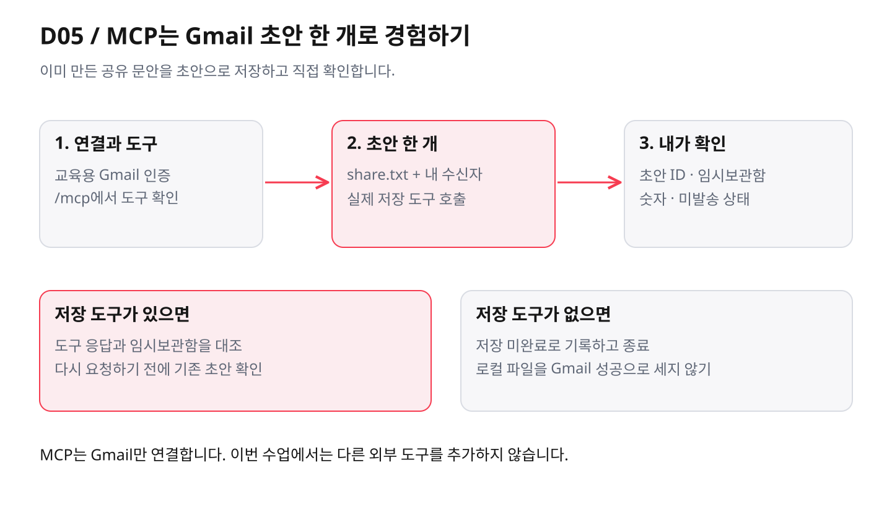

**D05 · MCP는 Gmail 초안 한 개로 경험하기**
연결 확인 → 초안 저장 → 사람 확인. 발송하지 않습니다. · 직접 그린 설명 도식이며 실제 제품 화면이 아닙니다. 이미지를 눌러 확대할 수 있습니다.

**도식 내용을 글로 읽기**

- 교육용 Gmail을 연결하고 같은 Claude 계정의 Terminal에서 /mcp로 실제 도구를 확인합니다.

- 보고서 share.txt와 교육용 수신자로 초안 한 개만 저장합니다. 메일함 전체 검색과 발송은 하지 않습니다.

- 실제 도구 응답의 초안 ID와 Gmail 임시보관함을 확인합니다. 저장 도구가 없으면 미완료로 끝냅니다.

## 22. 실행 카드로 혼자 다시 실행

오후 · 개인 실습 · Module 3

**앞 단계에서 이어서:** 앱과 감시 실행을 마쳤습니다. 추가 기능을 만들지 않고 내 업무 실행 카드만으로 같은 내 입력의 보고서를 한 번 다시 만듭니다.

### 1. 실행 카드만 보고 다시 해 보기

- 기존 Claude 세션과 작업 메모를 닫습니다.

- notes/내업무_실행카드.txt만 열고 카드의 자연어 실행 요청을 Claude Code 안에 붙입니다. 입력은 같은 workbooks/내업무비용.xlsx입니다. 결과는 같은 output/my-work에 저장됩니다. 건수·합계·검사 상태를 카드와 대조합니다.

- 앞에서 만든 스크립트의 실행만 맡깁니다. 새 코드나 보고서 양식을 만들라고 요청하지 않습니다.

**열어서 확인:** 내 카드에 적은 결과 파일

**성공 기준:** 먼저 **카드만 보고** 입력·기준·결과·오류 확인 순서를 따라봅니다. 막히면 그 지점을 적고 도움을 받아 카드를 보완합니다.

### 2. 빠진 안내 고치기

- 멈춘 지점·오래 걸린 설명을 한 곳 기록합니다.

- 카드를 고쳐 같은 동작을 다시 확인합니다.

## 23. 내 작품 확인과 짧은 시연

오후 · 개인 실습 · Module 3

**앞 단계에서 이어서:** 새 파일을 만들지 않습니다. 이미 만든 작품에서 **입력·실행·결과·검사 근거가 연결**되는지 확인하고 짧은 시연을 기록합니다.

### 1. 내 결과 묶음 정리

- 체크리스트·비용 보고서·로그인 기반 앱 보고서·도구·Skill·카드·검증 로그를 모읍니다.

- 팀·로그인 기반 앱은 실제 **성공·실패·미확인**, 자동 반복은 generated·skip·error·종료를 구분합니다.

### 2. 짧은 시연을 혼자 기록

- 어떤 반복 업무인지 적습니다.

- 입력·내 기준·실제 명령을 보여 줍니다.

- 결과 숫자·이번 앱 실행 상태·자동 반복 로그·미확인을 보여 줍니다.

- 다음 주에 다시 쓸 방법을 설명합니다.

- 개인 기록 또는 화면 녹화로 남깁니다. 전체 발표는 운영진이 정한 대표만 진행합니다.

- [ ] 결과 파일과 재사용 절차를 모았다.

- [ ] 개인 기준·3명 팀·로그인 앱·자동화 확인 기록을 남겼다.

Module 3 시연은 내 입력 → 스크립트 실행 → 결과 확인 → 규칙·Skill·담당자 활용 → Gmail 초안 확인을 연결합니다. 내 기준과 다음 사용 방법을 실행 카드로 보여 줍니다.

## 24. 제출하고 다음 사용 정하기

오후 · 개인 실습 · Module 3

### 처음 적은 내 업무 · 다시 써 볼까요?

오늘 만든 것 중 무엇을 이 업무에 다시 쓸 수 있나요? 다음에 넣을 자료와 실행할 절차를 한 가지 정해 아래 결과 메모에 적습니다.

**앞 단계에서 이어서:** 작품 확인과 시연은 끝났습니다. **실행 중인 감시를 종료**하고 제출·다음 사용 날짜만 정합니다.

notes/내업무_실습기록.md를 저장해 제출합니다.

## 막혔을 때, 여기서 합류합니다

선택 참고 · 수료 후

### 막힌 단계 하나만 확인합니다

| 증상 | 내가 확인할 것 |
| --- | --- |
| 파일이 안 보임 | 파일 탐색기 또는 Finder에서 실습 폴더와 경로 확인 |
| 명령이 안 됨 | 요청을 Claude Code 안에 붙였는지 |
| 보고서 숫자가 예상과 다름 | 이번 검사 상태·실제로 읽은 입력 경로·필수 열·내 기준 |
| Gmail 초안이 없음 | 초안 저장 도구·이번 도구 응답·임시보관함 |

계속 막히면 아래 오류 텍스트의 빈칸만 채워 한 번 요청합니다. **원본과 정상 결과를 보존**합니다.

[텍스트 내려받기 · 10_Claude_오류하나수정.txt](templates/복붙텍스트/10_Claude_오류하나수정.txt)

P107 · Claude Code 안 · 막힌 오류 하나만

```text
- 현재 단계: [지금 하는 실습]
- 대상 파일 또는 실행 명령: [실제 파일명이나 명령]
- 마지막 오류: [오류 1~3줄]
- 이미 확인한 것: [직접 확인한 결과]
- 이 오류의 원인 한 가지부터 확인하고 필요한 부분만 고쳐줘.
- 정상 결과와 원본은 보존하고, 실제 재검사 결과와 미확인을 4줄 이내로 알려줘.
```

**왜 이렇게 요청하나요?**

- **지킬 기준**: 바꿔도 되는 범위와 그대로 둘 것을 정해 불필요한 작업을 줄입니다.

- **확인 방법**: 완료했다는 말보다 실제 확인한 결과와 확인하지 못한 것을 받습니다.

제공 합류 파일로 다음 단계를 연습할 수 있습니다. 직접 만들지 못한 부분과 미확인을 개인 기록에 적습니다. 실제 브라우저 검사는 사람이 마치며 Playwright/E2E는 후반 소개만 합니다.

## 부탁하는 말과 내 작업 환경

첫 도구와 내 업무 정하기에서는 먼저 메타프롬프트로 요청 초안을 받습니다. 입력·결과·확인 방법을 읽고, 제공 요청과 중복 실행하지 않습니다. 각 요청 옆 이유 설명을 참고합니다. 내 업무는 평소 말로 한 문단, 처음에는 작업 하나만 정합니다. CLAUDE.md는 사용자 공통과 프로젝트용을 인터뷰로 나누고 초안을 확인한 뒤 기존 내용을 보존해 합칩니다. 팀은 비용/회의/고객 후속관리 중 하나만 고릅니다. 강사는 비용 보고 팀을 예시로 진행합니다. 대안 팀은 제공 역할을 복사하고 실제 세 이름의 위임 기록과 결과를 확인합니다.
